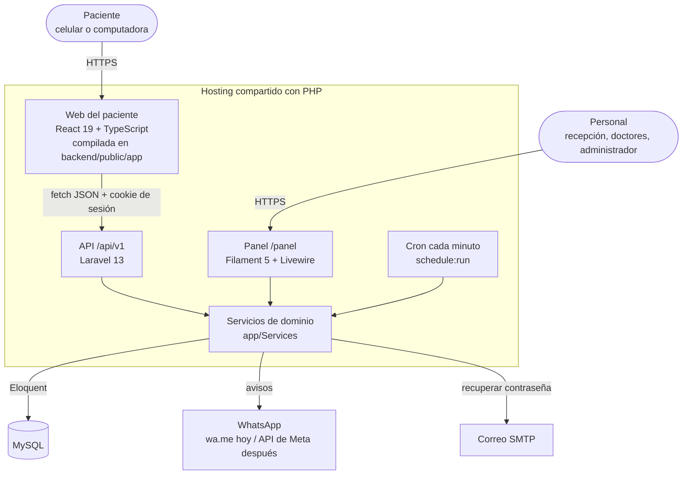

# Resumen ejecutivo

Este documento reúne el análisis previo obligatorio (sección 0 del prompt CE02) y el diagnóstico de la FASE 0 frente a la rúbrica oficial de la EPE. Todas las cifras se midieron el 18/11/2026 sobre el repositorio `venga-implantes` (commit `b91fdee`), sin cambiar código.

1. El sistema React + PHP vive en `venga-implantes`: `frontend/` con React 19 + TypeScript + Vite y `backend/` con Laravel 13, Filament 5 y MySQL.
2. La web del paciente es React y consume una API `/api/v1` de 36 rutas con sesión de Laravel en el mismo dominio; el panel interno sigue en Filament (PHP).
3. El backend es un monolito modular con 67 clases de servicio en 12 módulos, 35 políticas, 40 enums y 58 modelos sobre 68 tablas.
4. Pruebas: backend 1 037 pruebas en verde; frontend 126 en verde; lint, tipos, formato y build sin errores.
5. CI en GitHub Actions para ambos lados y paquete para el hosting; no hay despliegue automático, cobertura ni análisis estático.
6. No hay vistas, procedimientos, funciones ni triggers en la base: es la mayor brecha del E2.
7. CE0233 y CE0234 ya tienen evidencia real; falta la documentación OpenAPI y la evidencia de despliegue.
8. No hay servicio distribuido (CE0235) ni app móvil (CE0236).
9. No hay contradicciones que impidan seguir: el frontend y el backend existen, la base está definida y el sistema compila y pasa sus pruebas.
10. Decisiones del estudiante (18/11/2026): el repositorio de la EPE es `venga-implantes`, sí se hace la app móvil, el despliegue es en Microsoft Azure y el equipo lo forman Fran Franklin Calizaya Apaza, Jhoel Hairton Apaza Quispe y Joselyn Yucra Mamani (ciclo 10). Faltan la sección y el número de grupo.
11. Cambio del 19/11/2026: el equipo decidió **no** hacer la app móvil ni el servicio de IA, y que el área CE01 (Gestión de TI) no forma parte de esta evaluación porque ya se presentó. Se agregaron al sistema la consulta de DNI en RENIEC (por Decolecta) y los feriados de Nager.Date. Donde este análisis habla de la app o del servicio de IA, vale como el plan del 18/11/2026.

Frente a la rúbrica, de las 18 evidencias de CE02 hay 1 cubierta en código (CE0233), 9 parciales, 6 que faltan (una de ellas, la app móvil, es opcional) y 2 que no aplican (consola y escritorio). El código está más avanzado que la documentación: la mayor parte del trabajo que sigue es documentar y medir lo que ya existe, y los cambios de código se concentran en la base de datos (E2), la documentación de la API y el servicio distribuido (E3), y la cobertura, el despliegue y el monitoreo (E4).

# Análisis previo del proyecto

> Documento de trabajo. Todas las cifras salen de comandos ejecutados el 18/11/2026 sobre el commit `b91fdee` de `main` (ver "Cómo se midió" al final del apartado "Cómo se ejecuta y se despliega"). Lo que no se pudo medir queda como `[PENDIENTE]`.

## Dónde está el proyecto

El estudiante indica que el sistema está hecho con **React (frontend) y PHP (backend)**. Al recorrer los repositorios y la carpeta del proyecto en la computadora del estudiante se encontraron dos repositorios relacionados:

*Tabla 1. Repositorios encontrados.*

| Repositorio | Qué contiene | Estado |
| --- | --- | --- |
| `francalizaya266-sudo/venga-implantes` | `backend/` (Laravel 13: API `/api/v1`, panel interno con Filament, lógica, base de datos y pruebas) y `frontend/` (React 19 + TypeScript: la web del paciente). | **Versión vigente.** Creado el 18/11/2026 a partir del anterior; su `main` trae los mismos cambios (275 commits, 97 PR integrados) más la separación en backend y frontend. |
| `francalizaya266-sudo/consultorio-dental` | El mismo sistema como un solo Laravel, con la web pública en Blade + Livewire y sin React. | Versión anterior. Es donde se trabajaron los PR #1 a #98 (fuente para reconstruir los sprints del E4). |

En la computadora del estudiante, la carpeta de trabajo contiene las dos copias (`consultorio-dental` y `venga-implantes`, esta última con `backend/` y `frontend/`).

**Conclusión:** el proyecto "React + PHP" es `venga-implantes`. Los entregables CE02 describen y evidencian ese repositorio; el estudiante lo confirmó el 18/11/2026.

## Stack real

*Tabla 2. Stack real medido en el código.*

| Capa | Tecnología medida | Evidencia |
| --- | --- | --- |
| Frontend | React 19.3.1, TypeScript 6.0.3, Vite 8.3.8 | `frontend/package.json`, `node_modules/*/package.json` |
| Enrutador | React Router 8.5.1 (`createBrowserRouter`), 17 rutas + página 404 | `frontend/src/app/router.tsx` |
| Estado y datos | TanStack Query 5.108.0 (consultas con caché) | `frontend/src/api/queries.ts` |
| Consumo del backend | `fetch` nativo con `credentials: 'same-origin'`, sin axios | `frontend/src/api/client.ts` |
| Librería de UI | Ninguna: componentes propios y CSS escrito a mano (1 625 líneas) | `frontend/src/components/`, `frontend/src/styles/site.css` |
| Autenticación de la web | Cookie de sesión de Laravel + "celular recordado" (dispositivo recordado) + enlace personal por WhatsApp; las acciones `POST` llevan `X-XSRF-TOKEN`. Sin tokens ni CORS (mismo dominio). | `backend/routes/api.php`, `backend/app/Services/Access/` |
| Pruebas del frontend | Vitest 5.1.0 + Testing Library 16.3.3 + jsdom, API simulada | `frontend/src/test/`, `*.test.tsx` |
| Calidad del frontend | ESLint 10.15.0, Prettier 3.10.1, `tsc --noEmit` | `frontend/eslint.config.js`, scripts de `package.json` |
| Backend | Laravel 13.38.0 sobre PHP ^8.3 (probado con PHP 8.3.6) | `backend/composer.lock` |
| Panel interno | Filament 5.10.3 (con Livewire 4.4.8): pantallas armadas desde PHP, no React | `backend/app/Filament/`, `backend/app/Providers/Filament/AdminPanelProvider.php` |
| Estructura del backend | Monolito modular: controladores y pantallas delgados que llaman a servicios (`app/Services/*`), políticas de acceso (`app/Policies`), estados como enums (`app/Enums`), API versionada con Form Requests y API Resources | `backend/app/` |
| Acceso a datos | Eloquent (ORM de Laravel); 58 modelos | `backend/app/Models/` |
| Pruebas del backend | PHPUnit 12.5.40 (`php artisan test`); SQLite en memoria | `backend/phpunit.xml`, `backend/tests/` |
| Formato del backend | Laravel Pint 1.32.1 | `vendor/bin/pint --test` |
| Base de datos | MySQL en producción (README: copia restaurada probada sobre MariaDB 10.11); SQLite en memoria en las pruebas | `backend/config/database.php`, `README.md` |
| Migraciones y datos | 49 migraciones que crean 68 tablas; seeders `CatalogSeeder` (catálogos para producción) y `DemoSeeder` (11 meses de datos de demostración) | `backend/database/` |
| Integraciones | WhatsApp en dos etapas (`click_to_chat` con enlace wa.me hoy; `cloud_api` de Meta después); correo SMTP para recuperar contraseñas. Sin pasarela de pagos (pagos solo informativos). Sin servicio de IA. | `backend/app/Services/WhatsApp/`, `backend/config/services.php` |
| CI | GitHub Actions `.github/workflows/tests.yml`: backend (Pint + pruebas), frontend (Prettier, ESLint, Vitest, compilación) y, en `main`, el paquete `consultorio-para-hosting` | `.github/workflows/tests.yml` |
| Despliegue | Hosting compartido con PHP, sin Node en producción (la web se sube compilada en `backend/public/app`) y un solo cron cada minuto. Sin despliegue automático. | `README.md` |

**Variables de entorno requeridas (solo nombres, nunca valores):**

- Aplicación: `APP_*`, `SESSION_*`, `QUEUE_CONNECTION`, `CACHE_STORE`.
- Base de datos: `DB_CONNECTION`, `DB_HOST`, `DB_PORT`, `DB_DATABASE`, `DB_USERNAME`, `DB_PASSWORD`.
- Correo: `MAIL_MAILER`, `MAIL_SCHEME`, `MAIL_HOST`, `MAIL_PORT`, `MAIL_USERNAME`, `MAIL_PASSWORD`, `MAIL_FROM_ADDRESS`.
- WhatsApp: `CLINIC_WHATSAPP`, `WHATSAPP_DRIVER`, `WHATSAPP_CLOUD_TOKEN`, `WHATSAPP_PHONE_NUMBER_ID`, `WHATSAPP_API_VERSION`.
- Avisos y copias: `REMINDERS_AT`, `FLAG_UNCONFIRMED_AT`, `INSTALLMENT_REMINDER_DAYS`, `BACKUPS_KEEP`, `BACKUPS_FILES_PART_MB`.

## Arquitectura actual

<!-- figura: 00-diagramas/contenedores-actual.png -->

*Figura 1. Contenedores del sistema tal como están hoy en `venga-implantes`.*

Puntos clave:

- **Un solo dominio.** Laravel entrega el documento de cada página (`SpaController` + `SpaDocument`) con su título, su descripción y los datos para Google ya escritos, y carga el build de React. Desde ahí React navega sin recargar y pide los datos a `/api/v1`.
- **El panel interno sigue en PHP.** Las 29 secciones del panel (agenda, pacientes, historia clínica con odontograma, caja, inventario, reportes, configuración) están hechas con Filament. React solo cubre la web del paciente.
- **Toda escritura pasa por los servicios.** La API, el panel y el cron llaman a `app/Services/*`; las reglas del negocio no viven en las pantallas.

## Módulos y funcionalidades

*Tabla 3. Módulos funcionales y su ubicación.*

| Módulo | Qué hace | Dónde está |
| --- | --- | --- |
| Web pública | Inicio con el próximo horario libre, tratamientos con precio "desde", promociones, equipo, antes y después, opiniones, preguntas frecuentes, contacto y privacidad | `frontend/src/pages/`, `backend/app/Http/Controllers/Api/V1/Site/`, `backend/app/Services/Web/` (9 clases) |
| Reserva en 3 pasos | Elegir tratamiento, día y hora libres, y datos del paciente; la cita queda pendiente hasta confirmarla por WhatsApp | `frontend/src/pages/booking/`, `Api/V1/Booking/BookingController.php`, `app/Services/Booking/` (9 clases) |
| Mi cuenta y enlace por WhatsApp | Ver, confirmar, cancelar y cambiar citas; familias bajo un mismo celular; salud antes de la cita | `frontend/src/pages/account/`, `link/`, `change/`; `Api/V1/Account/`; `app/Services/Access/` (3 clases) |
| Agenda inteligente | Horarios donde cabe la duración completa más la esterilización, huecos, bloqueos, duraciones aprendidas | `app/Services/Agenda/` (5 clases), `app/Filament/Pages/Agenda.php` |
| Historia clínica | Atención, odontograma, plan de tratamiento firmado, recetas, radiografías y fotos, consentimientos | `app/Services/Clinical/` (12 clases), `app/Livewire/OdontogramChart.php`, `public/js/odontogram.js` |
| Caja y cobros | Cargos al terminar la atención, pagos informativos, anulaciones con motivo, cierre de caja, cuotas | `app/Services/Billing/` (3 clases), `app/Filament/Pages/CashClosing.php` |
| Inventario | Materiales, lotes, recetas por tratamiento, pedidos, conteo del mes | `app/Services/Inventory/` (4 clases) |
| Pacientes | Registro, ficha, saldos, seguimiento | `app/Services/Patients/` (2 clases), `app/Filament/Resources/Patients/` |
| Avisos de WhatsApp | Bandeja de avisos, recordatorios, campañas | `app/Services/WhatsApp/` (3 clases) |
| Reportes y resumen | Ganancias, dinero por cobrar, actividad, campañas; Excel e impresión | `app/Services/Reports/` (7 clases), `app/Services/Dashboard/` (6 clases) |
| Copias de seguridad | Copia diaria `.sql.gz`, restauración, archivos en `.zip` | `app/Services/Backup/` (3 clases), comandos `respaldo:crear` y `respaldo:restaurar` |
| Auditoría | Historial de cambios de 40 modelos (`Concerns/Auditable`) | `app/Models/Concerns/Auditable.php`, tabla `audit_logs` |

## Endpoints de la API

`backend/routes/api.php`, prefijo `/api/v1`. Total: **36 rutas** (`php artisan route:list --path=api`).

*Tabla 4. Rutas de la API `/api/v1` por grupo.*

| Grupo | Rutas | Método y ruta | Protección |
| --- | ---: | --- | --- |
| Contenido | 12 | `GET site`, `home`, `treatments`, `treatments/{slug}`, `promotions`, `promotions/{slug}`, `team`, `cases`, `reviews`, `faqs`, `pages/contact`, `pages/privacy` | Pública |
| Reserva | 5 | `GET booking/options`, `booking/days`, `booking/slots`; `POST booking/appointments`; `POST booking/appointments/{appointment}/origin` | `origin`: firma relativa + `throttle:30,1` |
| Mi cuenta | 12 | `GET account`; `POST account/access`, `account/verification`, `account/logout`; confirmar, cancelar y cambiar cita; pedir la siguiente sesión; ver y guardar la salud del paciente | `throttle:patient-api` (240/min por IP) + celular recordado |
| Enlace por WhatsApp | 7 | `GET links/{token}`; `POST confirm`, `cancel`, `enter`; `GET change`, `change/slots`; `POST change` | Token de 32 caracteres + `throttle:patient-api` |

Validación con 3 Form Requests (`StoreBookingRequest`, `ChangeAppointmentRequest`, `StoreHealthRequest`) y respuestas con 10 API Resources (`app/Http/Resources/V1`). Errores: `422` con `errors` por campo, `409` con `code` (por ejemplo `slot_taken`), `403`, `404` y `429`. **No hay documentación OpenAPI.**

## Modelo de datos

*Tabla 5. Cifras del modelo de datos.*

| Elemento | Cantidad | Evidencia |
| --- | ---: | --- |
| Migraciones | 49 | `backend/database/migrations/` |
| Tablas creadas | 68 (de ellas 9 son de Laravel: `users`, `password_reset_tokens`, `sessions`, `cache`, `cache_locks`, `jobs`, `job_batches`, `failed_jobs`, `notifications`) | `Schema::create` en las migraciones |
| Modelos Eloquent | 58 | `backend/app/Models/` |
| Llaves foráneas | 143 | `constrained()` / `foreign()` en las migraciones |
| Índices declarados | 39 simples + 24 únicos | `index()` / `unique()` en las migraciones |
| Modelos con historial de cambios | 40 | `use Auditable` |
| Modelos con borrado lógico | 15 | `SoftDeletes` |
| Vistas, funciones, procedimientos y triggers en la base | 0 | ninguna migración usa `DB::statement` ni `CREATE VIEW/TRIGGER/PROCEDURE` |

Comprobación: `php artisan migrate` sobre una base SQLite vacía deja **69 tablas**, las 68 de las migraciones más `migrations`, la tabla de control de Laravel.

## Roles y permisos

*Tabla 6. Roles y permisos.*

| Rol | Cómo entra | Qué puede |
| --- | --- | --- |
| Administrador (`UserRole::Admin`) | Panel con correo y contraseña | Todo el panel, configuración, web, reportes de ganancias. Ve datos clínicos solo si además es odontólogo (`is_dentist`), por la Ley N.º 29733. |
| Recepción (`UserRole::Reception`) | Panel con correo y contraseña | Agenda, pacientes (sin historia clínica), cobros, avisos de WhatsApp. No ve ganancias. |
| Doctor (`UserRole::Doctor`) | Panel con correo y contraseña | Su propia agenda, historia clínica y odontograma. No maneja dinero; ve sus ganancias solo si se activa en Ajustes. |
| Paciente (sin usuario) | Web: celular recordado o enlace personal por WhatsApp, sin contraseña | Reservar, ver y cambiar sus citas y las de su familia. |

35 políticas en `backend/app/Policies` controlan el acceso en el panel y la API.

## Estado de las pruebas y la calidad

*Tabla 7. Estado de las pruebas y la calidad.*

| Dónde | Comando | Resultado medido |
| --- | --- | --- |
| Backend | `php artisan test` | **1 037 pruebas, 8 887 verificaciones, todas pasan** (2 min 39 s) |
| Backend | `vendor/bin/pint --test` | Sin diferencias (`passed`) |
| Frontend | `npm test` (Vitest) | **126 pruebas en 16 archivos, todas pasan** (7,24 s) |
| Frontend | `npm run lint` | Sin errores |
| Frontend | `npm run typecheck` | Sin errores |
| Frontend | `npm run format:check` | Todo con el formato de Prettier |
| Frontend | `npm run build` | Compila: un solo archivo JS de 458,87 kB (138,55 kB comprimido) y CSS de 82,94 kB (17,97 kB comprimido) |

No hay reporte de cobertura en ninguno de los dos lados (el workflow usa `coverage: none` y el frontend no tiene `@vitest/coverage-v8`).

## Cómo se ejecuta y se despliega

- **Local:** `cd backend && composer install && cp .env.example .env && php artisan key:generate && php artisan migrate --seed`, luego `npm --prefix ../frontend install` y `composer dev` (Laravel en `http://localhost:8000` con el servidor de Vite). Usuarios de demostración: `admin@consultorio.test` y `recepcion@consultorio.test`.
- **Producción:** hosting compartido. La raíz pública apunta a `backend/public`, `composer install --no-dev`, `php artisan migrate --force`, `php artisan db:seed --class=CatalogSeeder --force` y un cron cada minuto con `schedule:run`. El paquete `consultorio-para-hosting` de GitHub Actions trae `backend/` con la web ya compilada.
- **Tareas programadas** (`backend/routes/console.php`, 10 según `php artisan schedule:list`): recordatorios y citas sin confirmar (cada 15 min), cuotas (06:00 y cada 15 min), lista de espera (cada 5 min), envío de WhatsApp (cada 5 min), cola (cada minuto), `model:prune` (diario), duraciones aprendidas (02:30) y copia de seguridad (03:00).
- **Verificación de salud:** ruta `/up` de Laravel (`backend/bootstrap/app.php`).
- **URL de producción:** el despliegue será en Microsoft Azure. `[PENDIENTE – estudiante: URL cuando exista]`.

**Cómo se midió:** clon de `main` en `b91fdee`; `composer install` desde `composer.lock`; `npm ci`; los comandos de la tabla de pruebas; conteos con `find`/`grep` sobre `backend/app`, `backend/database`, `backend/tests` y `frontend/src`; `php artisan route:list`. PHP 8.3.6 y Node 22.23.5.

## Diferencias con la sección 2 del prompt

*Tabla 8. Diferencias entre el prompt y el código.*

| El prompt dice | Lo que hay en el código | Efecto en el plan |
| --- | --- | --- |
| Repositorio `consultorio-dental` | El sistema React + PHP está en `venga-implantes` (`backend/` + `frontend/`). | Los entregables se escriben sobre `venga-implantes`. |
| "Blade + Livewire para la web pública" | La web pública es **React 19 + TypeScript**; la de Blade y Livewire se retiró (commit `46395b0`). Livewire solo queda en el panel (odontograma y pulso del panel). | La arquitectura (E1 y E3) se describe como SPA React + API Laravel + panel Filament. |
| "React y PHP" (sección 0) | Cierto para la web del paciente. El **panel interno no es React**: son 29 recursos y 18 páginas de Filament armadas desde PHP. | Los documentos deben decirlo así para no exagerar el alcance de React ante el jurado. |
| FASE 3: "API REST `/api/v1` con Sanctum" | La API `/api/v1` **ya existe** (36 rutas, Form Requests, API Resources, límite de peticiones y pruebas). Usa la sesión de Laravel en el mismo dominio, no Sanctum. | CE0234 ya tiene evidencia; en FASE 3 solo se completa (OpenAPI, pruebas faltantes por ruta). Sanctum solo haría falta si hay un cliente externo (app móvil o servicio). |
| "Suite de pruebas grande" | Backend: 1 037 pruebas en verde. Frontend: 126 pruebas. | Las pruebas del frontend se suman al E4. |
| `.github/workflows/tests.yml` con Pint + `php artisan test` | Además prueba el frontend (Prettier, ESLint, Vitest, build) y arma el paquete para el hosting. No despliega. | El pipeline ya cubre integración continua; falta despliegue, cobertura y análisis estático. |
| Copia restaurada con "66 tablas" (README) | Las migraciones crean 68 tablas. | El dato del README es de una versión anterior; se usa el valor medido. |
| Historial para los sprints | `venga-implantes` tiene 275 commits (22/10/2026 a 18/11/2026) y 97 PR integrados, todos a nombre del estudiante; los PR #1 a #98 se trabajaron en `consultorio-dental`, donde los commits originales registran coautoría de un asistente de IA. | Los sprints del E4 se reconstruyen con las fechas reales de esos PR. Conviene declarar el uso de IA como herramienta de desarrollo en el E4 y en la sustentación (la FASE 5 ya prevé esa pregunta). |

## Ajustes al plan por fase

*Tabla 9. Ajustes al plan por fase.*

| Fase | Ajuste |
| --- | --- |
| FASE 1 (E1) | C4 con tres contenedores (SPA React, API Laravel, panel Filament) más MySQL, cron y WhatsApp, la app móvil y el servicio de IA como contenedores planificados, y la vista de despliegue en Azure. ADR nuevo: separar la web del paciente en React con API `/api/v1` y mantener el panel en Filament. Prototipo navegable: el sistema con datos de demostración más las capturas ya guardadas en el proyecto. |
| FASE 2 (E2) | Sin cambios de fondo: la base es la misma. Las vistas, funciones, procedimientos y el trigger se agregan solo para MySQL, como dice el prompt. |
| FASE 3 (E3) | **No se crea una API nueva.** Se documenta la existente y se completa: OpenAPI, pruebas por ruta que falten, pruebas de componentes React. Se suman el servicio de IA (CE0235) y la app móvil (CE0236), confirmada por el estudiante; la app necesita autenticación por token (Sanctum), porque no comparte la cookie de sesión de la web. |
| FASE 4 (E4) | Cobertura en los dos lados (pcov y `@vitest/coverage-v8`, que es una dependencia nueva y requiere aprobación), Larastan, despliegue y rollback. Los comandos de prueba son `php artisan test` en `backend/` y `npm test` en `frontend/`. |
| FASE 5 | Sin cambios. |
