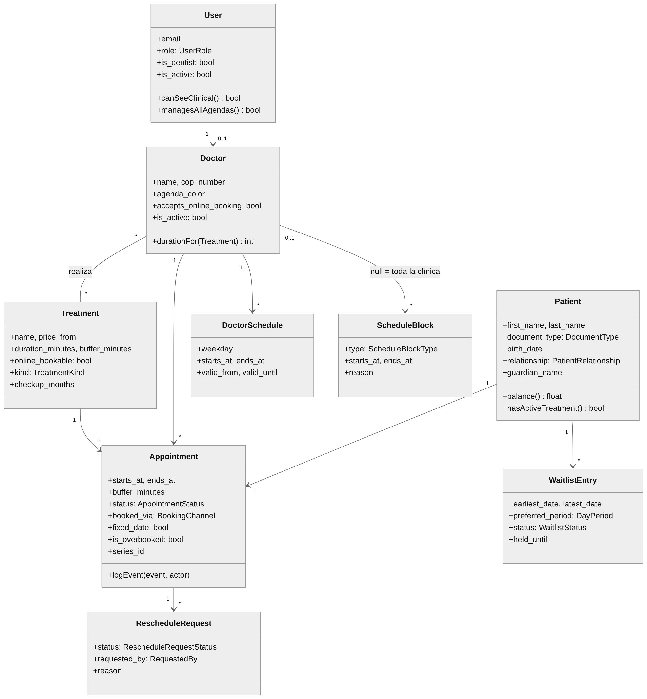
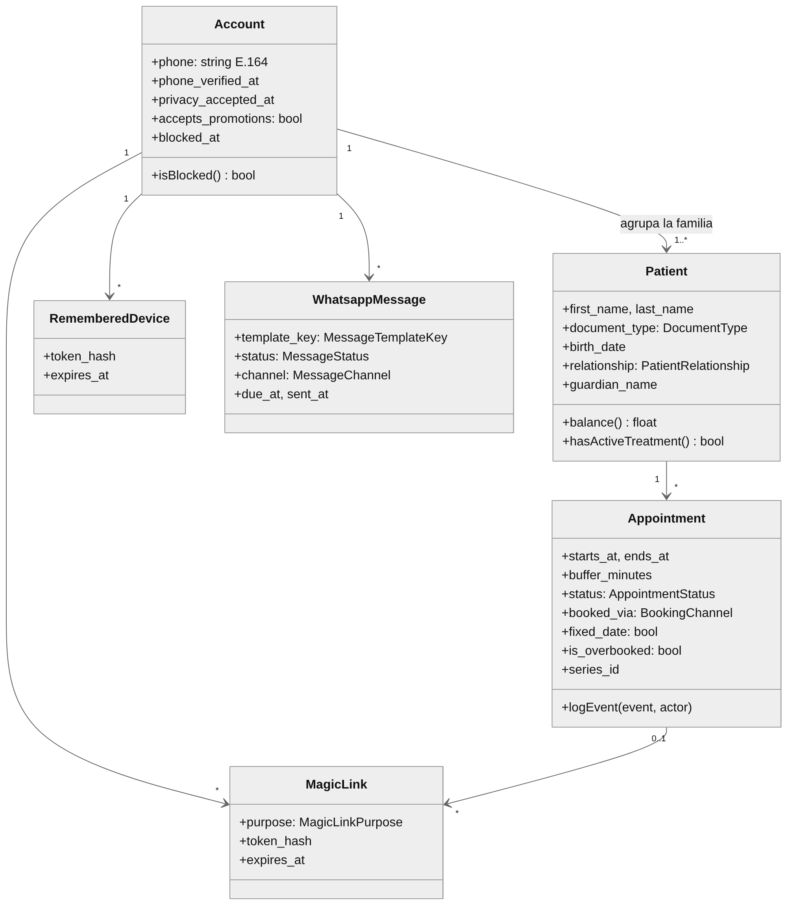
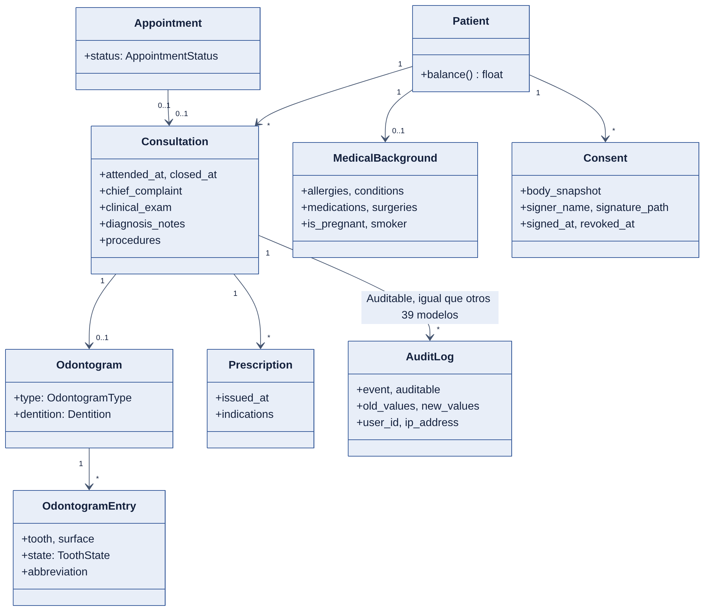
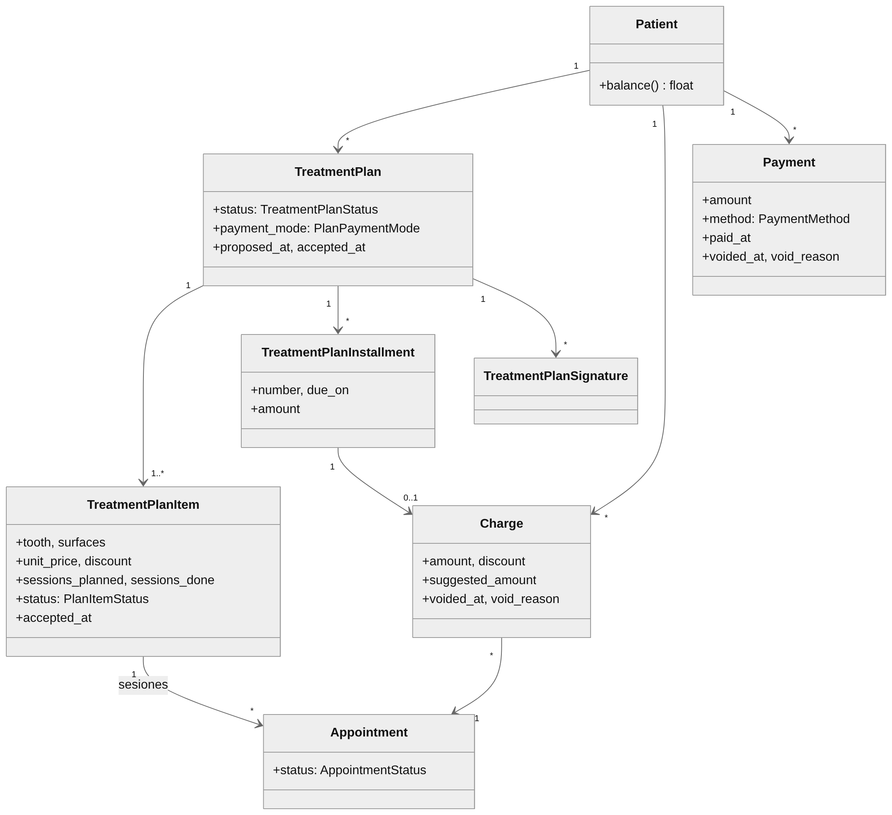

[[HORIZONTAL]]

# Anexo A. Matriz de trazabilidad

La matriz une cada requerimiento funcional de la tabla 2 con su historia de usuario (tabla 5), su caso de uso (figuras 16 y 17), el componente del diagrama C3 que lo atiende (figuras 14 y 15), el archivo principal del código y la prueba automatizada que lo comprueba. Las rutas que empiezan con `app/`, `config/` o `routes/` están en `backend/`; las que empiezan con `src/`, en `frontend/`. Las pruebas del backend se citan como `Clase::método` (PHPUnit, en `backend/tests`) y las del frontend como archivo y nombre de la prueba (Vitest). Un guion (—) en la columna HU indica que el requerimiento no tiene una historia propia en la tabla 5.

La matriz se comprueba con `python3 docs/entregables/CE02-ingenieria-de-software/verificar-trazabilidad.py`, que revisa que cada requerimiento de la tabla 2 esté una sola vez, que cada historia tenga los mismos requerimientos que en la tabla 5, que los 20 casos de uso estén cubiertos y que cada archivo y cada prueba citados existan en el repositorio. La ejecución del 19/11/2026 encontró los 87 requerimientos, 164 pruebas distintas en 88 archivos de prueba y 112 archivos del código, todos presentes.

*Tabla A1. Matriz de trazabilidad RF → historia → caso de uso → componente → archivo → prueba automatizada.*

| RF | HU | CU | Componente (C3) | Archivo | Prueba automatizada |
| --- | --- | --- | --- | --- | --- |
| RF-WEB-01 | — | CU-01 | API v1 → Web | `app/Services/Web/OpeningHours.php` | `OpeningHoursTest::test_the_clinic_hours_come_from_the_active_doctors_schedules`; `OpeningHoursTest::test_says_whether_it_is_open_now_and_when_it_opens` |
| RF-WEB-02 | — | CU-01 | API v1; pages/ públicas | `app/Http/Controllers/Api/V1/Site/TreatmentController.php`; `src/pages/TreatmentPage.tsx` | `SiteContentTest::test_hidden_or_inactive_treatments_have_no_page` |
| RF-WEB-03 | — | CU-01 | API v1; pages/ públicas | `app/Http/Controllers/Api/V1/Site/TeamController.php`; `app/Http/Controllers/Api/V1/Site/SmileCaseController.php` | `SiteContentTest::test_the_team_lists_the_public_doctors_with_what_they_attend`; `WebContentPanelTest::test_a_before_and_after_case_needs_the_patients_written_consent` |
| RF-WEB-04 | — | CU-01, CU-02 | API v1 → Booking | `app/Http/Controllers/Api/V1/Site/PromotionController.php` | `SiteContentTest::test_a_campaign_shows_its_price_on_the_treatment_and_the_promotion_and_books_with_it`; `BookingControllerTest::test_a_promo_code_that_does_not_exist_stops_the_booking_and_a_valid_one_is_applied` |
| RF-WEB-05 | — | CU-01 | SpaController → Web | `app/Services/Web/StructuredData.php`; `app/Http/Controllers/Site/SitemapController.php` | `SpaControllerTest::test_a_page_opens_with_what_google_reads_and_the_data_the_frontend_would_ask_the_api_for`; `SitemapControllerTest::test_the_sitemap_lists_public_pages_and_robots_keeps_private_ones_out` |
| RF-WEB-06 | — | CU-18 | Panel Filament → Web | `app/Filament/Pages/WebPages.php` | `WebPagesPanelTest::test_the_sheet_opens_with_the_texts_of_the_system_and_the_web_shows_what_is_saved` |
| RF-RES-01 | HU-01 | CU-02 | API v1 → Booking; pages/booking | `app/Http/Controllers/Api/V1/Booking/BookingController.php`; `src/pages/booking/BookingWizard.tsx` | `BookingControllerTest::test_the_first_step_offers_only_what_is_booked_online_with_its_price_and_duration`; `BookingPage.test.tsx`: “books an appointment in three steps” |
| RF-RES-02 | HU-01 | CU-02 | Booking → Agenda | `app/Services/Booking/WebAvailability.php`; `app/Services/Agenda/AvailabilityService.php` | `AvailabilityServiceTest::test_reserves_sterilization_time_after_existing_appointments`; `WebAvailabilityTest::test_shows_first_the_times_that_leave_no_useless_gaps` |
| RF-RES-03 | — | CU-02 | API v1 → Booking; pages/booking | `app/Http/Controllers/Api/V1/Booking/BookingController.php` | `BookingControllerTest::test_the_first_available_doctor_takes_the_time_and_a_chosen_doctor_only_offers_theirs`; `BookingPage.test.tsx`: “lets choose the doctor when several attend the treatment” |
| RF-RES-04 | HU-01 | CU-02 | Booking → WhatsApp, StaffAlerts | `app/Services/Booking/AppointmentService.php` | `AppointmentServiceTest::test_web_booking_is_reserved_instantly_and_creates_the_account_and_patient`; `AppointmentServiceTest::test_web_booking_prepares_the_confirmation_message_and_alerts_reception` |
| RF-RES-05 | — | CU-02 | Booking → Access | `app/Services/Booking/AppointmentService.php`; `app/Services/Access/DeviceService.php` | `BookingControllerTest::test_a_remembered_phone_books_for_the_family_without_typing_the_number`; `BookingPage.test.tsx`: “from a remembered phone it asks who the appointment is for, not the number” |
| RF-RES-06 | — | CU-02 | Controlador del sitio | `app/Http/Controllers/Site/AppointmentCalendarController.php`; `app/Support/CalendarEvent.php` | `AppointmentCalendarControllerTest::test_the_signed_address_gives_the_appointment_as_a_calendar_file` |
| RF-RES-07 | — | CU-02 | API v1 → Booking; pages/booking | `app/Http/Controllers/Api/V1/Booking/BookingController.php` | `BookingControllerTest::test_how_they_found_us_is_asked_once_after_booking`; `BookingPage.test.tsx`: “after booking, asks once how the patient heard about the clinic” |
| RF-CTA-01 | HU-02 | CU-03 | API v1 → Access, Booking; pages/link | `app/Http/Controllers/Api/V1/Account/LinkController.php`; `src/pages/link/LinkPage.tsx` | `LinkControllerTest::test_confirming_from_the_link_verifies_the_phone_and_remembers_the_device`; `LinkPage.test.tsx`: “cancels the appointment from the link” |
| RF-CTA-02 | HU-03 | CU-04 | Booking; pages/change | `app/Services/Booking/PatientChangePolicy.php`; `src/pages/change/ChangeAppointment.tsx` | `LinkControllerTest::test_more_than_a_day_ahead_the_patient_moves_the_appointment_at_once`; `LinkControllerTest::test_close_to_the_appointment_the_patient_proposes_up_to_three_times` |
| RF-CTA-03 | HU-04 | CU-05 | API v1 → Access; pages/account | `app/Http/Controllers/Api/V1/Account/AccountController.php`; `app/Services/Access/DeviceService.php` | `AccountControllerTest::test_a_remembered_device_sees_the_family_upcoming_appointments_but_not_personal_data`; `AccountPage.test.tsx`: “keeps the amounts and the personal data behind a verification by WhatsApp” |
| RF-CTA-04 | HU-04 | CU-05 | API v1 → Access | `app/Services/Access/MagicLinkService.php` | `AccountControllerTest::test_asking_for_access_leaves_one_link_ready_for_reception_without_revealing_numbers`; `AccountPage.test.tsx`: “asks for the link by WhatsApp and answers the same to everyone” |
| RF-CTA-05 | — | CU-06 | API v1; pages/account | `app/Http/Controllers/Api/V1/Account/HealthController.php`; `src/pages/account/HealthPage.tsx` | `HealthControllerTest::test_the_family_tells_the_doctor_about_their_health_once`; `HealthPage.test.tsx`: “sends the health history to the clinic and returns to Mi cuenta” |
| RF-CTA-06 | — | CU-05 | API v1 → StaffAlerts | `app/Http/Controllers/Api/V1/Account/AccountController.php` | `AccountControllerTest::test_asking_for_the_next_session_tells_reception_once_and_only_from_the_family_phone` |
| RF-CTA-07 | — | CU-05 | API v1 → Access; pages/account | `app/Services/Access/DeviceService.php` | `AccountControllerTest::test_leaving_forgets_this_device`; `AccountPage.test.tsx`: “forgets this phone when the patient leaves” |
| RF-CTA-08 | — | CU-02, CU-05 | API v1 → Booking, Access | `app/Http/Controllers/Api/V1/Booking/BookingController.php`; `app/Services/Access/DeviceService.php` | `BookingControllerTest::test_a_first_booking_with_a_new_number_enters_my_account_without_waiting_for_the_link`; `BookingControllerTest::test_a_number_the_clinic_already_has_is_not_remembered_without_its_link`; `LinkControllerTest::test_the_owner_of_the_number_using_its_link_on_another_phone_forgets_the_phones_that_never_used_one` |
| RF-AGE-01 | — | CU-07 | Panel Filament → Agenda | `app/Filament/Pages/Agenda.php` | `AgendaCalendarTest::test_reception_sees_every_doctor_on_the_day`; `AgendaCalendarTest::test_a_doctor_only_sees_their_own_agenda_and_starts_on_the_week` |
| RF-AGE-02 | HU-05 | CU-07 | Panel Filament → Booking | `app/Filament/Actions/CreateAppointmentAction.php`; `app/Services/Booking/AppointmentService.php` | `AgendaPanelTest::test_reception_books_a_free_slot_and_the_notice_is_prepared`; `AgendaCalendarTest::test_a_new_patient_is_registered_in_the_same_window_as_the_appointment` |
| RF-AGE-03 | HU-05 | CU-07 | Panel Filament → Booking | `app/Services/Booking/AppointmentService.php`; `app/Services/Booking/AppointmentChange.php` | `AgendaCalendarTest::test_dropping_an_appointment_moves_it_after_confirming`; `AppointmentServiceTest::test_a_clash_says_which_appointment_or_which_block_is_in_the_way` |
| RF-AGE-04 | HU-06 | CU-08 | Panel Filament → Booking | `app/Filament/Actions/AppointmentActions.php`; `app/Services/Booking/AppointmentService.php` | `AgendaPanelTest::test_the_day_buttons_move_an_appointment_through_its_states`; `UndoLastStepTest::test_after_a_day_there_is_nothing_left_to_undo` |
| RF-AGE-05 | — | CU-07 | Panel Filament → Agenda → Nager.Date | `app/Services/Agenda/BlockScheduler.php`; `app/Services/Agenda/HolidayCalendar.php`; `app/Support/PeruvianHolidays.php` | `AgendaToolsTest::test_a_block_can_repeat_the_same_hours_every_week`; `BlockSchedulerTest::test_loading_holidays_closes_those_whole_days_for_every_doctor`; `HolidayCalendarTest::test_it_adds_the_holidays_only_nager_date_has_and_keeps_the_names_the_system_uses`; `HolidayCalendarTest::test_when_nager_date_does_not_answer_it_is_the_system_list_and_it_tries_again_in_a_few_minutes` |
| RF-AGE-06 | — | CU-07 | Panel Filament | `app/Filament/Resources/Doctors/DoctorResource.php` | `DoctorSeasonAndAccessTest::test_a_range_of_the_schedule_can_be_valid_only_for_a_season`; `DoctorWeekScheduleTest::test_ranges_that_overlap_are_caught_as_the_hour_picker_writes_them` |
| RF-AGE-07 | — | CU-09 | Panel Filament → Agenda, Booking | `app/Services/Agenda/GapFinder.php`; `app/Services/Booking/WaitlistService.php` | `AgendaFindAndListTest::test_find_a_gap_offers_the_next_free_times_and_opens_the_appointment_ready`; `WaitlistServiceTest::test_an_offered_slot_is_held_for_that_patient_while_they_answer` |
| RF-AGE-08 | — | CU-07 | Panel Filament → Booking | `app/Services/Booking/AppointmentService.php` | `OverbookingTest::test_booking_over_another_appointment_only_passes_when_it_is_asked_as_an_overbooking`; `AppointmentSeriesTest::test_a_series_repeats_the_weekday_and_the_time_and_tells_the_patient_once` |
| RF-AGE-09 | — | CU-08 | Panel Filament → Booking | `app/Filament/Actions/WalkInAction.php` | `WalkInTest::test_who_comes_without_an_appointment_gets_todays_first_room_and_waits_in_the_room` |
| RF-AGE-10 | HU-03 | CU-09 | Panel Filament → Booking | `app/Services/Booking/RescheduleRequestService.php` | `RescheduleRequestServiceTest::test_approving_an_option_moves_the_appointment_and_notifies_the_patient`; `RescheduleRequestServiceTest::test_rejecting_keeps_the_original_time_and_tells_the_patient` |
| RF-AGE-11 | — | CU-20 | Comandos → Agenda | `app/Services/Agenda/LearnedDurations.php`; `app/Console/Commands/LearnDurations.php` | `LearnedDurationsTest::test_the_agenda_reserves_what_the_doctor_really_takes` |
| RF-AGE-12 | — | CU-07 | Panel Filament | `app/Http/Controllers/Reports/AgendaDayController.php` | `ClinicWeekAndPrintTest::test_the_day_sheet_lists_each_doctor_with_their_appointments_to_tick_by_hand` |
| RF-AGE-13 | — | CU-07 | Panel Filament → Agenda | `app/Filament/Actions/CreateAppointmentAction.php`; `app/Filament/Support/SlotPicker.php` | `EasierSchedulingTest::test_the_next_seven_days_are_buttons_that_say_how_many_free_times_each_has`; `EasierSchedulingTest::test_the_free_times_come_in_morning_and_afternoon_and_the_ones_that_leave_no_gaps_are_recommended`; `EasierSchedulingTest::test_the_most_booked_treatments_are_one_tap_away`; `EasierSchedulingTest::test_choosing_the_patient_brings_the_doctor_who_saw_them_last` |
| RF-PAC-01 | — | CU-10 | Panel Filament → Patients | `app/Services/Patients/PatientRegistrar.php` | `PatientRegistrationTest::test_patients_that_may_already_be_registered_are_found_by_document_name_and_phone`; `PatientRegistrationTest::test_documents_are_checked_by_type_and_saved_clean` |
| RF-PAC-02 | — | CU-10 | Panel Filament → Patients | `app/Services/Patients/PatientRegistrar.php`; `app/Filament/Resources/Accounts/AccountResource.php` | `PatientRegistrationTest::test_a_phone_has_one_holder_and_a_wrong_relationship_can_be_corrected`; `PatientRegistrationTest::test_a_minor_has_a_guardian_who_signs_for_them` |
| RF-PAC-03 | — | CU-10 | Panel Filament → Patients | `app/Filament/Resources/Patients/PatientResource.php`; `app/Services/Patients/PatientInsights.php` | `PatientsAndSetupPanelTest::test_the_patient_file_shows_one_timeline_and_the_medical_alert_only_to_who_attends`; `PatientNextStepTest::test_the_file_says_what_is_next_for_each_one_with_the_button_to_do_it` |
| RF-PAC-04 | — | CU-10 | Panel Filament → Dashboard | `app/Services/Dashboard/FollowUps.php` | `DashboardPanelTest::test_reception_sees_whom_to_follow_up_with_and_the_lists_count_the_same`; `DashboardPanelTest::test_regulars_who_leave_happy_are_asked_for_their_google_review_once_in_six_months` |
| RF-PAC-05 | — | CU-10 | Panel Filament | `app/Filament/Resources/Accounts/AccountActions.php` | `PatientsAndSetupPanelTest::test_reception_blocks_and_unblocks_web_bookings_for_a_phone`; `AppointmentServiceTest::test_rejects_web_booking_from_a_blocked_number` |
| RF-PAC-06 | — | CU-10 | Panel Filament → Patients → Decolecta | `app/Services/Patients/DniLookup.php`; `app/Filament/Resources/Patients/Schemas/PatientForm.php` | `DniLookupTest::test_the_magnifying_glass_fills_the_names_as_reniec_has_them`; `DniLookupTest::test_when_reniec_does_not_have_it_or_does_not_answer_the_names_stay_to_be_written`; `DniLookupTest::test_the_magnifying_glass_only_shows_for_a_dni_and_with_the_key_set` |
| RF-CLI-01 | HU-09 | CU-14 | Panel Filament → Clinical | `app/Services/Clinical/ConsultationService.php` | `ClinicalServicesTest::test_attending_an_appointment_opens_the_consultation_with_the_treatment_template_and_a_first_odontogram`; `ClinicalServicesTest::test_only_the_doctor_of_the_appointment_can_attend_it` |
| RF-CLI-02 | — | CU-14 | Panel Filament → Clinical | `app/Filament/Actions/EditMedicalBackgroundAction.php` | `ClinicalPanelTest::test_doctors_register_medical_background_and_alerts_show_up`; `ClinicalPanelTest::test_the_allergy_stays_next_to_the_name_and_a_related_medication_is_flagged` |
| RF-CLI-03 | — | CU-14 | Panel Filament → Clinical | `app/Livewire/OdontogramChart.php`; `app/Services/Clinical/FindingsDictation.php` | `ClinicalPanelTest::test_the_odontogram_marks_surfaces_only_for_the_doctor_writing`; `FindingsDictationTest::test_dictated_words_are_understood_like_the_doctor_says_them` |
| RF-CLI-04 | HU-11 | CU-14 | Clinical | `app/Services/Clinical/PrescriptionService.php`; `app/Services/Clinical/PediatricDose.php` | `PatientSafetyChecksTest::test_the_prescription_warns_by_age_pregnancy_illness_and_what_the_patient_takes`; `PatientSafetyChecksTest::test_a_child_dose_goes_by_weight_and_never_passes_an_adult_one` |
| RF-CLI-05 | — | CU-14 | Panel Filament → Clinical | `app/Services/Clinical/ConsentService.php`; `app/Filament/Actions/SignConsentAction.php` | `ClinicalFilesPanelTest::test_a_consent_is_signed_on_screen_printed_and_revoked`; `ClinicalFilesAndConsentsTest::test_a_parent_signs_for_a_child_and_the_signed_text_does_not_change_when_the_template_does` |
| RF-CLI-06 | — | CU-14 | Clinical; Policies | `app/Services/Clinical/ClinicalFileService.php`; `app/Http/Controllers/Clinical/ClinicalFileController.php` | `ClinicalFilesAndConsentsTest::test_images_are_compressed_with_a_thumbnail_and_documents_are_kept_as_they_are`; `ClinicalFilesAndConsentsTest::test_files_are_only_served_to_who_can_see_the_clinical_record` |
| RF-CLI-07 | HU-09 | CU-14 | Clinical → Billing, Inventory | `app/Services/Clinical/ConsultationService.php` | `VisitCloseOutTest::test_finishing_reviews_what_is_often_forgotten_then_tells_reception_to_collect_and_suggests_the_next_session`; `ClinicalServicesTest::test_closing_completes_the_appointment_and_reopening_is_allowed_for_24_hours` |
| RF-CLI-08 | — | CU-14 | Panel Filament | `app/Http/Controllers/Clinical/PrintController.php` | `ClinicalFilesPanelTest::test_the_full_history_prints_with_the_odontogram_and_leaves_a_trace` |
| RF-CLI-09 | — | CU-14 | Panel Filament | `app/Filament/Resources/LabOrders/LabOrderResource.php`; `app/Filament/Actions/SendToLabAction.php` | `LabOrdersTest::test_a_lab_work_is_followed_from_the_day_it_leaves_until_it_is_paid` |
| RF-PRE-01 | HU-10 | CU-15 | Panel Filament → Clinical | `app/Services/Clinical/TreatmentPlanService.php`; `app/Services/Clinical/OdontogramSuggestions.php` | `TreatmentPlanPanelTest::test_a_new_plan_comes_filled_from_the_odontogram_and_is_accepted_printed_and_sent`; `TreatmentPlanPanelTest::test_the_budget_names_each_tooth_says_why_and_until_when_it_is_valid` |
| RF-PRE-02 | HU-10 | CU-15 | Panel Filament → Clinical | `app/Filament/Actions/SignPlanAction.php`; `app/Services/Clinical/TreatmentPlanService.php` | `TreatmentPlanPaymentsTest::test_upfront_charges_everything_today_with_the_discount_for_paying_at_once`; `TreatmentPlanPaymentsTest::test_installments_are_whole_soles_once_a_month_and_the_last_one_adjusts` |
| RF-PRE-03 | HU-10 | CU-15 | Clinical | `app/Services/Clinical/TreatmentPlanService.php` | `TreatmentPlanPaymentsTest::test_once_signed_the_agreed_prices_no_longer_change_and_additions_are_signed_apart` |
| RF-PRE-04 | — | CU-15 | Panel Filament → Clinical | `app/Filament/Resources/TreatmentPackages/TreatmentPackageResource.php` | `TreatmentPackagesTest::test_the_package_price_is_shared_among_its_treatments_so_the_plan_totals_exactly_the_package`; `TwoForOnePackagesTest::test_the_other_person_gets_the_same_treatments_at_no_cost_and_is_accepted_when_the_payer_signs` |
| RF-PRE-05 | — | CU-15 | Panel Filament → Dashboard | `app/Filament/Resources/TreatmentPlans/TreatmentPlanResource.php` | `TreatmentPlansListPanelTest::test_the_state_says_what_each_budget_is_waiting_for`; `TreatmentPlansListPanelTest::test_whatsapp_follows_up_on_that_plan_and_shows_up_as_written` |
| RF-PRE-06 | — | CU-15 | Clinical | `app/Services/Clinical/TreatmentPlanService.php` | `TreatmentPlanAndPrescriptionTest::test_the_plan_advances_when_its_sessions_are_attended_and_goes_back_if_reopened` |
| RF-CAJ-01 | HU-07 | CU-12 | Panel Filament → Billing | `app/Filament/Actions/CheckoutAction.php`; `app/Services/Billing/BillingService.php` | `BillingPanelTest::test_reception_checks_out_a_completed_appointment_in_one_step`; `CashChangeTest::test_paying_in_cash_says_the_change_and_only_the_amount_is_saved` |
| RF-CAJ-02 | — | CU-12 | Billing | `app/Services/Billing/BillingService.php` | `BillingPanelTest::test_the_patient_page_shows_the_balance_and_takes_payments_and_manual_charges`; `BillingPanelTest::test_money_left_in_advance_comes_off_the_total_as_credit` |
| RF-CAJ-03 | HU-07 | CU-12 | Billing | `app/Services/Billing/PaymentReceipt.php`; `app/Http/Controllers/Billing/PaymentReceiptController.php` | `CollectingAndReceiptsTest::test_the_receipt_says_what_was_paid_and_what_is_left` |
| RF-CAJ-04 | — | CU-20 | Comandos → Billing | `app/Console/Commands/ChargeDueInstallments.php`; `app/Filament/Resources/Installments/InstallmentResource.php` | `ChargeDueInstallmentsTest::test_charges_the_installments_due_today_once_and_skips_cancelled_plans`; `InstallmentsPanelTest::test_reception_sees_the_late_cuotas_and_those_due_this_week_and_writes_to_the_patient` |
| RF-CAJ-05 | HU-08 | CU-13 | Panel Filament → Billing | `app/Services/Billing/CashClosing.php`; `app/Filament/Pages/CashClosing.php` | `DailyClosingTest::test_closing_the_day_counts_the_cash_and_locks_its_payments_for_reception`; `CashClosingPanelTest::test_the_day_adds_up_by_method_and_by_person_without_what_was_voided` |
| RF-CAJ-06 | — | CU-12 | Billing; Policies | `app/Services/Billing/BillingService.php` | `PatientsAndSetupPanelTest::test_payments_are_voided_not_deleted_and_leave_the_total` |
| RF-CAJ-07 | — | CU-13 | Panel Filament | `app/Filament/Resources/Expenses/ExpenseResource.php` | `ExpensesTest::test_reception_notes_an_expense_and_the_cash_paid_leaves_the_drawer` |
| RF-CAJ-08 | — | CU-12, CU-14 | Panel Filament → StaffAlerts | `app/Filament/Support/VisitCloseOut.php` | `VisitCloseOutTest::test_finishing_reviews_what_is_often_forgotten_then_tells_reception_to_collect_and_suggests_the_next_session`; `VisitCloseOutTest::test_a_doctor_who_has_nothing_to_collect_does_not_bother_reception`; `VisitCloseOutTest::test_the_admin_who_attends_collects_or_hands_the_payment_to_reception`; `VisitCloseOutTest::test_without_anyone_at_reception_the_admin_collects_herself` |
| RF-INV-01 | — | CU-16 | Panel Filament → Inventory | `app/Services/Inventory/InventoryService.php`; `app/Services/Inventory/StarterCatalog.php` | `InventoryPanelTest::test_the_clinic_starts_with_the_suggested_list_and_then_counts_what_it_has`; `InventoryServiceTest::test_a_count_sets_what_there_is_and_keeps_who_and_why` |
| RF-INV-02 | — | CU-16 | Clinical → Inventory | `app/Services/Inventory/InventoryService.php` | `InventoryServiceTest::test_closing_a_consultation_uses_the_recipe_taking_first_what_expires_first` |
| RF-INV-03 | — | CU-14 | Clinical → Inventory | `app/Services/Inventory/InventoryService.php` | `InventoryServiceTest::test_an_implant_records_its_lot_and_serial_on_the_patient` |
| RF-INV-04 | — | CU-16 | Inventory → WhatsApp | `app/Services/Inventory/InventoryService.php`; `app/Filament/Resources/PurchaseOrders/PlaceOrderAction.php` | `InventoryServiceTest::test_an_order_goes_by_whatsapp_and_arrives_with_its_lots`; `InventoryServiceTest::test_going_below_the_minimum_alerts_reception_once` |
| RF-INV-05 | — | CU-16 | Inventory | `app/Services/Inventory/Tray.php`; `app/Services/Inventory/SupplyForecast.php` | `TrayAndForecastTest::test_the_tray_lists_what_each_appointment_uses_with_a_different_implant_each`; `TrayAndForecastTest::test_the_appointments_ahead_say_when_a_supply_runs_out` |
| RF-AVI-01 | — | CU-11 | WhatsApp | `app/Services/WhatsApp/WhatsAppOutbox.php`; `app/Enums/MessageTemplateKey.php` | `WhatsAppOutboxTest::test_uses_the_text_edited_by_the_clinic`; `WhatsAppOutboxTest::test_keeps_only_the_latest_pending_notice_of_each_kind` |
| RF-AVI-02 | — | CU-11 | Panel Filament → WhatsApp | `app/Services/WhatsApp/WhatsAppOutbox.php`; `app/Filament/Actions/SendWhatsAppAction.php` | `WhatsAppOutboxTest::test_click_to_chat_opens_the_clinic_whatsapp_with_the_message_written`; `AgendaPanelTest::test_sending_a_notice_opens_whatsapp_and_marks_it_sent` |
| RF-AVI-03 | — | CU-20 | Comandos → WhatsApp | `app/Services/WhatsApp/CloudApiChannel.php`; `app/Console/Commands/SendDueWhatsAppMessages.php` | `SendDueWhatsAppMessagesTest::test_sends_due_messages_through_the_cloud_api_when_active`; `SendDueWhatsAppMessagesTest::test_does_nothing_while_the_official_api_is_not_active` |
| RF-AVI-04 | — | CU-20 | Comandos → Booking | `app/Console/Commands/FlagUnconfirmedAppointments.php` | `FlagUnconfirmedAppointmentsTest::test_flags_tomorrows_unconfirmed_appointments_so_reception_calls`; `SettingsNoticesTest::test_unconfirmed_appointments_pass_to_call_from_the_hour_chosen_in_ajustes` |
| RF-AVI-05 | — | CU-11 | WhatsApp | `app/Services/WhatsApp/CampaignBroadcast.php` | `CampaignAnnouncementTest::test_a_published_campaign_is_announced_only_to_who_accepts_promotions_and_apart_from_appointment_notices` |
| RF-AVI-06 | — | CU-08 | StaffAlerts; Panel Filament | `app/Services/StaffAlerts.php`; `app/Livewire/PanelPulse.php` | `StaffAlertsTest::test_an_alert_is_in_the_bell_right_away_without_waiting_for_the_queue`; `LivePanelTest::test_the_doctor_is_told_their_patient_is_waiting_until_they_call_them_in` |
| RF-AVI-07 | — | CU-07, CU-12 | Panel Filament | `app/Filament/Support/MenuPending.php` | `MenuPendingTest::test_the_agenda_counts_the_appointments_to_confirm_and_the_changes_patients_asked_for`; `MenuPendingTest::test_patients_count_the_unfinished_visits_and_the_lab_work_that_needs_something`; `MenuPendingTest::test_the_cash_desk_counts_who_still_owes_for_today`; `MenuPendingTest::test_nothing_waiting_shows_no_number` |
| RF-REP-01 | — | CU-17 | Panel Filament → Dashboard | `app/Filament/Pages/Dashboard.php`; `app/Services/Dashboard/TodayPulse.php` | `DashboardPanelTest::test_each_role_sees_its_own_cards`; `DashboardPanelTest::test_the_waiting_room_lists_who_has_waited_longest_first` |
| RF-REP-02 | — | CU-17 | Panel Filament → Reports | `app/Services/Reports/EarningsReport.php`; `app/Http/Controllers/Reports/EarningsExportController.php` | `EarningsReportTest::test_it_breaks_earnings_down_by_day_doctor_treatment_and_payment_method`; `ReportsPanelTest::test_the_excel_download_has_a_sheet_per_table_and_every_payment` |
| RF-REP-03 | — | CU-17 | Reports | `app/Services/Reports/ActivityReport.php` | `ActivityReportTest::test_it_counts_attended_visits_no_shows_and_new_patients`; `ActivityReportTest::test_occupancy_is_the_booked_share_of_the_open_hours_after_blocks` |
| RF-REP-04 | — | CU-17 | Panel Filament → Reports | `app/Services/Reports/MoneyWaiting.php`; `app/Filament/Pages/MoneyWaitingReport.php` | `MoneyWaitingReportTest::test_the_admin_sees_who_did_not_answer_who_missed_what_it_cost_and_how_many_budgets_are_accepted` |
| RF-REP-05 | — | CU-17 | Reports; Policies | `app/Services/Reports/ReportAccess.php` | `ReportsPanelTest::test_reception_does_not_see_earnings`; `ReportsPanelTest::test_a_doctor_sees_only_their_own_numbers_once_the_clinic_allows_it` |
| RF-CFG-01 | — | CU-18 | Panel Filament; Middleware | `app/Filament/Resources/Users/UserResource.php`; `app/Http/Middleware/RequireOwnPassword.php` | `OwnPasswordAtFirstLoginTest::test_a_user_created_by_the_administrator_must_choose_their_own_password`; `PasswordRecoveryTest::test_with_mail_set_up_the_link_reaches_the_user_and_lets_them_set_a_new_password` |
| RF-CFG-02 | — | CU-18 | Panel Filament | `app/Filament/Resources/Treatments/TreatmentResource.php`; `app/Filament/Resources/Doctors/DoctorResource.php` | `WhereItAppearsTest::test_changing_where_a_treatment_appears_changes_its_page_and_its_online_booking`; `TreatmentWhoAttendsTest::test_a_new_treatment_comes_with_every_active_doctor_marked` |
| RF-CFG-03 | HU-12 | CU-18 | Panel Filament | `app/Filament/Pages/Settings.php`; `config/consultorio.php` | `SettingsRulesTest::test_booking_rules_that_contradict_each_other_are_not_saved`; `PatientsAndSetupPanelTest::test_the_admin_changes_booking_limits_from_settings` |
| RF-CFG-04 | — | CU-19 | Modelos (Auditable); Panel Filament | `app/Models/Concerns/Auditable.php`; `app/Filament/Resources/AuditLogs/AuditLogResource.php` | `AuditableTest::test_records_who_changed_what_with_old_and_new_values`; `ChangeHistoryTest::test_only_the_administrator_reads_the_history_and_nobody_changes_it` |
| RF-CFG-05 | — | CU-19, CU-20 | Comandos → Backup; Panel Filament | `app/Services/Backup/DatabaseBackup.php`; `app/Filament/Pages/Backups.php` | `DatabaseBackupTest::test_a_backup_brings_back_everything_as_it_was`; `BackupsPanelTest::test_copies_have_clinical_data_so_only_the_dentist_admin_gets_them` |
| RF-CFG-06 | — | CU-18 | Panel Filament | `app/Filament/Resources/ConsentTemplates/ConsentTemplateResource.php`; `app/Filament/Resources/MessageTemplates/MessageTemplateResource.php` | `TextsUsageAndVersionsTest::test_what_each_previous_version_of_a_consent_text_said_can_be_read`; `ClinicalPanelTest::test_quick_writing_records_use_and_saves_new_options` |
| RF-API-01 | — | CU-01 a CU-06 | API v1 | `routes/api.php`, `docs/api/openapi.json` | `OpenApiTest::test_every_api_route_is_documented_with_its_name_and_nothing_else_is`; cada respuesta de las pruebas de la API se compara con el contrato (`tests/Concerns/ChecksApiContract.php`) |

RF-API-01 estaba planificado y se completó en la FASE 3 (E3): `docs/api/openapi.json` describe las 36 rutas y `TestCase` compara con él cada respuesta de la API que piden las pruebas.

[[VERTICAL]]

# Anexo B. Validación con usuarios

Este anexo se llena en la sesión de validación descrita en la sección 2.4 (tabla 7) `[PENDIENTE – estudiante: llenar en la sesión con el Dr. Vega y la recepcionista]`. Las tareas de paciente las hace la recepcionista con un celular; las de doctor y administrador, el Dr. Vega.

## Registro de resultados por tarea {-}

*Tabla B1. Registro de resultados de la validación.*

| N.º | Tarea (tabla 7) | Participante | ¿Sin ayuda? (sí/no) | Tiempo (min) | Errores | Observación |
| :-: | --- | --- | :-: | :-: | :-: | --- |
| 1 | Reservar una limpieza para mañana en la tarde | Recepcionista | | | | |
| 2 | Abrir el enlace de la cita y confirmarla | Recepcionista | | | | |
| 3 | Agendar en la agenda a un paciente nuevo | Recepcionista | | | | |
| 4 | Mover una cita arrastrándola a otra hora libre | Recepcionista | | | | |
| 5 | Marcar que llegó y luego deshacerlo | Recepcionista | | | | |
| 6 | Atender, marcar una caries en el odontograma y terminar | Dr. Vega | | | | |
| 7 | Armar el presupuesto desde el odontograma | Dr. Vega | | | | |
| 8 | Cobrar en efectivo y abrir la constancia | Recepcionista | | | | |
| 9 | Cerrar la caja del día | Recepcionista | | | | |
| 10 | Ver los ingresos del mes por doctor y descargar el Excel | Dr. Vega | | | | |
| 11 | Cambiar la anticipación mínima de reserva | Dr. Vega | | | | |
| 12 | Registrar a un paciente nuevo con la lupa del DNI y darle una cita con los botones de día | Recepcionista | | | | |

Resultado: tareas completadas sin ayuda: \_\_\_\_\_\_ de 12. Meta: 90 % o más.

## Cuestionario SUS {-}

Cada participante responde al final de la sesión, sin ayuda, con una escala de 1 (totalmente en desacuerdo) a 5 (totalmente de acuerdo). Es el cuestionario System Usability Scale de John Brooke (1996), en español.

*Tabla B2. Cuestionario SUS y su puntaje.*

| N.º | Afirmación | Dr. Vega | Recepcionista |
| :-: | --- | :-: | :-: |
| 1 | Creo que me gustaría usar este sistema con frecuencia. | | |
| 2 | Encontré el sistema innecesariamente complejo. | | |
| 3 | Pensé que el sistema era fácil de usar. | | |
| 4 | Creo que necesitaría el apoyo de un técnico para poder usar este sistema. | | |
| 5 | Encontré que las distintas funciones del sistema estaban bien integradas. | | |
| 6 | Pensé que había demasiada inconsistencia en el sistema. | | |
| 7 | Imagino que la mayoría de las personas aprendería a usar este sistema muy rápido. | | |
| 8 | Encontré el sistema muy engorroso de usar. | | |
| 9 | Me sentí muy seguro usando el sistema. | | |
| 10 | Necesité aprender muchas cosas antes de poder empezar con este sistema. | | |
| | **Puntaje SUS (0 a 100)** | | |

Cálculo: en las afirmaciones impares se resta 1 a la respuesta; en las pares, la respuesta se resta de 5. La suma de los diez valores se multiplica por 2,5. Meta: 70 o más por participante.

[[PAGINA]]

## Acta de validación {-}

**ACTA DE VALIDACIÓN DE REQUERIMIENTOS Y PROTOTIPO N.º 01**

**Proyecto:** Sistema web de Clínica Vega Implant (Entregable 1, CE021).

**Fecha y hora:** `[PENDIENTE – estudiante: dd/mm/aaaa, hora de inicio y de fin]`

**Lugar:** Clínica Vega Implant, Jr. Apurímac 648, Juliaca.

**Objeto.** Validar con los usuarios del consultorio la especificación de requerimientos (87 requerimientos funcionales, 17 no funcionales, 24 reglas de negocio y 12 historias de usuario) y el prototipo navegable con datos de demostración (figuras 1 a 10 del documento principal).

**Participantes.**

| Nombre | Rol en la validación |
| --- | --- |
| Dr. Jassmanny Neil Vega Jaen (COP 29668) | Administrador y odontólogo de la clínica |
| Recepcionista de la clínica | Recepción |
| Fran Franklin Calizaya Apaza | Equipo de desarrollo (conduce la sesión) |
| Jhoel Hairton Apaza Quispe | Equipo de desarrollo (anota tiempos y errores) |
| Joselyn Yucra Mamani | Equipo de desarrollo (anota observaciones) |

**Lo que se revisó.** Las 12 tareas de la tabla 7 sobre el prototipo, el registro de la tabla B1, el cuestionario de la tabla B2 y la lista de requerimientos de la tabla 2.

**Resultados.** Tareas completadas sin ayuda: \_\_\_\_\_\_ de 12. SUS del Dr. Vega: \_\_\_\_\_\_. SUS de recepción: \_\_\_\_\_\_.

**Puntos que deciden los usuarios en esta sesión.**

1. Si se inicia el trámite con Meta para la etapa 2 de los avisos (ADR-07). Decisión: \_\_\_\_\_\_\_\_\_\_\_\_\_\_\_\_\_\_\_\_\_\_\_\_

**Observaciones y cambios pedidos.**

| N.º | Observación | RF o pantalla | Decisión (aceptada, rechazada o al backlog) |
| :-: | --- | --- | --- |
| 1 | | | |
| 2 | | | |
| 3 | | | |
| 4 | | | |

**Acuerdos.** (1) Los requerimientos y el prototipo quedan validados con las observaciones anotadas. (2) Los cambios aceptados entran como historias nuevas al backlog de la FASE 4, con su RF de origen. (3) El equipo entrega la versión corregida del E1 junto con esta acta firmada.

**Firmas.** En señal de conformidad con lo validado y con las observaciones anotadas, firman:

| Nombre | Rol | Firma |
| --- | --- | :-: |
| Dr. Jassmanny Neil Vega Jaen | Administrador y odontólogo | `[PENDIENTE – firma]` |
| Recepcionista | Recepción | `[PENDIENTE – firma]` |
| Fran Franklin Calizaya Apaza | Equipo de desarrollo | `[PENDIENTE – firma]` |
| Jhoel Hairton Apaza Quispe | Equipo de desarrollo | `[PENDIENTE – firma]` |
| Joselyn Yucra Mamani | Equipo de desarrollo | `[PENDIENTE – firma]` |

# Anexo C. Diagramas de clases detallados

La figura 18 del documento principal muestra las 24 clases del dominio y sus relaciones. Las cuatro figuras de este anexo amplían cada área con los atributos y métodos que usan las reglas de negocio. Salen de los modelos de `backend/app/Models`, de sus migraciones y de sus enumeraciones; cada atributo y cada método dibujado existe con ese nombre en el código.

{width=16cm}

*Figura C1. Agenda: paciente, doctor, usuario, tratamiento, cita, horario semanal, bloqueo, solicitud de cambio y lista de espera.*

{width=14cm}

*Figura C2. Acceso sin contraseña y avisos: cuenta del celular, paciente, celular recordado, enlace personal, mensaje de WhatsApp y cita.*

{width=16cm}

*Figura C3. Atención clínica: paciente, cita, atención, antecedentes médicos, odontograma y sus hallazgos, receta, consentimiento e historial de cambios.*

{width=16cm}

*Figura C4. Presupuesto y caja: plan de tratamiento, sus ítems, cuotas y firmas, cargos y pagos.*

# Anexo D. Criterios de aceptación y casos de uso

## Criterios de aceptación de las historias de usuario {-}

Cada historia de la tabla 5 tiene sus escenarios en Gherkin. Entre paréntesis va la clase de prueba que ya los comprueba.

**HU-01 · Reservar en línea** (`BookingControllerTest`, `AppointmentServiceTest`)

```text
Escenario: reserva con un horario libre
  Dado que la limpieza dental se reserva en línea y el doctor tiene libre el jueves a las 10:00
  Cuando el paciente elige ese servicio, ese horario y escribe sus datos
  Entonces la cita queda "Pendiente" a su nombre
  Y se prepara la confirmación por WhatsApp con su enlace personal
  Y recepción recibe la alerta "Nueva cita web"
Escenario: el horario se ocupó mientras escribía
  Dado que otra persona tomó ese horario hace un momento
  Cuando el paciente confirma la reserva
  Entonces ve "Ese horario se acaba de ocupar. Por favor elige otro." y vuelve a elegir horario
```

**HU-02 · Confirmar o cancelar desde el enlace** (`LinkControllerTest`)

```text
Escenario: confirmar desde el enlace
  Dado un enlace vigente de una cita pendiente
  Cuando el paciente pulsa "Confirmar"
  Entonces la cita queda "Confirmada", el celular queda verificado y el dispositivo, recordado
Escenario: cancelar demasiado tarde
  Dado que faltan menos de 12 horas para la cita
  Cuando el paciente intenta cancelarla desde el enlace
  Entonces la cita se mantiene y se le pide comunicarse con el consultorio
```

**HU-03 · Cambiar mi cita** (`LinkControllerTest`, `RescheduleRequestServiceTest`)

```text
Escenario: con más de un día de anticipación
  Dado que faltan más de 24 horas, con el mismo doctor y tratamiento
  Cuando el paciente elige otro horario libre
  Entonces la cita se mueve en el acto
Escenario: con menos de un día
  Dado que faltan menos de 24 horas
  Cuando el paciente propone horarios
  Entonces puede proponer hasta tres, la cita original se mantiene
  Y recepción aprueba uno, la rechaza u ofrece otro horario
```

**HU-04 · Mi cuenta sin contraseña** (`AccountControllerTest`)

```text
Escenario: celular recordado
  Dado un celular que la familia ya verificó
  Cuando abre Mi cuenta
  Entonces ve las próximas citas de toda la familia, pero no sus datos personales
Escenario: ver planes y pagos
  Dado que la familia entró con un enlace de verificación hace menos de 15 minutos
  Cuando abre Mi cuenta
  Entonces ve sus planes, lo hecho, lo pagado y la próxima cuota
```

**HU-05 · Agendar sin cruces** (`AgendaPanelTest`, `AppointmentServiceTest`)

```text
Escenario: horario libre
  Dado un horario libre en la agenda del doctor
  Cuando recepción crea la cita
  Entonces la cita nace "Confirmada" y su aviso de WhatsApp queda preparado
Escenario: horario ocupado
  Dado que el horario se cruza con otra cita o con un bloqueo
  Cuando recepción intenta guardarla
  Entonces no se guarda y el mensaje dice con qué cita o bloqueo choca
```

**HU-06 · Llegada, inasistencia y deshacer** (`UndoLastStepTest`)

```text
Escenario: inasistencia marcada por error
  Dado una cita confirmada marcada "No asistió" hace menos de un día
  Cuando recepción pulsa "Deshacer"
  Entonces la cita vuelve a "Confirmada" y el historial de la cita lo registra
Escenario: pasado un día
  Dado que el paso se hizo hace más de 24 horas
  Entonces ya no se ofrece deshacerlo
```

**HU-07 · Cobrar en un paso** (`BillingPanelTest`, `CollectingAndReceiptsTest`)

```text
Escenario: cobro de una cita atendida
  Dado una cita atendida con su tratamiento cargado
  Cuando recepción pulsa "Cobrar" y registra el pago
  Entonces el saldo del paciente se actualiza y la constancia dice lo pagado y lo que falta
Escenario: descuento excesivo
  Cuando recepción escribe un descuento mayor al precio
  Entonces el cobro no se guarda
```

**HU-08 · Cierre del día** (`DailyClosingTest`, `CashClosingPanelTest`)

```text
Escenario: cierre que cuadra
  Dado los pagos del día sin contar los anulados
  Cuando recepción cuenta el efectivo y cierra el día
  Entonces el cierre suma por medio de pago y por persona
  Y los pagos de ese día quedan bloqueados para recepción
```

**HU-09 · Atender y cerrar** (`ClinicalServicesTest`)

```text
Escenario: solo el doctor de la cita
  Dado una cita del Dr. A
  Cuando el Dr. B intenta atenderla
  Entonces el sistema no abre la atención
Escenario: cerrar y reabrir
  Dado una atención abierta por el doctor de la cita
  Cuando la termina
  Entonces la cita queda "Atendida", se carga lo hecho y se descuentan los materiales
  Y puede reabrirla durante las siguientes 24 horas
```

**HU-10 · Presupuesto firmado** (`TreatmentPlanPaymentsTest`, `TreatmentPlanPanelTest`)

```text
Escenario: precio fijo al firmar
  Dado un presupuesto presentado al paciente
  Cuando el paciente lo firma con su forma de pago
  Entonces los precios acordados ya no cambian
  Y lo que se agregue después se firma aparte
```

**HU-11 · Receta segura** (`AllergyCheckTest`, `PatientSafetyChecksTest`)

```text
Escenario: alergia a la penicilina
  Dado un paciente con alergia a la penicilina
  Cuando el doctor receta amoxicilina
  Entonces la receta lo marca y avisa sobre las cefalosporinas
Escenario: dosis de un niño
  Dado un niño con su peso registrado
  Entonces la dosis va por peso y nunca supera la de un adulto
```

**HU-12 · Reglas de reserva** (`SettingsRulesTest`)

```text
Escenario: reglas que se contradicen
  Dado que el administrador abre Ajustes
  Cuando escribe reglas de reserva que se contradicen entre sí
  Entonces no se guardan y el formulario dice por qué
```

## Especificación de los casos de uso centrales {-}

*Tabla D1. Especificación de los dos casos de uso centrales.*

| Campo | CU-02 Reservar cita en línea | CU-14 Atender y cerrar la atención |
| --- | --- | --- |
| Actores | Paciente o familiar; WhatsApp (secundario) | Doctor; recepción (secundario) |
| Precondición | El tratamiento se reserva en línea y algún doctor lo ofrece en la web. | La cita está "En sala" o "Confirmada" y el usuario es el doctor de la cita. |
| Flujo principal | 1. Elige el servicio con su duración y precio "desde". 2. Elige doctor (o el primero disponible), día y hora entre los horarios libres. 3. Escribe sus datos o elige a un familiar y acepta la privacidad. 4. El sistema valida, vuelve a comprobar el horario en una transacción y crea la cita "Pendiente". 5. Muestra "Reserva hecha" con el archivo de calendario y deja el WhatsApp con el enlace personal en la bandeja. | 1. Pulsa "Atender": la cita pasa a "En atención" con la plantilla del tratamiento y el odontograma anterior. 2. Registra motivo, odontograma, diagnóstico, procedimientos, receta y consentimiento. 3. Pulsa "Terminar atención": el sistema muestra lo que suele olvidarse y los materiales. 4. Al confirmar, en una transacción: avanza el plan, la cita queda "Atendida", se carga lo hecho y se descuentan los materiales. 5. Si el paciente debe algo, recepción recibe el aviso de cobrar (el doctor no maneja dinero, RN-24) y la atención sugiere la próxima sesión. |
| Alternos | 4a. El horario se ocupó mientras tanto: vuelve al paso 2. 4b. El paciente está en tratamiento: se le dice que su doctor programa las sesiones. 4c. Más de 2 citas futuras por paciente o 6 por celular: se rechaza con el motivo. 4d. Más de 8 reservas por hora desde la misma conexión: se detiene. | 1a. Otro doctor intenta atender: se le niega. 2a. Una alergia o un embarazo: la receta advierte antes de guardar. 3a. Se descarta la atención: la cita vuelve a "En sala". 4a. Se reabre dentro de 24 h para corregir sin cobrar dos veces. 5a. La administradora que también atiende elige cobrar ella o pasar el cobro a recepción; si no hay nadie activo en recepción, cobra ella. |
| Postcondición | Cita "Pendiente", cuenta y paciente creados o reutilizados, aviso de confirmación y alerta a recepción. | Historia clínica completa y auditada, cita "Atendida", cargo pendiente de cobro y stock actualizado. |
| Reglas y pruebas | RN-01 a RN-05; `BookingControllerTest::test_a_time_taken_meanwhile_sends_the_patient_back_to_choose_another`, `AppointmentServiceTest::test_limits_each_patient_to_two_future_web_appointments` | RN-14, RN-16, RN-24; `ClinicalServicesTest::test_only_the_doctor_of_the_appointment_can_attend_it`, `VisitCloseOutTest::test_finishing_reviews_what_is_often_forgotten_then_tells_reception_to_collect_and_suggests_the_next_session`, `VisitCloseOutTest::test_the_admin_who_attends_collects_or_hands_the_payment_to_reception` |

[[PAGINA]]

# Anexo E. Evidencia de la sustentación

Este anexo guarda la evidencia de que el entregable se sustentó ante el docente, como pide la rúbrica del área (CE021). Se llena el día de la sustentación `[PENDIENTE – estudiante: llenar el día de la sustentación]`.

*Tabla E1. Registro de la sustentación del E1.*

| Campo | Registro |
| --- | --- |
| Fecha y hora | |
| Docente evaluador | |
| Modalidad (presencial o virtual) | `[PENDIENTE – estudiante]` |
| Integrantes que sustentaron y parte que expuso cada uno | `[PENDIENTE – estudiante]` |
| Enlace a la grabación o a las diapositivas | `[PENDIENTE – estudiante]` |
| Preguntas del docente y respuesta resumida | `[PENDIENTE – estudiante]` |
| Observaciones y compromisos de corrección | `[PENDIENTE – estudiante]` |

**Capturas de la sesión.** `[PENDIENTE – estudiante: una captura de la sustentación con los integrantes visibles y otra de la diapositiva de la matriz de trazabilidad]`

**Firma del docente.** `[PENDIENTE – firma]`
