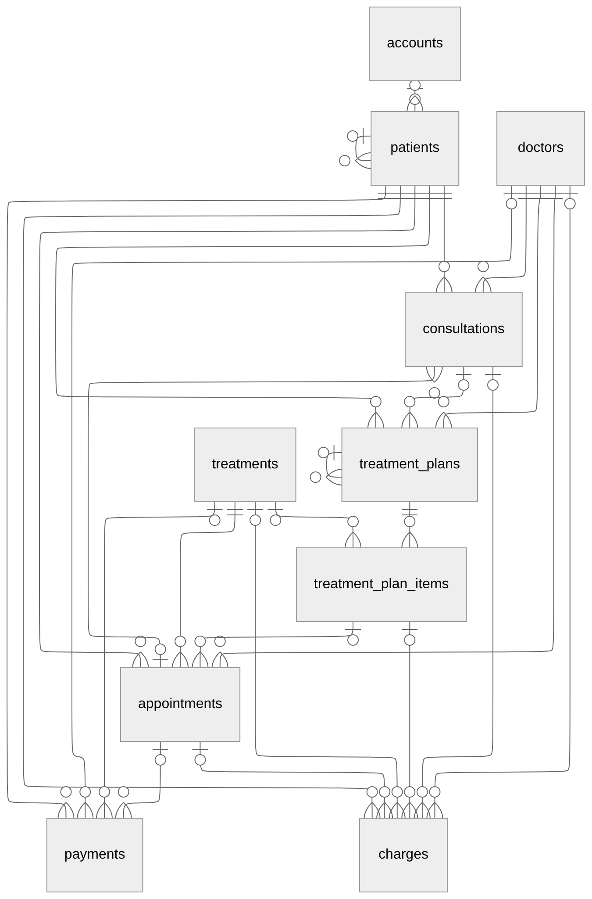
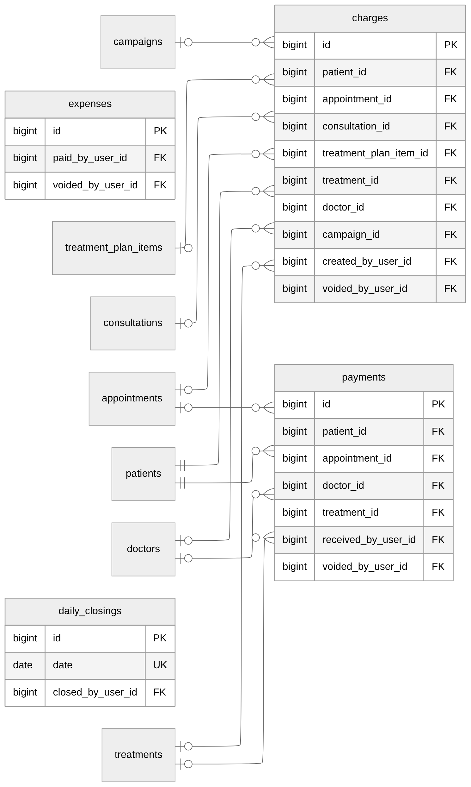

# Resumen ejecutivo

Este entregable documenta, implementa y prueba la plataforma de datos del sistema de Clínica Vega Implant sobre MySQL 8, el motor de producción (ADR-05 del E1). Todo dato sale del repositorio `venga-implantes` (rama de la FASE 2, sobre el commit `3c66e25`) o de un comando corrido el 18 o el 19/11/2026 en un MySQL 8.0.46 con los datos de demostración del seeder; nada viene de pacientes reales.

1. **Modelo de datos (CE0221).** 70 tablas en 8 dominios, 810 columnas y 143 llaves foráneas, en tercera forma normal salvo 6 desnormalizaciones justificadas. El diccionario y los 10 diagramas entidad-relación se generan desde el código con `generar-modelo.py`: no se escriben a mano.
2. **Implementación (CE0222).** `ddl.sql` y `dml.sql` salen de `mysqldump` con el usuario de respaldo; cargados en una base vacía tardan 1,9 s y reproducen los 262 pacientes, los 727 pagos y los S/ 49 740,00 por cobrar. Correr las 1 044 pruebas del backend sobre MySQL encontró un error real que SQLite no mostraba (sección 2.4); quedó corregido y la CI lo vigila desde ahora.
3. **Programación (CE0223).** 5 vistas, 6 funciones, 2 procedimientos y 2 triggers, solo para MySQL, con 13 pruebas que comparan cada resultado con el servicio PHP que ya usa el panel. Cuatro índices nuevos llevan la agenda del día de leer 861 filas a 5 (de 0,94 a 0,05 ms).
4. **Administración y seguridad (CE0224).** Cuatro usuarios de base con privilegios mínimos (`seguridad.sql`), comprobados con 22 pruebas automáticas; copia en 0,49 s y restauración medida en 3,2 s; consultas de monitoreo; y lo que pide la Ley N.º 29733 llevado a la base.

Las capturas de Azure y la revisión del diccionario con la clínica se listan en el anexo D (tabla D2).

# Modelo de datos

## Alcance, fuentes y validación

El modelo es el que ya usa el sistema: 53 migraciones de Laravel en `backend/database/migrations`, de las cuales 3 se agregan en esta fase. No se rediseñó nada que funcione: se documentó, se midió y se completó con lo que pedía el E2. Las fuentes del modelo son tres, todas en el repositorio:

- **`sql/ddl.sql`**, la estructura tal como la deja MySQL 8 después de migrar (sección 2.2). Es la fuente de tipos, nulos, llaves e índices.
- **Las migraciones**, por el comentario que antecede a cada tabla y a cada columna.
- **Los modelos y enums** de `backend/app`, por los valores permitidos de cada columna de estado o tipo.

`generar-modelo.py` lee esas tres fuentes y escribe el diccionario (anexo A), los diagramas ER (figuras 1 y 2 y anexo B) y `evidencias/resumen-del-modelo.txt`. Cuando una columna no tiene comentario en su migración, su descripción es la traducción de su nombre (`glosario_columnas.py`). Si mañana se agrega una tabla, el script se detiene hasta que se le asigne un dominio, así que el diccionario no se queda atrás.

El modelo se validó de cuatro formas: MySQL hace cumplir las 143 llaves foráneas y los 24 valores únicos; la suite completa del backend (1 044 pruebas) pasa sobre MySQL 8 (sección 2.4); `ddl.sql` más `dml.sql` reconstruyen la base con las mismas cifras (sección 2.2); y las 13 pruebas del grupo `mysql` comparan cada vista y procedimiento con la aplicación (sección 3.7). El significado de cada dato lo revisan quienes lo usan: el Dr. Vega y recepción revisan el diccionario de los dominios Caja y Pacientes (anexo A), y sus observaciones se anotan en el anexo D.

## Modelo conceptual

El trabajo de todos los días pasa por diez entidades (figura 1). Una **cuenta** es un celular y puede tener a su cargo a varios **pacientes** de la familia. Cada **cita** une a un paciente con un **doctor** y un **tratamiento**; la **atención** registra lo que se hizo; el **plan de tratamiento** y sus **ítems** son el presupuesto que el paciente firma. Lo realizado genera **cargos** y el paciente hace **pagos**: el saldo es la diferencia, nunca un número guardado aparte.

<!-- figura: diagramas/er-nucleo.png 9cm -->



*Figura 1. Modelo conceptual: las diez entidades centrales y sus relaciones (notación pata de gallo; el círculo es "cero").*

Las 70 tablas se reparten en ocho dominios (tabla 1). Las que más reciben llaves foráneas son `users` (34: quién creó, anuló o cerró algo), `patients` (19), `doctors` (17) y `treatments` (17).

*Tabla 1. Dominios del modelo, medidos sobre `ddl.sql` (`evidencias/resumen-del-modelo.txt`).*

| Dominio | Tablas | Columnas | Llaves foráneas | Tablas principales |
| --- | --: | --: | --: | --- |
| Pacientes, cuentas y avisos | 7 | 104 | 15 | `accounts`, `patients`, `magic_links`, `whatsapp_messages` |
| Catálogo, doctores y agenda | 12 | 186 | 33 | `treatments`, `doctors`, `doctor_schedules`, `appointments` |
| Atención clínica | 17 | 177 | 36 | `consultations`, `odontograms`, `prescriptions`, `consents` |
| Presupuestos y planes | 7 | 88 | 17 | `treatment_plans`, `treatment_plan_items`, `treatment_plan_installments` |
| Caja | 4 | 59 | 18 | `charges`, `payments`, `daily_closings`, `expenses` |
| Inventario | 7 | 72 | 17 | `supplies`, `supply_batches`, `stock_movements` |
| Web pública | 3 | 37 | 6 | `faqs`, `reviews`, `smile_cases` |
| Acceso, auditoría y sistema | 13 | 87 | 1 | `users`, `audit_logs`, `payment_audit_logs`, `settings` |
| **Total** | **70** | **810** | **143** | |

## Modelo lógico

Todas las tablas siguen las mismas convenciones, que se leen en `ddl.sql`:

- **Llaves.** Cada tabla tiene llave primaria: 63 son `bigint unsigned` autoincrementales y 7 son de Laravel (sesiones, caché, cola). Las llaves foráneas se llaman `<tabla>_id`, o `<rol>_user_id` cuando dicen quién hizo algo (`voided_by_user_id`).
- **Borrar.** De las 143 llaves foráneas, 89 ponen NULL al borrar la fila referida, 33 borran en cascada y 21 lo impiden. Hacia `patients` apuntan 19: las 10 de historia clínica y dinero (`appointments`, `consultations`, `charges`, `payments`, entre otras) impiden borrar a un paciente con historia; 4 se borran con él (antecedentes, recomendaciones, lista de espera) y 5 quedan en NULL. El ADR-05 del E1 decía 11; la cifra medida es 19 y quedó corregida allí.
- **Nada se borra de verdad.** 15 tablas tienen borrado lógico (`deleted_at`) y las 3 que mueven dinero (`charges`, `payments`, `expenses`) se anulan con fecha, usuario y motivo (`voided_at`), como decide el ADR-08 del E1.
- **Dinero y fechas.** Los montos son `decimal(10,2)` en soles. Las fechas se guardan en hora de Lima (`APP_TIMEZONE=America/Lima`), y las funciones de la base calculan "hoy" igual (sección 3.3).
- **Estados.** Los estados y tipos (`status`, `method`, `category`) son `varchar` validados por los 40 enums de PHP. El anexo A lista los valores permitidos de cada uno. La base no tiene restricciones `CHECK`; agregarlas es una mejora posible, pero obliga a cambiar dos lugares cada vez que se agrega un estado.
- **Motor y texto.** InnoDB y `utf8mb4_unicode_ci` en todas las tablas, para que las tildes y la ñ se ordenen bien.

La figura 2 muestra el modelo lógico de la caja, que es donde trabajan los procedimientos y el trigger de la sección 3. Los demás dominios están en el anexo B, en ocho figuras con las mismas reglas: cada caja lista la llave primaria (PK), las foráneas (FK) y los valores únicos (UK), y las relaciones con `users` se omiten para que el dibujo se lea. Acceso, auditoría y sistema no tiene figura: su única llave foránea va a `users` y el resto son tablas de Laravel (sesiones, caché, cola), que el anexo A describe.

<!-- figura: diagramas/er-caja.png 9cm -->



*Figura 2. Modelo lógico de la caja: cargos, pagos, cierres del día y gastos, con sus llaves.*

## Normalización y desnormalizaciones justificadas

El modelo está en tercera forma normal. Todo valor es atómico, salvo las 13 columnas JSON que se comentan abajo (1FN). Las llaves primarias son de una sola columna, así que no hay dependencias parciales (2FN). Y ningún dato depende de otro que no sea la llave (3FN). Tres ejemplos:

- El celular es de la **cuenta** y no del paciente: una familia comparte un celular, y repetirlo en cada paciente obligaría a cambiarlo en varias filas. `patients.account_id` lo resuelve.
- La duración propia de un doctor para un tratamiento vive en `doctor_treatment`, la tabla que une ambos, porque depende de los dos a la vez y no de uno solo.
- El saldo del paciente **no se guarda**: se calcula de `charges` y `payments` cada vez (`Patient::balance()`, la vista `v_saldo_paciente` y la función `fn_saldo_paciente`). Así nunca puede quedar desfasado.

Hay seis lugares donde el modelo guarda a propósito un dato que podría calcularse (tabla 2). Ninguno se cambia a mano: cada uno lo mantiene un servicio dentro de la misma transacción que el dato de origen, o es una foto del momento que no debe cambiar.

*Tabla 2. Desnormalizaciones del modelo y por qué se mantienen.*

| Dato guardado | Se podría calcular, pero se guarda porque… | Quién lo mantiene |
| --- | --- | --- |
| `supplies.stock` | Sale de sumar los movimientos de inventario, y el aviso de material bajo se lee en cada pantalla | `InventoryService`, en la misma transacción que el movimiento |
| `supply_batches.remaining` | Sale de los movimientos del lote, y cada uso se descuenta del lote que vence primero | `InventoryService`, al descontar del lote |
| `patients.first_visit_at`, `last_visit_at` | Sale de las citas atendidas, y el seguimiento de controles ordena por la última visita con un índice | `AppointmentService`, al terminar la atención |
| `daily_closings.collected`, `pending`, `expected_cash` | Sale de los pagos y cargos del día, pero es el cierre que firmó quien contó la caja: no cambia si después se anula algo | `CashClosing`, al cerrar el día |
| `charges.description`, `treatment_plan_items.unit_price`, `treatment_plan_signatures.total` | Sale del nombre y el precio vigentes del tratamiento, pero vale el precio que se acordó y firmó, no el de hoy | `BillingService` y `TreatmentPlanService` |
| `consents.body_snapshot` | Sale de la plantilla del consentimiento, pero vale el texto que el paciente firmó, aunque la plantilla cambie | Al firmar el consentimiento |

Las 13 columnas JSON guardan datos que se leen enteros con su fila: los valores de antes y después de `audit_logs`, los signos vitales y el detalle de una atención, los datos de un aviso de WhatsApp y el valor de cada ajuste. Solo dos consultas filtran por dentro de un JSON (`whatsapp_messages.params->campaign_id` en `CampaignBroadcast` y `notifications.data` de Laravel), y son tablas pequeñas. `audit_logs` es polimórfica (`auditable_type`, `auditable_id`) para que un solo historial sirva a los 40 modelos auditados, y `payment_audit_logs.payment_id` no tiene llave foránea a propósito: el registro de un pago borrado tiene que quedar.

## Diccionario de datos

El diccionario completo está en el anexo A: una tabla por cada una de las 70 tablas, con el tipo, si acepta nulos, el valor por defecto, la llave y la descripción de cada columna. De las 810 columnas, 81 se describen con el comentario de su migración o con los valores de su enum, y 729 con la traducción de su nombre; ninguna queda sin descripción. La tabla 3 muestra cómo se lee, con la tabla de pagos.

*Tabla 3. Extracto del diccionario: `payments` (pagos hechos en el consultorio; no hay pagos en línea).*

| Columna | Tipo | Nulo | Llave | Descripción |
| --- | --- | :-: | --- | --- |
| `id` | bigint unsigned | | PK | Identificador. |
| `patient_id` | bigint unsigned | | FK → `patients` (restringe) | Paciente. |
| `appointment_id` | bigint unsigned | Sí | FK → `appointments` (pone NULL) | Cita. |
| `amount` | decimal(10,2) | | | Monto (S/). |
| `method` | varchar(20) | | | Valores: `cash` (Efectivo), `card` (Tarjeta), `yape` (Yape), `plin` (Plin), `transfer` (Transferencia), `other` (Otro). |
| `reference` | varchar(50) | Sí | | N.º de operación Yape, Plin o tarjeta. |
| `paid_at` | datetime | | | Fecha y hora del pago. |
| `received_by_user_id` | bigint unsigned | Sí | FK → `users` (pone NULL) | Usuario que recibió. |
| `voided_at`, `voided_by_user_id`, `void_reason` | timestamp, bigint, varchar(255) | Sí | | Anulación: cuándo, quién y por qué (no se borra). |

# Implementación de la base de datos

## Motor, configuración y migraciones

La base corre en MySQL 8.0: en desarrollo y en la CI, la imagen oficial `mysql:8.0` (8.0.46 al medir); en producción, Azure Database for MySQL Flexible Server 8.0, privado y con TLS obligatorio, según el despliegue del E1. La versión exacta se ve en "Información general" del servidor, en el portal de Azure (anexo D, tabla D2). Laravel abre cada conexión en modo estricto (`'strict' => true` en `config/database.php`), y `ddl.sql` muestra el `sql_mode` que queda: `ONLY_FULL_GROUP_BY`, `STRICT_TRANS_TABLES`, `NO_ZERO_IN_DATE`, `NO_ZERO_DATE`, `ERROR_FOR_DIVISION_BY_ZERO` y `NO_ENGINE_SUBSTITUTION`.

Las pruebas del backend corren en SQLite en memoria, porque son rápidas y no necesitan servidor. Por eso las tres migraciones nuevas (tabla 4) solo actúan cuando `DB::getDriverName()` es `mysql`: en SQLite no hacen nada y la suite sigue en verde.

*Tabla 4. Migraciones de la FASE 2 (solo para MySQL).*

| Migración | Qué crea | Por qué solo en MySQL |
| --- | --- | --- |
| `2026_11_18_210452_add_indexes_for_frequent_queries` | 4 índices de la sección 3.6 | Dos son índices sobre una expresión (`date(starts_at)`), que SQLite no usa igual |
| `2026_11_18_210453_create_payment_audit_logs_table` | La tabla que llena el trigger de la sección 3.5 | Solo la llena un trigger de MySQL |
| `2026_11_18_210454_create_reporting_views_functions_and_procedures` | Las vistas, funciones, procedimientos y triggers de `database/sql/mysql` | Están escritos en el SQL de MySQL 8 |

El código SQL de los objetos está en cuatro archivos (`funciones.sql`, `vistas.sql`, `procedimientos.sql` y `triggers.sql`, en `backend/database/sql/mysql`) y no dentro de las migraciones, para que se lea y se revise como SQL. La clase `DatabaseObjects` los separa en 25 sentencias y los ejecuta. El comando `php artisan bd:objetos` los vuelve a crear cuando hace falta, por ejemplo después de restaurar una copia (sección 4.3), y comprueba que no falte ninguno.

## Scripts `ddl.sql` y `dml.sql`

Los dos scripts están en `docs/entregables/CE02-ingenieria-de-software/E2-plataforma-de-datos/sql` y los genera `generar-ddl-dml.sh` con el usuario `consultorio_respaldo`, que solo puede leer (sección 4.1):

- **`ddl.sql`** (142 530 bytes) sale de `mysqldump --no-data --routines --triggers`: las 70 tablas con sus llaves, índices y restricciones, las 5 vistas, las 8 rutinas y los 2 triggers. Se quitan los contadores `AUTO_INCREMENT`, que dependen de los datos.
- **`dml.sql`** (676 177 bytes) sale de `mysqldump --no-create-info --complete-insert`: los datos de demostración del seeder (`DemoSeeder`), con el nombre de cada columna en cada `INSERT`. Quedan fuera las bitácoras (`audit_logs` y `payment_audit_logs`, que escribe la aplicación sola), las sesiones, la caché y la cola. La clave de los dos usuarios del panel se cambia por el hash de una clave al azar que no se guardó (`quitar-claves.py`): el repositorio es público.

Para comprobar que reconstruyen la base, se cargaron en una base vacía del mismo servidor (tabla 5). La carga se detiene si el dueño de los objetos (`consultorio_despliegue`) no puede leer esa base, porque las vistas se crean con sus permisos; con ese permiso, todo quedó igual que el original.

*Tabla 5. Carga de `ddl.sql` y `dml.sql` en una base vacía (`evidencias/carga-ddl-dml.txt`).*

| Medida | Resultado | Igual al original |
| --- | --- | :-: |
| Tiempo de carga | 1 938 ms | — |
| Pacientes / pagos / migraciones | 262 / 727 / 53 | Sí |
| Saldo total por cobrar (`v_saldo_paciente`) | S/ 49 740,00 | Sí |
| Rutinas / vistas / triggers / llaves foráneas | 8 / 5 / 2 / 143 | Sí |

## Tablas, relaciones y restricciones

*Tabla 6. Restricciones de la base, contadas en `ddl.sql` y en `information_schema`.*

| Elemento | Cantidad | Detalle |
| --- | --: | --- |
| Tablas | 70 | 68 de las migraciones del sistema, `migrations` de Laravel y `payment_audit_logs` (solo MySQL) |
| Columnas | 810 | 446 aceptan `NULL` y 98 tienen valor por defecto; el tipo de cada una está en el anexo A |
| Llaves primarias | 70 | Una por tabla |
| Llaves foráneas | 143 | 89 `SET NULL`, 33 `CASCADE`, 21 `RESTRICT` |
| Valores únicos | 24 | Por ejemplo el celular de la cuenta, el documento del paciente y el día de cada cierre de caja |
| Índices secundarios | 169 | Incluye los que crea MySQL para cada llave foránea y los 4 de la FASE 2 |
| Vistas / funciones / procedimientos / triggers | 5 / 6 / 2 / 2 | Sección 3 |

La captura de las tablas de la base de Azure y del diagrama de relaciones del dominio Caja, desde MySQL Workbench o phpMyAdmin, se lista en el anexo D (tabla D2).

## La suite completa sobre MySQL 8: un error que SQLite no mostraba

Las 1 044 pruebas del backend siempre corrieron en SQLite. Al correrlas también sobre MySQL 8 (`evidencias/suite-completa-en-mysql.txt`), 15 fallaron con el mismo error, y dos más fallaron porque eran pruebas pensadas solo para SQLite:

```
SQLSTATE[HY000]: General error: 3065 Expression #1 of ORDER BY clause
is not in SELECT list, references column
'consultorio_test.treatment_plan_items.sort_order' which is not in
SELECT list; this is incompatible with DISTINCT
```

La causa estaba en `TreatmentPlanService::linkCampaign`, que busca los paquetes de un plan con `DISTINCT`. La relación `items()` ordena por `sort_order`, y MySQL, en modo `ONLY_FULL_GROUP_BY`, no acepta un `DISTINCT` que ordena por columnas que no pide. En producción, eso habría impedido aceptar un plan armado desde un paquete o una campaña 2x1. La corrección es una línea: `reorder()` quita ese orden, que no hacía falta para buscar los paquetes. Las dos pruebas de SQLite ahora revisan el motor en que corren. Resultado: 1 043 pruebas en verde y 1 omitida (la que solo tiene sentido en SQLite). Para que no vuelva a pasar, el job `mysql` de la CI corre ahora toda la suite sobre MySQL 8.

# Consultas y programación de la base

## Consultas del negocio

`sql/consultas.sql` tiene 15 consultas que responden preguntas reales del consultorio. Cada una indica con qué usuario se corre: `consultorio_app` lee las tablas y `consultorio_reportes` solo ve las vistas y los procedimientos. `correr-consultas.sh` las corrió el 18/11/2026 a las 21:46 (hora de Lima) y guardó cada resultado completo en `evidencias/consultas-resultado.txt`. La tabla 7 resume lo que responde cada una.

*Tabla 7. Las 15 consultas, la técnica SQL que usan y lo que respondieron con los datos de demostración.*

| N.º | Pregunta | Técnica | Usuario | Resultado |
| --- | --- | --- | --- | --- |
| C01 | ¿Cuántos pacientes tiene cada cuenta? | `LEFT JOIN`, tabla derivada | app | 259 cuentas con 1 paciente y 1 con 3 |
| C02 | ¿Cómo le fue a cada doctor en 90 días? | Agregación condicional | app | 229 citas, 204 atendidas, 8,1 % de inasistencia |
| C03 | ¿Qué se reserva más y por dónde? | `JOIN`, `GROUP BY` | app | Evaluación (247 citas, 58,3 % por la web) |
| C04 | ¿Cuánto se cobró por mes y medio de pago? | Tabla dinámica con `SUM(IF…)` | app | Octubre: S/ 17 140,00; Yape fue el medio más usado |
| C05 | ¿Quiénes deben más? | Subconsultas agregadas, `HAVING` | app | El mayor saldo: S/ 5 598,00 |
| C06 | ¿Cuánto hay por cobrar? | Vista `v_saldo_paciente` | reportes | 99 pacientes deben S/ 49 740,00 |
| C07 | ¿Qué tan antigua es la deuda? | Vista con funciones de ventana, `CASE` | reportes | S/ 28 980,00 tienen más de 90 días |
| C08 | ¿Cómo está la agenda de hoy? | Vista `v_agenda_del_dia` | reportes | 5 citas con su estado y saldo |
| C09 | ¿Qué materiales costaron más? | Vista `v_consumo_materiales` | reportes | El implante dental: S/ 450,00 |
| C10 | ¿Qué materiales hay que pedir? | `LEFT JOIN`, comparación de columnas | app | 3 materiales en el mínimo o debajo |
| C11 | ¿Cada cuánto vuelven los pacientes? | CTE y `LAG` (función de ventana) | app | Limpieza: cada 44,1 días en promedio |
| C12 | ¿A quiénes hay que volver a llamar? | CTE y `NOT EXISTS` | app | 17 pacientes sin atención en 6 meses |
| C13 | ¿Qué cambió esta semana y quién? | `LEFT JOIN` a la bitácora | app | Lo que hizo el seeder al cargar la demostración |
| C14 | Cierre de caja del 12/11/2026 | Procedimiento `sp_cierre_caja` | reportes | S/ 1 500,00 cobrados y S/ 470,00 pendientes |
| C15 | Ingresos de octubre de 2026 | Procedimiento `sp_reporte_mensual_ingresos` | reportes | Realizado S/ 20 390,00; queda S/ 16 468,41 |

La consulta C07, por ejemplo, reparte la deuda por antigüedad a partir de la vista que aplica los pagos del cargo más antiguo al más nuevo:

```sql
SELECT CASE
  WHEN DATEDIFF(fn_hoy_lima(), cargado_el) <= 30 THEN '1. Hasta 30 días'
  WHEN DATEDIFF(fn_hoy_lima(), cargado_el) <= 60 THEN '2. De 31 a 60 días'
  WHEN DATEDIFF(fn_hoy_lima(), cargado_el) <= 90 THEN '3. De 61 a 90 días'
  ELSE '4. Más de 90 días'
END AS antiguedad,
COUNT(*) AS cargos,
COUNT(DISTINCT paciente_id) AS pacientes,
SUM(por_pagar) AS por_pagar
FROM v_cargos_pendientes
GROUP BY antiguedad
ORDER BY antiguedad;
```

*Tabla 8. Resultado de C07: antigüedad de la deuda.*

| Antigüedad | Cargos | Pacientes | Por pagar (S/) |
| --- | --: | --: | --: |
| Hasta 30 días | 29 | 27 | 5 315,00 |
| De 31 a 60 días | 28 | 27 | 5 176,00 |
| De 61 a 90 días | 20 | 19 | 10 269,00 |
| Más de 90 días | 83 | 49 | 28 980,00 |
| **Total** | **160** | | **49 740,00** |

El total coincide con C06, que suma los saldos con otra vista: la deuda repartida por cargo y la deuda por paciente dan lo mismo.

## Vistas

Las cinco vistas (`vistas.sql`) responden las preguntas que más se repiten y sirven al usuario de reportes, que no puede leer las tablas. Todas son `SQL SECURITY DEFINER`: corren con los permisos de `consultorio_despliegue`, que las creó, y solo leen. Cada una aplica la misma regla que un servicio de la aplicación, y una prueba lo comprueba (tabla 9).

*Tabla 9. Vistas de la base y la regla de la aplicación que repiten.*

| Vista | Qué responde | Misma regla que |
| --- | --- | --- |
| `v_saldo_paciente` | Cargado, pagado y saldo de cada paciente, con su última visita | `balance()` y `owing()` de `Patient` |
| `v_agenda_del_dia` | Las citas de hoy sin las canceladas, con el saldo de cada paciente | El widget "Agenda de hoy" del panel |
| `v_cargos_pendientes` | Lo que falta pagar de cada cargo, aplicando los pagos del más antiguo al más nuevo | `unpaidCharges()` de `BillingService` |
| `v_deuda_vencida` | Las cuotas vencidas de cada plan, con días de atraso | `installmentsIn()` de `BillingService`, con las cuotas `late` |
| `v_consumo_materiales` | Lo usado y dado de baja de cada material por mes, con su costo | `materialsCost()` de `EarningsReport` |

Las pruebas de `MysqlDatabaseObjectsTest` que comparan cada vista con la aplicación son, en el mismo orden:

- `test_the_balance_is_the_same_as_in_the_patient_file`
- `test_the_day_schedule_has_today_appointments_like_the_dashboard`
- `test_payments_cover_the_oldest_charges_first`
- `test_overdue_debt_lists_the_late_installments_like_the_installments_page`
- `test_materials_consumption_costs_the_same_as_the_earnings_report`

`v_cargos_pendientes` es la más elaborada. Con `ROW_NUMBER()` y una suma acumulada (`SUM() OVER`) por paciente calcula cuánto de cada cargo cubren los pagos, como hace la aplicación en PHP, sin un solo ciclo.

## Funciones

*Tabla 10. Funciones de la base (`funciones.sql`).*

| Función | Devuelve | Para qué |
| --- | --- | --- |
| `fn_ahora_lima()` | `DATETIME` | La hora de Lima (UTC−5) aunque el servidor esté en UTC, como en Azure |
| `fn_hoy_lima()` | `DATE` | La fecha de hoy en Lima |
| `fn_saldo_paciente(id)` | `DECIMAL(12,2)` | El saldo de un paciente: cargos válidos menos pagos válidos |
| `fn_estado_cita(estado)` | Texto | El nombre del estado de la cita como lo ve el consultorio ("No asistió") |
| `fn_medio_pago(medio)` | Texto | El nombre del medio de pago ("Transferencia") |
| `fn_categoria_material(categoría)` | Texto | El nombre de la categoría del material ("Resinas y restauración") |

Las tres funciones de nombres repiten las etiquetas de los enums de PHP, y la prueba `test_the_names_match_the_ones_the_clinic_sees` recorre cada valor del enum para que no se separen. Las funciones de fecha llevan una lección medida: usar `fn_hoy_lima()` dentro del `WHERE` de la agenda hace que MySQL lea las 861 citas, porque no puede tratar una función guardada como constante. Por eso las vistas escriben `CONVERT_TZ(UTC_TIMESTAMP(), '+00:00', '-05:00')`, que sí es constante en cada consulta y deja usar el índice (5 filas).

## Procedimientos almacenados

`sp_cierre_caja(fecha, recibido_por)` devuelve dos resultados: el resumen del día (cobrado, efectivo que debería haber, gastos, pendiente de cobro, anulados y, si ya se cerró, lo contado y la diferencia) y lo cobrado por medio de pago. Con el segundo parámetro filtra por la persona que cobró, como el filtro "Persona" del panel. `sp_reporte_mensual_ingresos(año, mes)` devuelve el resumen del mes (cobrado, realizado, gastos, materiales, lo que queda y lo que hay por cobrar hoy), el realizado y cobrado por doctor y el cobrado por medio de pago con su porcentaje. Ambos rechazan parámetros inválidos con `SIGNAL` y solo leen (`READS SQL DATA`). Sus pruebas calculan las mismas cifras con `CashClosing` y `EarningsReport` y exigen que coincidan; el resultado con los datos de demostración está en la tabla 7 (C14 y C15).

## Trigger de auditoría

La aplicación ya audita los pagos: cada pago creado o anulado queda en `audit_logs` con el usuario y la IP (trait `Auditable`), y la aplicación nunca cambia el monto, el medio, la fecha ni el paciente de un pago, ni lo borra (`PaymentPolicy::delete` devuelve `false`). Un trigger que repitiera eso no agregaría nada.

Lo que la aplicación no puede ver es un cambio hecho **por fuera** de ella: desde phpMyAdmin, la consola o un script. Para eso están los dos triggers de `payments` (`triggers.sql`):

- `trg_pagos_auditar_cambio` (`AFTER UPDATE`) anota en `payment_audit_logs` solo las columnas que cambiaron, con sus valores de antes y después. Anular un pago como lo hace la aplicación no se anota, porque eso ya está en `audit_logs`. Quitar una anulación sí se anota.
- `trg_pagos_auditar_borrado` (`AFTER DELETE`) guarda la fila completa del pago borrado.

Los dos guardan quién lo hizo con `USER()`, el usuario y el equipo de la conexión. `CURRENT_USER()` no sirve: dentro de un trigger devuelve al dueño del trigger. Dos pruebas lo comprueban, y en la CI borrar 10 pagos desde la consola deja exactamente 10 registros (sección 4.3):

- `test_the_trigger_leaves_alone_what_the_application_already_audits`: una anulación hecha por la aplicación no deja registro.
- `test_the_trigger_records_what_is_changed_or_deleted_outside_the_application`: un cambio de monto, una anulación deshecha y un borrado sí lo dejan.

## Índices y planes de ejecución

Se midieron con `EXPLAIN` y `EXPLAIN ANALYZE` las seis consultas de las pantallas y reportes más usados, tal como las arma Laravel (`sql/consultas-medidas.sql`), antes y después de los índices nuevos y con los mismos datos. Cada tiempo es la mediana de cinco corridas (tabla 11; las salidas completas están en `evidencias/explain-antes.txt` y `explain-despues.txt`).

*Tabla 11. Plan de ejecución antes y después de los índices de la FASE 2.*

| Consulta (dónde se usa) | Índice nuevo | Antes: acceso, filas, ms | Después: acceso, filas, ms |
| --- | --- | --- | --- |
| Q1 Agenda de hoy (panel "Hoy", `whereDate`) | `appointments_starts_on_index` sobre `date(starts_at)` | `ALL`, 861, 0,94 | `ref`, 5, 0,05 |
| Q2 Saldos por cobrar (`Patient::owing`) | `charges_patient_balance_index` y `payments_patient_balance_index` | `ref` y lectura de la fila, 3, 3,81 | `ref` solo con el índice, 3, 2,61 |
| Q3 Realizado del mes (`EarningsReport`) | `charges_charged_at_index` | `ALL`, 755, 0,55 | `range`, 74, 0,17 |
| Q4 Realizado por doctor (`EarningsReport`) | `charges_charged_at_index` | `index`, 755, 1,11 | `range`, 74, 0,22 |
| Q5 Costo de materiales del mes | Ninguno (se descartó) | `ALL`, 300, 0,38 | `ALL`, 300, 0,33 |
| Q6 Quién cobró ese día (`CashClosing`) | `payments_paid_on_index` sobre `date(paid_at)` | `ALL`, 727, 0,33 | `ref`, 2, 0,10 |

Tres decisiones explican la tabla:

- **Índices sobre una expresión.** Laravel convierte `whereDate('starts_at', …)` en `date(starts_at) = ?`. Un índice normal sobre `starts_at` no sirve para eso (en Q6, `payments` ya tenía uno sobre `paid_at` y MySQL igual leía las 727 filas). Un índice funcional sobre `date(starts_at)`, que MySQL 8 permite, encaja exacto, y no hubo que tocar el código PHP.
- **Índices que cubren el cálculo.** En Q2 los índices `(patient_id, voided_at, amount, discount)` tienen todo lo que suma el saldo, así que MySQL no lee la tabla ("Using index").
- **Un índice descartado.** Para Q5 se probó `(type, created_at)` en `stock_movements`: como 191 de los 300 movimientos caían en el rango, MySQL prefería leer la tabla entera y el índice no se usaba. Se quitó, porque un índice que no se usa solo hace más lentas las escrituras.

Con los datos de demostración, las diferencias son de décimas de milisegundo. Lo que importa es la forma del plan: con `ALL` el tiempo crece con cada cita que se agenda; con `ref` depende solo de las citas de ese día. La prueba `test_the_frequent_queries_can_use_the_new_indexes` comprueba en la CI que cada consulta puede usar su índice.

## Cómo se prueba

Las 13 pruebas de `MysqlDatabaseObjectsTest` llevan el grupo `mysql`: `phpunit.xml` las excluye cuando la suite corre en SQLite y el job "Base de datos (MySQL 8)" de GitHub Actions las corre con `php artisan test --group=mysql` sobre un servicio `mysql:8.0` (tabla 12). Cada prueba arma sus datos con las factories y compara la vista o el procedimiento con el servicio PHP sobre esos mismos datos, en vez de comparar contra números escritos a mano.

*Tabla 12. Pasos del job "Base de datos (MySQL 8)" en `.github/workflows/tests.yml`.*

| Paso | Qué comprueba |
| --- | --- |
| Pruebas de vistas, funciones, procedimientos y triggers | Las 13 pruebas del grupo `mysql` |
| Suite completa sobre MySQL 8 | Las 1 044 pruebas del backend en el motor de producción (sección 2.4) |
| Crear los usuarios, migrar, cargar la demostración, `bd:objetos` | `seguridad.sql` y las migraciones corridas por `consultorio_despliegue`, no por root |
| Dar a reportes las vistas y comprobar cada usuario | `probar-seguridad.sh`: 22 permisos que deben darse o negarse (sección 4.1) |
| Copia y restauración cronometradas | Copia, daño desde la consola, restauración medida en ms y bitácora del trigger (sección 4.3) |

# Seguridad y administración

## Usuarios y roles de la base

Hasta ahora la aplicación se conectaba con un solo usuario capaz de todo. `backend/database/sql/seguridad.sql` crea cuatro, cada uno con lo mínimo que necesita (tabla 13). Lo corre el administrador del servidor; las claves no van en el archivo, que es público, sino que se pasan al correrlo, y quedan en Key Vault junto con los demás secretos (ADR-06 del E1). Se puede volver a correr cuando se quiera: cambia las claves y vuelve a dar los mismos permisos.

*Tabla 13. Usuarios de la base y sus privilegios (`seguridad.sql`).*

| Usuario | Lo usa | Puede | No puede |
| --- | --- | --- | --- |
| `consultorio_app` | La aplicación en el día a día | `SELECT`, `INSERT`, `UPDATE`, `DELETE` en `consultorio` | Crear, cambiar o borrar tablas, triggers o usuarios |
| `consultorio_despliegue` | Las migraciones, `bd:objetos` y `respaldo:restaurar` | Lo anterior y cambiar la estructura: tablas, índices, vistas, rutinas, triggers | Crear usuarios, dar permisos o tocar otra base |
| `consultorio_reportes` | Excel, Power BI o la consola, solo lectura | `SELECT` en las 5 vistas y `EXECUTE` de las funciones y procedimientos | Leer cualquier tabla, incluida la historia clínica; escribir. Se bloquea un día tras 5 claves erradas |
| `consultorio_respaldo` | Copias con `mysqldump` desde fuera | `SELECT`, `SHOW VIEW`, `TRIGGER` y `SHOW_ROUTINE` para copiar todo | Escribir nada |

Cuatro detalles salieron de probarlo, no de suponerlo (`evidencias/objetos-y-su-dueno.txt`):

- **Quién crea los objetos.** Si root crea las vistas y los triggers, después `consultorio_despliegue` no puede borrarlos ni rehacerlos (error 1227, falta `SYSTEM_USER`). Por eso los crea siempre `consultorio_despliegue`.
- **Funciones con registro binario.** Con el registro binario activo, un usuario sin `SUPER` no puede crear funciones ni triggers (error 1419) hasta que el servidor tenga `log_bin_trust_function_creators = ON`. En Azure se activa en "Parámetros del servidor" (anexo D, tabla D2).
- **Permisos que se pierden.** MySQL borra los permisos de una rutina cuando la rutina se borra, y `bd:objetos` las rehace. Por eso reportes recibe `EXECUTE` sobre la base entera y no rutina por rutina. Es seguro porque todas las rutinas solo leen.
- **Copias completas.** `mysqldump --routines` necesita `SHOW_ROUTINE` para leer el código de las funciones (con solo `EXECUTE` falla). Si Azure no deja darlo, se copia sin `--routines` y `bd:objetos` las vuelve a crear.

`probar-seguridad.sh` comprueba 22 permisos que deben darse o negarse: que reportes no lee `patients` ni `medical_backgrounds`, que la aplicación no puede borrar la tabla de auditoría ni el trigger, que despliegue no puede crear usuarios, entre otros. Corre en cada CI, y en la prueba local dio "Todo como se esperaba" (`evidencias/probar-seguridad.txt`). La aplicación ya usa el nuevo usuario en la CI: la copia de la sección 4.3 se hace como `consultorio_app` y la restauración como `consultorio_despliegue`. En Azure pasa lo mismo: la configuración de producción (`infra/env/produccion.env`) usa `DB_USERNAME=consultorio_app`, y `infra/scripts/deploy-app.sh` corre las migraciones con `consultorio_despliegue`, cuya clave lee de Key Vault. Así se publicó la primera versión en `vm-app` el 19/11/2026 (ejecución 44505713594 de "Desplegar en Azure", E4). Los cuatro usuarios se ven en la base de Azure (anexo D, tabla D2).

## Auditoría

La auditoría tiene dos capas que no se repiten:

1. **En la aplicación**, `audit_logs` guarda cada cambio de los 40 modelos auditados, con los valores de antes y después, el usuario, la IP, el navegador y la dirección. Es lo que ve el administrador en el historial de cambios del panel. Con los datos de demostración tiene 4 599 filas y es la tabla más grande (2,00 MB de 6,95 MB, sección 4.4).
2. **En la base**, los triggers de la sección 3.5 anotan en `payment_audit_logs` lo que se hace con los pagos por fuera de la aplicación. Esa tabla debería quedar siempre vacía: una fila ahí es un cambio directo que alguien tiene que explicar. La consulta M8 de `monitoreo.sql` la revisa.

El trigger se puso en `payments` porque es la tabla donde un cambio silencioso hace más daño: mueve el saldo del paciente y el cierre de caja de un día ya cerrado.

## Respaldo y recuperación

El sistema ya tenía copia de seguridad; esta fase la midió y la hizo compatible con los objetos nuevos. `respaldo:crear` corre cada día a las 03:00 (`routes/console.php`) y guarda la base en un `.sql.gz` sin depender de `mysqldump`. Se guardan las últimas 14 copias, y el administrador puede cambiarlo entre 3 y 90 desde el panel. El panel avisa si la última copia tiene más de 36 horas, porque eso significa que el cron no está corriendo, y si pasó una semana sin descargar una copia fuera del servidor. Las radiografías, fotos y firmas se respaldan aparte (`FilesBackup`).

Restaurar una copia borra y recrea las tablas, y con ellas los triggers. Además, la bitácora de pagos volvería a la fecha de la copia y se perdería justo el registro del daño. Por eso `respaldo:restaurar` ahora guarda la bitácora antes de restaurar, recrea los objetos con `bd:objetos` y devuelve las anotaciones posteriores a la copia.

La prueba (tabla 14) simuló un daño desde la consola: se borraron 10 pagos y se cambió el nombre de los 262 pacientes. Luego se restauró y se midió el tiempo tres veces.

*Tabla 14. Copia y restauración medidas (`evidencias/respaldo-y-restauracion.txt`).*

| Paso | Usuario | Resultado |
| --- | --- | --- |
| Copia (`respaldo:crear`) | `consultorio_app` | 0,488 s; 220 238 bytes comprimidos |
| Daño desde la consola | root | 717 pagos (faltan 10); 262 pacientes con el nombre cambiado; 10 borrados anotados por el trigger |
| Restauración (`respaldo:restaurar --force`) | `consultorio_despliegue` | 3,494 s, 3,215 s y 3,198 s (mediana 3,215 s); 257 sentencias |
| Después de restaurar | — | 727 pagos, 0 nombres cambiados, los 10 registros del trigger conservados y las 70 tablas con las mismas filas, salvo la caché |
| Lo mismo en la CI | `consultorio_despliegue` | 2,426 s en la primera corrida del job y 1,864 s en la del merge del PR #20 (19/11/2026, GitHub Actions), con los 10 registros del trigger y los 22 permisos comprobados; el job lo mide en cada corrida |

Con una copia diaria, en el peor caso se pierde lo registrado desde las 03:00 de ese día, y la restauración con este volumen tarda unos segundos más lo que tome traer el archivo. Azure guarda además copias automáticas del servidor flexible y permite restaurar a un momento dado, lo que reduce esa pérdida, con la retención que se configura en "Copia de seguridad y restauración" del portal. El procedimiento paso a paso está en el anexo E.

## Monitoreo

`sql/monitoreo.sql` reúne ocho consultas que el administrador corre en la consola. En Azure, las mismas métricas se ven en "Supervisión" del portal. La tabla 15 muestra lo que dieron en el servidor local (`evidencias/monitoreo-resultado.txt`).

*Tabla 15. Consultas de monitoreo y lo que mostraron con los datos de demostración.*

| Consulta | Qué mira | Resultado local |
| --- | --- | --- |
| M1, M2 | Tamaño de cada tabla y de la base | 6,95 MB en total (3,00 de datos y 3,95 de índices); `audit_logs` es la mayor con 2,00 MB |
| M3 | Si el registro de consultas lentas está activo | Apagado (valor de fábrica de MySQL, 10 s) |
| M4 | Las consultas que más tiempo sumaron (`performance_schema`) | Las inserciones en `audit_logs` al cargar la demostración, las lecturas de la copia (`SHOW TABLE STATUS`) y los `CREATE TABLE` de la migración y las tres restauraciones |
| M5 | Tablas leídas enteras sin índice (`sys`) | `audit_logs`, `appointments` y `payments` encabezan la lista |
| M6 | Índices que no se han usado (`sys`) | 126 índices, 97 de ellos de llaves foráneas; los 4 de la FASE 2 sí se usaron |
| M7 | Conexiones por usuario | Solo root: la aplicación no estaba conectada |
| M8 | Cambios a pagos por fuera de la aplicación (trigger) | Ninguno en los últimos 30 días |

En un servidor que solo cargó la demostración, midió y restauró, M4 a M6 no dicen nada del uso real: hay que mirarlas en producción después de unas semanas. Para Azure se recomienda activar `slow_query_log` con `long_query_time = 1` y enviar ese registro a Azure Monitor, junto con una alerta de almacenamiento (anexo D, tabla D2).

## Protección de datos personales (Ley N.º 29733)

La base guarda datos de salud, que la Ley N.º 29733 considera sensibles: antecedentes, atenciones, odontogramas, recetas, consentimientos y archivos clínicos. La tabla 16 muestra cómo la plataforma de datos los protege, además de lo que ya hace la aplicación (ADR-11 del E1).

*Tabla 16. Medidas de la base para la Ley N.º 29733.*

| Medida | Cómo está implementada | Evidencia |
| --- | --- | --- |
| Consentimiento separado | `accounts.privacy_accepted_at` y `privacy_version` para el tratamiento de datos; `accepts_promotions` y `promotions_consent_at` para las promociones, aparte | Diccionario, anexo A |
| Mínimo privilegio | Reportes no lee ninguna tabla, solo vistas sin historia clínica; respaldo no escribe; la aplicación no cambia la estructura | `probar-seguridad.sh` |
| Acceso a lo clínico | Solo el doctor tratante y el administrador odontólogo (`PatientPolicy::viewClinical`); las copias solo las descarga ese administrador (`Backups::canDownload`) | Pruebas del E1 |
| Trazabilidad | `audit_logs` en 40 modelos y el trigger de pagos | Sección 4.2 |
| Conservación | La historia no se puede borrar (10 llaves `RESTRICT`); borrado lógico en 15 tablas | `ddl.sql` |
| Secretos fuera del repositorio | Claves de la base pasadas al correr `seguridad.sql`; los enlaces de WhatsApp y los dispositivos recordados se guardan solo como hash (`token_hash`); `dml.sql` sin claves | Anexo C |
| Cifrado | En tránsito: TLS obligatorio en Azure (E1). En reposo: el disco del servidor de Azure. Ninguna columna se cifra en la aplicación | "Redes" (TLS) y "Seguridad" del servidor en Azure (anexo D, tabla D2) |
| Registro del banco de datos | El banco de datos de pacientes se inscribe ante la Autoridad Nacional de Protección de Datos Personales | No inscrito al 19/11/2026; es un trámite que le corresponde a la clínica |

# Anexos

Los anexos van en un Word aparte, `CE022-S2-E2-Plataforma-de-Datos-del-Sistema-Anexos.docx`:

- **A.** El diccionario de datos de las 70 tablas.
- **B.** El modelo lógico de los demás dominios, en ocho figuras.
- **C.** Los scripts completos: funciones, vistas, procedimientos, triggers, `seguridad.sql`, `monitoreo.sql` y `consultas.sql`. `ddl.sql` y `dml.sql` van como archivos aparte, por su tamaño.
- **D.** Las evidencias de cada medición, copiadas de sus archivos, y las capturas de Azure.
- **E.** La documentación técnica de administración: instalar, desplegar, respaldar, restaurar, monitorear y cambiar claves.
- **F.** La evidencia de la sustentación ante el docente.

Todos los archivos están en `docs/entregables/CE02-ingenieria-de-software/E2-plataforma-de-datos` y `backend/database/sql` del repositorio.
