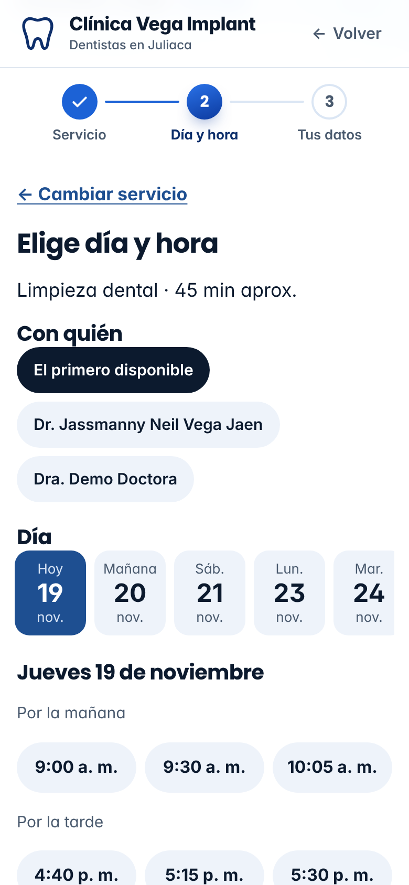
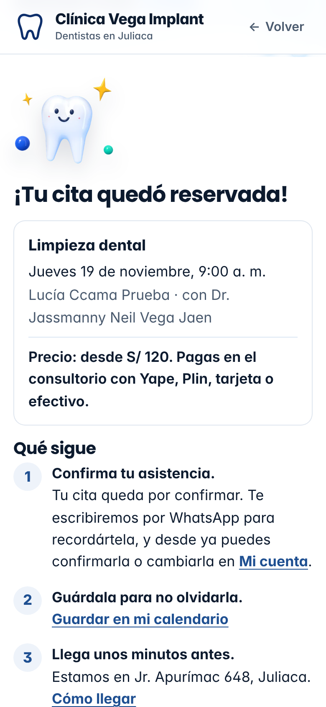
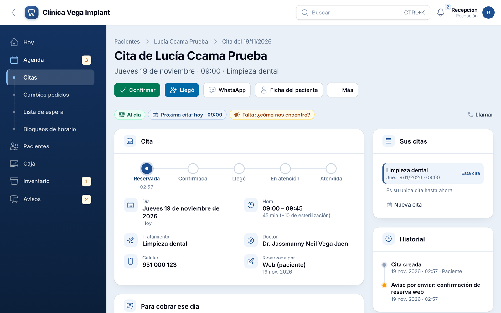
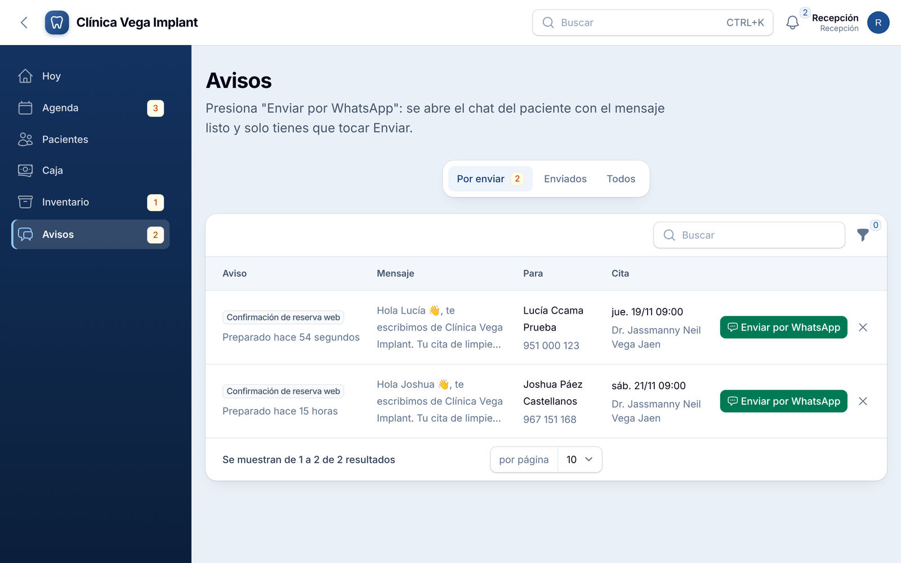
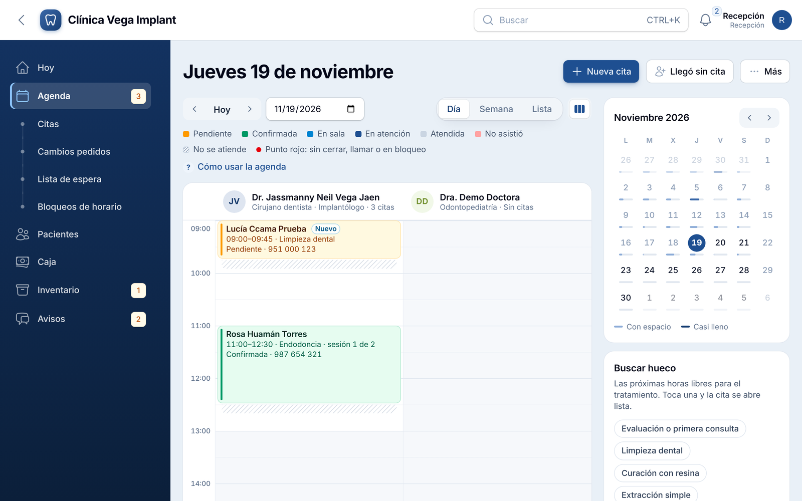

# Anexo A. Repositorio fuente

*Tabla A1. Datos del repositorio.*

| Campo | Valor |
| --- | --- |
| Dirección | https://github.com/francalizaya266-sudo/venga-implantes (público) |
| Rama principal | `main`: lo que está aprobado y lo único que se publica en Azure (`desplegar-azure.yml` solo corre desde `main`) |
| Rama del E3 | `claude/project-thread-2tzlbx`, en revisión en el pull request #14 |
| Versión entregada | `[PENDIENTE – estudiante: al unir el PR #14, crear la etiqueta e3-entrega sobre ese commit de main]` |
| Contrato de la API | `docs/api/openapi.json` |
| Documentos y evidencias del E3 | `docs/entregables/CE02-ingenieria-de-software/E3-sistema-funcional` |

Para obtenerlo: `git clone https://github.com/francalizaya266-sudo/venga-implantes.git`. El anexo B explica cómo correrlo. El repositorio no tiene secretos ni datos de pacientes: el `.env` está en `.gitignore`, los secretos de producción van en Key Vault y los datos de demostración los genera el seeder.

*Tabla A2. Cambios de la FASE 3, en orden.*

| Commit | Cambio |
| --- | --- |
| `c70ca19` | La API rechaza datos de otro tipo con 422 y responde sus errores en español (`ApiErrorsTest`). |
| `ada8a79` | El botón de "Los más pedidos" queda con su tratamiento al cambiar de doctor (`EasierSchedulingTest`). |
| `8576e89` | La API v1 documentada en OpenAPI 3.1 y cada respuesta de las pruebas del backend validada contra ella (`OpenApiTest`). |
| `deac535` | Las respuestas de mentira de las pruebas de la web cumplen el mismo contrato; siete diferencias corregidas. |
| `4990c3d` | Pruebas de las páginas de un servicio, una promoción y antes y después. |
| `67ba171` | El botón de WhatsApp cumple el contraste AA (de 4,30:1 a 4,87:1). |
| `1683fc6` | Scripts y resultados de las mediciones de la API y de la web. |
| `e797bcb` | El envío por la API de WhatsApp espera a lo más 13 s por aviso (`SendDueWhatsAppMessagesTest`). |
| `4f5e045` | El Nginx de Azure comprime el JavaScript y el CSS de la web; medición a través de esa configuración. |
| `8c20db0` | `ApiErrorsTest` comprueba lo que ve el paciente con `APP_DEBUG=false`, también en la CI. |

# Anexo B. Manual técnico breve

Este manual es para quien instale, publique u opere el sistema. Los comandos se corren desde la carpeta `backend` del repositorio, salvo que diga otra cosa. Ninguna clave se escribe en un archivo del repositorio. El manual de la base de datos (usuarios, copias, restauración y monitoreo) es el anexo E del E2, y el de la infraestructura de Azure, `infra/README.md`.

## Requisitos {-}

- **Para desarrollar:** PHP 8.3 o superior con las extensiones de Laravel, Composer 2, MySQL 8 (o SQLite para probar) y Node 22.
- **En el servidor:** Nginx, PHP-FPM 8.3 y el cliente de MySQL; Node no hace falta, porque la web llega compilada en el paquete.

## Instalar en una computadora {-}

```bash
cd backend
composer install
cp .env.example .env
php artisan key:generate
# crear la base de datos MySQL y completar DB_* en .env
php artisan migrate --seed
npm --prefix ../frontend install
composer dev
```

`composer dev` levanta Laravel en `http://localhost:8000` con el servidor de Vite, que recarga la web al guardar. Para verla como en producción: `npm --prefix ../frontend run build` y `php artisan serve`. `--seed` crea los datos de demostración (11 meses de historia); en producción se usa `php artisan db:seed --class=CatalogSeeder --force`, que solo carga los catálogos.

## Usuarios de demostración {-}

El panel está en `/panel`. El seeder crea al administrador (`admin@consultorio.test`, el Dr. Vega, que también atiende) y a recepción (`recepcion@consultorio.test`); su clave está en `DemoSeeder` y en el `README.md`. En producción, cada usuario recibe una clave temporal y el sistema le pide cambiarla al entrar por primera vez; si el administrador la olvida y no hay correo, quien tenga acceso al servidor le pone otra con `php artisan usuario:clave <correo>`.

## Probar {-}

*Tabla B1. Comandos de prueba (los mismos de la CI).*

| Dónde | Comando | Qué revisa |
| --- | --- | --- |
| `backend/` | `php artisan test` | Las 1 092 pruebas del backend, con SQLite en memoria; cada respuesta de la API se compara con el contrato. |
| `backend/` | `php artisan test --group=mysql` | Las vistas, funciones, procedimientos y triggers, sobre MySQL 8. |
| `backend/` | `vendor/bin/pint --test` | El formato del PHP. |
| `frontend/` | `npm test` | Las 141 pruebas de la web, con respuestas de mentira validadas contra el contrato. |
| `frontend/` | `npm run typecheck`, `npm run lint`, `npm run format:check` | Tipos, ESLint y Prettier. |

## Configurar {-}

Las variables del `.env` están en la tabla 11 del documento. En producción, `infra/env/produccion.env` tiene la configuración sin secretos y `deploy-app.sh` le suma los secretos de Key Vault (`app-key`, `db-password`, `mail-password`, `whatsapp-cloud-token`, `dni-lookup-token`). Sin `DNI_LOOKUP_TOKEN` la lupa del DNI no aparece; con `WHATSAPP_DRIVER=click_to_chat` recepción envía los avisos desde el panel, y con `cloud_api` salen solos.

## Publicar una versión en Azure {-}

1. Unir el cambio a `main` con la CI en verde.
2. Con la variable `DESPLIEGUE_AUTOMATICO=true`, el workflow corre solo cuando las pruebas de `main` pasan. Si no, en GitHub, **Actions → Desplegar en Azure → Run workflow** con la acción `publicar` (producción debe estar encendida: `bash infra/desplegar.sh encender`).
3. El workflow compila la web, sube el paquete a Blob y corre `deploy-app.sh` en `vm-app`, que deja la versión en `/var/www/vega/releases/<fecha>`, migra la base y cambia el enlace `current`. Al final pide `/up`.

La primera vez, la infraestructura se crea siguiendo las fases de `infra/README.md` (red, MySQL, Key Vault, VM, proxy y copias).

## Volver a la versión anterior {-}

En `vm-app` quedan las últimas cinco versiones. Si la nueva falla: **Actions → Desplegar en Azure → Run workflow** con la acción `volver` (sin versión vuelve a la anterior; con una, por ejemplo `20261119083000`, a esa). El workflow corre `infra/scripts/volver-version.sh` en `vm-app`, que rearma las cachés de esa versión, cambia el enlace `current`, recarga PHP-FPM y Nginx, y después pide `/up`. En la VM, `sudo bash volver-version.sh --lista` muestra las versiones guardadas. La base no se toca: si la versión nueva había migrado, primero se restaura la copia de antes de publicar (anexo E del E2).

## Operar {-}

- **Cron.** Un solo cron para Laravel, que `deploy-app.sh` deja en `/etc/cron.d/vega`: `* * * * * www-data php /var/www/vega/current/artisan schedule:run`. `php artisan schedule:list` muestra las 10 tareas y su próxima ejecución.
- **Avisos.** Con `click_to_chat`, recepción los envía desde **Avisos**. Con `cloud_api`, `whatsapp:enviar` los manda cada 5 minutos; los que fallan quedan con su motivo en la misma pantalla.
- **Copias.** `respaldo:crear` corre a las 3:00 y guarda las últimas `BACKUPS_KEEP`; `backup-to-blob.sh` las sube a Blob. El administrador las ve y descarga en **Configuración → Copias de seguridad**.
- **Salud.** `/up` responde 200 si la aplicación arranca y la base de datos contesta; el workflow **Vigilar producción** la pide cada 15 minutos y avisa por correo si falla. Con `LOG_STACK=json`, los registros van a `storage/logs/eventos-*.log` con el identificador de la petición (cabecera `X-Request-Id`), la ruta y el usuario, y Wazuh los lee (E4, sección 2.4).

## Errores conocidos {-}

*Tabla B2. Errores conocidos y su solución.*

| Síntoma | Causa | Solución |
| --- | --- | --- |
| La lupa del DNI o los feriados dicen que no responden, y el registro muestra `cURL error 60` | A PHP le faltan los certificados de HTTPS (frecuente en Windows) | Descargar `cacert.pem` y apuntar `curl.cainfo` y `openssl.cafile` de `php.ini` a ese archivo |
| "Unable to locate file in Vite manifest" | La web no está compilada | `npm --prefix ../frontend run build`, o `composer dev` en desarrollo |
| Una acción de la web responde 419 | La sesión venció con la página abierta | La web renueva la sesión y reintenta sola; si persiste, revisar `SESSION_DOMAIN` y `APP_URL` |
| Detrás del proxy, todos los pacientes comparten el límite de reservas | Laravel ve la IP del proxy | `TRUSTED_PROXIES` con la IP del proxy (en Azure, 10.20.3.4) |
| La web tarda unos 3,5 s en un celular | El Nginx no comprime el JavaScript | Usar `infra/nginx/proxy.conf` de esta versión (bloque `gzip_types`) |
| Una prueba que pasa en local falla en la CI | La CI usa `APP_DEBUG=true` del `.env.example` | La prueba debe fijar lo que supone (como `ApiErrorsTest`) |

## Repetir las mediciones y las capturas del E3 {-}

Desde `docs/entregables/CE02-ingenieria-de-software/E3-sistema-funcional/evidencias`, con el sistema corriendo:

- `bash medir-api.sh <URL> 30`: tiempos de la API (solo lectura).
- `bash nginx-local.sh` y luego `node medir-web.cjs http://127.0.0.1:8002 / /reservar …`: la web a través del Nginx de producción, en escritorio y celular, con la revisión de accesibilidad.
- `DEMO_PASSWORD=<clave> node capturas-e3.cjs <URL> <carpeta> web` y luego `… panel <id de la cita>`: la reserva de punta a punta (crea una cita en la base que se use).
- `bash docs/entregables/CE02-ingenieria-de-software/generar-word.sh`, desde la raíz del repositorio: los Word y PDF de todos los entregables.

# Anexo C. Capturas de funcionamiento

Las capturas se tomaron el 19/11/2026 con `evidencias/capturas-e3.cjs` sobre el sistema corriendo con los datos de demostración; la paciente que reserva es inventada. Están en tamaño completo en `evidencias/capturas`.

<!-- figura: ../evidencias/capturas/e3-web-1-horario.png 6.5cm -->



*Figura C1. Paso 2 de la reserva: los horarios libres del día con los dos doctores, o "el primero disponible".*

<!-- figura: ../evidencias/capturas/e3-web-3-reservada.png 6.5cm -->



*Figura C2. La cita reservada, con el precio, cómo se paga y lo que sigue.*

<!-- figura: ../evidencias/capturas/e3-panel-1-cita.png 16cm -->



*Figura C3. La ficha de la cita en el panel: reservada por la web, con su historial (cita creada y aviso por enviar).*

<!-- figura: ../evidencias/capturas/e3-panel-2-avisos.png 16cm -->



*Figura C4. Avisos: la confirmación lista para enviar por WhatsApp con un toque.*

<!-- figura: ../evidencias/capturas/e3-panel-3-agenda.png 16cm -->



*Figura C5. La agenda del día con la cita nueva, pendiente de confirmar.*

Las demás pantallas, capturadas del mismo sistema, están en el E1: web del paciente (figuras 3 y 4), "Hoy" y agenda (5), atención clínica (6), presupuesto (7), caja y cierre (8), recepción en el celular y reportes (9) y la ventana "Nueva cita" (10).

**Video de la demostración.** `[PENDIENTE – estudiante: grabar el mismo recorrido en la URL de producción, de 3 a 5 minutos, y anotar aquí su enlace]`

# Anexo D. Evidencia de despliegue y ejecución

## Rutas de la API v1 {-}

Las 36 operaciones del contrato `docs/api/openapi.json`, con los estados que puede responder cada una. `OpenApiTest` comprueba que coinciden una a una con `php artisan route:list --path=api/v1`.

*Tabla D1. Operaciones de `/api/v1`.*

| Método | Ruta | Operación | Para qué | Estados |
| --- | --- | --- | --- | --- |
| GET | `/site` | `site` | Lo que comparten todas las páginas | 200 |
| GET | `/home` | `home` | Inicio | 200 |
| GET | `/treatments` | `treatments.index` | Servicios | 200 |
| GET | `/treatments/{slug}` | `treatments.show` | Un servicio | 200, 404 |
| GET | `/promotions` | `promotions.index` | Promociones vigentes | 200 |
| GET | `/promotions/{slug}` | `promotions.show` | Una promoción | 200, 404 |
| GET | `/team` | `team` | Equipo | 200 |
| GET | `/cases` | `cases` | Antes y después | 200, 422 |
| GET | `/reviews` | `reviews` | Opiniones | 200 |
| GET | `/faqs` | `faqs` | Preguntas frecuentes | 200 |
| GET | `/pages/contact` | `pages.contact` | Contacto | 200 |
| GET | `/pages/privacy` | `pages.privacy` | Política de privacidad | 200 |
| GET | `/booking/options` | `booking.options` | Primer paso de la reserva | 200, 422 |
| GET | `/booking/days` | `booking.days` | Días con horarios libres | 200, 404 |
| GET | `/booking/slots` | `booking.slots` | Horarios libres de un día | 200, 404, 422 |
| POST | `/booking/appointments` | `booking.store` | Reservar la cita | 201, 403, 409, 419, 422, 429 |
| POST | `/booking/appointments/{appointment}/origin` | `booking.origin` | "¿Cómo nos conociste?" | 200, 403, 404, 419, 422, 429 |
| GET | `/account` | `account.show` | Mi cuenta | 200, 429 |
| POST | `/account/access` | `account.access` | Pedir el enlace de acceso desde un celular nuevo | 200, 419, 422, 429 |
| POST | `/account/verification` | `account.verification` | Pedir el enlace para ver planes y pagos | 200, 403, 419, 429 |
| POST | `/account/logout` | `account.logout` | Olvidar este celular | 200, 419, 429 |
| POST | `/account/appointments/{appointment}/confirm` | `account.appointments.confirm` | Confirmar una cita | 200, 403, 404, 419, 429 |
| POST | `/account/appointments/{appointment}/cancel` | `account.appointments.cancel` | Cancelar una cita | 200, 403, 404, 419, 422, 429 |
| GET | `/account/appointments/{appointment}/change` | `account.appointments.change` | Cambiar el horario: pantalla | 200, 403, 404, 429 |
| POST | `/account/appointments/{appointment}/change` | `account.appointments.change.save` | Cambiar el horario | 200, 403, 404, 419, 422, 429 |
| GET | `/account/appointments/{appointment}/change/slots` | `account.appointments.change.slots` | Cambiar el horario: horarios de un día | 200, 403, 404, 422, 429 |
| POST | `/account/patients/{patient}/next-session` | `account.patients.session` | Pedir la próxima sesión del tratamiento | 200, 403, 404, 419, 429 |
| GET | `/account/patients/{patient}/health` | `account.patients.health` | "Antes de tu cita": preguntas de salud | 200, 403, 404, 409, 429 |
| POST | `/account/patients/{patient}/health` | `account.patients.health.store` | "Antes de tu cita": guardar las respuestas | 201, 403, 404, 409, 419, 422, 429 |
| GET | `/links/{token}` | `links.show` | Qué abre el enlace | 200, 404, 429 |
| POST | `/links/{token}/confirm` | `links.confirm` | Confirmar la cita del enlace | 200, 404, 419, 429 |
| POST | `/links/{token}/cancel` | `links.cancel` | Cancelar la cita del enlace | 200, 404, 419, 422, 429 |
| POST | `/links/{token}/enter` | `links.enter` | Entrar a Mi cuenta con el enlace de acceso | 200, 404, 419, 429 |
| GET | `/links/{token}/change` | `links.change` | Cambiar el horario desde el enlace: pantalla | 200, 404, 429 |
| POST | `/links/{token}/change` | `links.change.save` | Cambiar el horario desde el enlace | 200, 404, 419, 422, 429 |
| GET | `/links/{token}/change/slots` | `links.change.slots` | Cambiar el horario desde el enlace: horarios de un día | 200, 404, 422, 429 |

## Resultados de las pruebas {-}

*Tabla D2. Pruebas corridas el 19/11/2026.*

| Suite | Resultado |
| --- | --- |
| Backend, `php artisan test` (SQLite) | 1 092 pruebas y 10 532 comprobaciones en verde, en 209 s |
| Web, `npm test` | 141 pruebas en 19 archivos en verde, en 10 s |
| Tipos, ESLint, Prettier y Pint | Sin observaciones |
| CI en GitHub Actions, PR #14 | Backend (Laravel), Base de datos (MySQL 8) y Frontend (React) en verde sobre `8c20db0`, ejecución 44484849601. «Paquete para el hosting» se omite fuera de `main` |

## Tiempos de la API {-}

Copiado de `evidencias/medicion-api.md`: 30 pedidos por ruta, con el servidor de desarrollo de PHP y los datos de demostración.

*Tabla D3. Tiempos de respuesta de la API.*

| Ruta (GET /api/v1/…) | Estado | Mediana (ms) | P95 (ms) | Máximo (ms) | Tamaño (KB) |
|---|---|---|---|---|---|
| `site` | 200 | 43 | 54 | 69 | 5.1 |
| `home` | 200 | 38 | 47 | 49 | 5.5 |
| `treatments` | 200 | 30 | 41 | 43 | 3.0 |
| `treatments/limpieza-dental` | 200 | 36 | 45 | 50 | 4.2 |
| `promotions` | 200 | 29 | 33 | 39 | 0.9 |
| `promotions/blanqueamiento-20` | 200 | 33 | 38 | 43 | 1.4 |
| `team` | 200 | 31 | 42 | 48 | 2.1 |
| `cases` | 200 | 27 | 32 | 39 | 0.6 |
| `reviews` | 200 | 38 | 39 | 40 | 0.5 |
| `faqs` | 200 | 35 | 39 | 40 | 3.0 |
| `pages/contact` | 200 | 34 | 48 | 51 | 1.4 |
| `booking/options` | 200 | 32 | 41 | 54 | 1.5 |
| `booking/days?treatment=3` | 200 | 118 | 142 | 151 | 2.6 |
| `booking/slots?treatment=3&date=2026-11-19` | 200 | 43 | 54 | 61 | 1.3 |
| `account` | 200 | 32 | 40 | 46 | 0.3 |
| `links/00000000000000000000000000000000` | 200 | 36 | 42 | 48 | 0.3 |

## La web a través del Nginx de producción {-}

Copiado de `evidencias/medicion-web.md`: Chromium con caché vacía, mediana de 3 cargas; el perfil celular tiene red 4G lenta y el procesador 4 veces más lento.

*Tabla D4. Rendimiento de la web.*

| Página | Perfil | TTFB (ms) | FCP (ms) | LCP (ms) | CLS | TBT (ms) | Carga (ms) | Pedidos | Descarga (KB) |
|---|---|---|---|---|---|---|---|---|---|
| `/` | escritorio | 65 | 216 | 256 | 0.004 | 0 | 107 | 23 | 442 |
| `/` | celular | 151 | 1820 | 1924 | 0.000 | 0 | 1516 | 13 | 333 |
| `/tratamientos/limpieza-dental` | escritorio | 58 | 164 | 696 | 0.000 | 0 | 108 | 13 | 294 |
| `/tratamientos/limpieza-dental` | celular | 152 | 1760 | 1872 | 0.000 | 0 | 1530 | 6 | 245 |
| `/reservar` | escritorio | 50 | 148 | 156 | 0.000 | 0 | 94 | 10 | 303 |
| `/reservar` | celular | 151 | 1684 | 1684 | 0.000 | 0 | 1537 | 10 | 303 |
| `/promociones/blanqueamiento-20` | escritorio | 52 | 140 | 140 | 0.000 | 0 | 93 | 6 | 243 |
| `/promociones/blanqueamiento-20` | celular | 151 | 1652 | 1652 | 0.000 | 0 | 1523 | 6 | 243 |
| `/mi-cuenta` | escritorio | 47 | 144 | 144 | 0.000 | 0 | 96 | 7 | 284 |
| `/mi-cuenta` | celular | 151 | 1700 | 1700 | 0.000 | 0 | 1550 | 7 | 284 |

## La configuración de Nginx de producción {-}

`nginx -t` con Nginx 1.24 (el paquete de Ubuntu 24.04 que instala `infra/cloud-init/proxy.yaml`) sobre la copia local de `infra/nginx/proxy.conf` que arma `nginx-local.sh`:

```text
nginx: the configuration file …/nginx.conf syntax is ok
nginx: configuration file …/nginx.conf test is successful
```

A través de esa configuración, el JavaScript de la web llega comprimido (`Content-Encoding: gzip`, 138 677 bytes en vez de 459 110), desde la caché del proxy en el segundo pedido (`X-Cache: HIT`), y el JSON de la API llega sin comprimir.

## Producción en Azure {-}

*Tabla D5. Evidencias de producción pendientes.*

| N.º | Qué capturar | Dónde |
| --: | --- | --- |
| 1 | `[PENDIENTE – estudiante: URL pública de la web y del panel]` | Navegador |
| 2 | `[PENDIENTE – estudiante: grupo de recursos de producción con sus recursos]` | Portal de Azure |
| 3 | `[PENDIENTE – estudiante: ejecución del workflow "Desplegar en Azure" en verde, con "Listo: /var/www/vega/releases/…"]` | GitHub, Actions |
| 4 | `[PENDIENTE – estudiante: respuesta de /up y la reserva de la figura 3 hecha en producción]` | Navegador |
| 5 | `[PENDIENTE – estudiante: Lighthouse en modo celular sobre la URL de producción]` | Chrome, DevTools |
| 6 | `[PENDIENTE – estudiante: php artisan schedule:list en vm-app]` | Consola de vm-app |

# Anexo E. Evidencia de la sustentación

Este anexo guarda la evidencia de que el entregable se sustentó ante el docente, como pide la plantilla del E3. Se llena el día de la sustentación `[PENDIENTE – estudiante: llenar el día de la sustentación]`.

*Tabla E1. Registro de la sustentación del E3.*

| Campo | Registro |
| --- | --- |
| Fecha y hora | `[PENDIENTE – estudiante]` |
| Docente evaluador | `[PENDIENTE – estudiante]` |
| Modalidad (presencial o virtual) | `[PENDIENTE – estudiante]` |
| Integrantes que sustentaron y parte que expuso cada uno | `[PENDIENTE – estudiante]` |
| Demostración en vivo (reserva en la web y la misma cita en el panel) | `[PENDIENTE – estudiante]` |
| Enlace a la grabación o a las diapositivas | `[PENDIENTE – estudiante]` |
| Preguntas del docente y respuesta resumida | `[PENDIENTE – estudiante]` |
| Observaciones y compromisos de corrección | `[PENDIENTE – estudiante]` |

**Capturas de la sesión.** `[PENDIENTE – estudiante: una captura de la sustentación con los integrantes visibles y otra de la demostración]`

**Firma del docente.** `[PENDIENTE – firma]`
