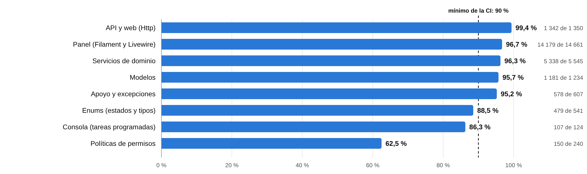
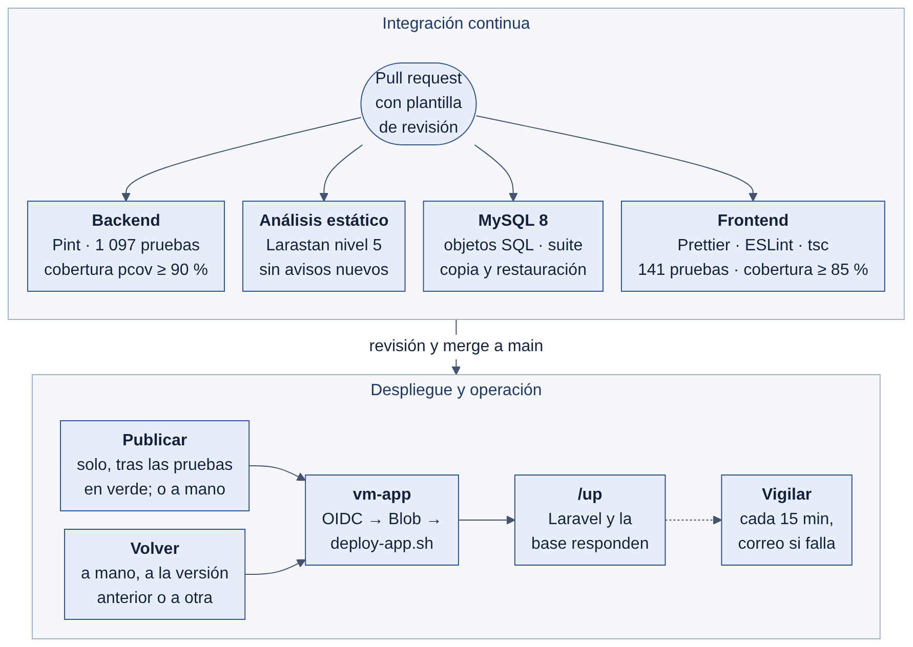
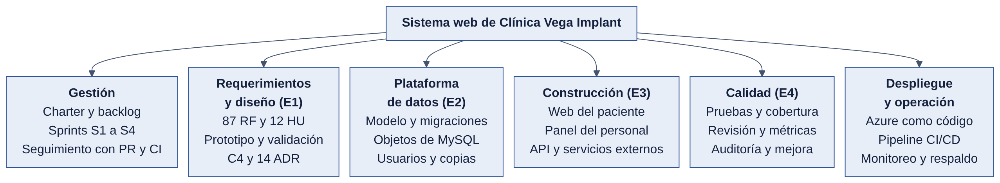
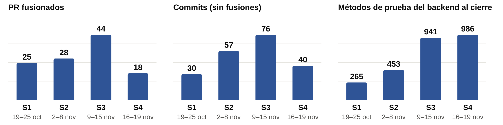
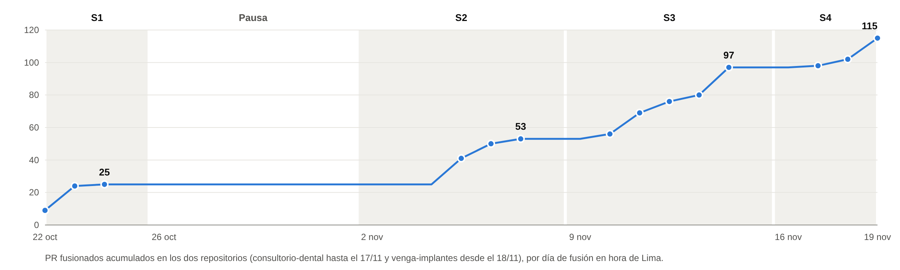
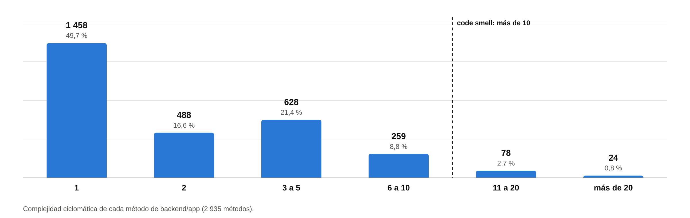

# Resumen ejecutivo

**Qué se evalúa.** Este entregable muestra la calidad del producto (pruebas, integración, despliegue y operación) y la del proceso con que se hizo (gestión ágil, aseguramiento y auditoría) del sistema web de Clínica Vega Implant. Todo dato sale del repositorio `venga-implantes` (rama del E4, sobre `main` en `e3ccd05`), de su historial y del de `consultorio-dental`, donde se trabajaron los primeros 98 PR, o de un comando corrido el 19/11/2026. Lo que solo puede hacer una persona va marcado `[PENDIENTE – estudiante]`.

**Estado de la calidad.**

1. **Pruebas.** 1 097 casos en el backend (10 555 verificaciones) y 141 en la web, todos en verde. Cubren los ocho flujos críticos, desde la reserva sin cruces hasta las copias de seguridad. La cobertura de líneas es de **96,1 %** en el backend y de **90,5 %** en la web: la CI la mide en cada cambio, exige 90 % y 85 % como mínimo y guarda los reportes (sección 1).
2. **Pipeline.** Cada PR pasa por cuatro trabajos: backend, análisis estático con Larastan, MySQL 8 y web. Lo que llega a `main` con la CI en verde se publica solo en Azure, sin claves y con identidad OIDC. El mismo workflow vuelve a la versión anterior en segundos (sección 2).
3. **Operación.** `/up` comprueba la aplicación y la base de datos. Desde fuera de Azure se vigila cada 15 minutos con aviso por correo, y Azure Monitor alerta por CPU y por VM caída. Los registros salen en JSON con el identificador de cada petición y van a Wazuh. Los respaldos tienen tres niveles: la copia diaria de la base, la copia horaria hacia la sede y las copias de 7 días de MySQL.

**Estado de la gestión.** El proyecto se llevó con un Scrum adaptado de sprints semanales, comparado con OpenUP en la sección 3.4. Los cuatro sprints se reconstruyeron con las fechas reales de los 115 PR fusionados, entre el 22/10 y el 19/11/2026. Cada PR dice qué cambia y cómo se probó, y solo se fusiona con la CI en verde. El Project Charter, el backlog y los sprints están en la sección 3 y en el anexo C.

**Aseguramiento y auditoría.** La matriz ISO/IEC 25010 tiene 16 métricas con meta y valor medido. Hay seis instrumentos de aseguramiento, entre ellos una plantilla de PR nueva con nueve puntos de revisión. Se midieron 2 935 métodos: la complejidad ciclomática media es de 2,87, y 102 métodos pasan de 10. Se hicieron cinco refactorizaciones reales, una de ellas en este entregable, que baja la reserva web de complejidad 31 a 15. Larastan, nuevo en la CI, encontró tres fallas que nadie había notado, ya corregidas con su prueba. La autoevaluación CMMI (SCAMPI C, no oficial) ubica al proceso en el **nivel 1 con prácticas de nivel 2 y 3 en marcha**: la ingeniería y la gestión de configuración son fuertes, y la planificación y la medición, débiles. El plan de mejora tiene once acciones con responsable y fecha, y dos ya están cumplidas (sección 4).

**Lo que falta para cerrar.** La primera publicación en verde y las capturas de producción, que dependen de encender Azure (sección 2.3). También faltan el rol de Joselyn y la sustentación.

# Pruebas

## Estrategia y niveles de prueba

Las pruebas siguen la pirámide: muchas pruebas rápidas sobre los servicios y las pantallas, menos sobre la API completa y pocas que dependen de MySQL. Cada regla del negocio tiene su prueba en el servicio que la implementa, y cada pantalla, la suya con el rol que la usa (tabla 1). Todas corren sin red: los servicios externos (WhatsApp, RENIEC por Decolecta, Nager.Date) se simulan con `Http::fake()`.

*Tabla 1. Niveles de prueba, contados en el código el 19/11/2026.*

| Nivel | Herramienta y carpeta | Archivos | Casos | Qué verifica |
| --- | --- | --: | --: | --- |
| Unitarias | PHPUnit · `tests/Unit` | 11 | 30 | Teléfonos, fechas, textos y cálculos sin base de datos. |
| Servicios de dominio | PHPUnit · `tests/Feature/Services` | 31 | 214 | Cada regla del negocio con la base: agenda sin cruces, cobros, planes, inventario, copias. |
| API y contrato | PHPUnit · `tests/Feature/Http` | 12 | 105 | Las 36 rutas de `/api/v1`, cada respuesta comparada con `docs/api/openapi.json`. |
| Panel del personal | PHPUnit + Livewire · `tests/Feature/Filament` | 85 | 598 | Pantallas por rol, formularios, acciones y permisos (84 pruebas de permisos en 50 archivos). |
| Tareas y modelos | PHPUnit · `Feature/Console`, `Feature/Models` | 12 | 27 | Las 10 tareas programadas, la limpieza diaria, auditoría de cambios y borrado lógico. |
| Operación | PHPUnit · `tests/Feature/ObservabilityTest` | 1 | 4 | `/up` con la base caída, el identificador de cada petición y el registro JSON (nuevo, sección 2.4). |
| Base de datos real | PHPUnit, grupo `mysql`, en MySQL 8 | 1 | 13 | Vistas, funciones, procedimientos y triggers del E2, y la suite completa otra vez sobre MySQL 8. |
| Web del paciente | Vitest 5.1 + Testing Library · `frontend/src` | 19 | 141 | Páginas y componentes con la API simulada: reservar, confirmar, cambiar, Mi cuenta. |
| Estática | Pint, Prettier, ESLint, TypeScript, Larastan | | | Formato y tipos; la CI falla ante cualquier diferencia o aviso nuevo. |

En el backend hay 991 métodos de prueba. Los 13 del grupo `mysql` solo corren en el job de MySQL 8, y los demás corren como 1 097 casos, porque los que usan `#[DataProvider]` se repiten una vez por cada caso de datos. Las pruebas se nombran como una regla de la clínica: por ejemplo, `test_rejects_web_booking_inside_the_minimum_lead_time`.

## Casos sobre los flujos críticos

Un flujo es crítico si su falla cuesta dinero o una cita, o expone un dato de salud. La tabla 2 muestra, para cada uno, el riesgo que cubre y algunos casos reales. La lista completa por archivo está en el anexo A.

*Tabla 2. Flujos críticos y sus casos de prueba.*

| Flujo | Riesgo si falla | Archivos (casos) | Qué comprueban, por ejemplo |
| --- | --- | --- | --- |
| Reservar en la web | Dos pacientes en el mismo horario | `BookingControllerTest` (21), `AppointmentServiceTest` (24), `BookingPage.test.tsx` (19) | Si otro tomó el horario mientras tanto, el paciente vuelve a elegir; lo que necesita evaluación no se reserva en línea. |
| Confirmar o cambiar desde el enlace | Una cita movida sin permiso | `LinkControllerTest` (16), `RescheduleRequestServiceTest` (14), `ChangePage.test.tsx` (8) | Con menos de un día, el cambio necesita aprobación; cancelar desde el enlace cancela la cita. |
| Agendar desde el panel | Cruces o bloqueos ignorados | `AgendaCalendarTest` (26), `OverbookingTest` (6), `ScheduleBlockClashTest` (8) | Un sobrecupo nunca pasa sobre un bloqueo ni sobre un horario guardado para la lista de espera. |
| Atender | Historia vista por quien no atiende | `ClinicalPanelTest` (18), `ClinicalServicesTest` (10), `AttendScreenTest` (8) | Solo el doctor de la cita la atiende; la plantilla deja fuera el medicamento que no le conviene al paciente. |
| Cobrar y cerrar caja | Cobrar dos veces o un cierre que no cuadra | `BillingServiceTest` (6), `TreatmentPlanPaymentsTest` (9), `CashClosingPanelTest` (6) | Corregir una atención no cobra dos veces; el cierre suma por medio y por persona sin lo anulado. |
| Permisos (Ley N.º 29733) | Recepción ve la historia clínica | `PanelAccessTest` (9) y 84 casos en 50 archivos | Cada rol abre solo lo que necesita; los doctores no ven la caja. |
| Copias y restauración | Perder la base o una copia rota | `DatabaseBackupTest`, `BackupsPanelTest` (10), `MysqlDatabaseObjectsTest` (13) | Restaurar una copia deja todo como estaba; solo el administrador odontólogo descarga copias. |
| Salud del sistema | Producción caída sin aviso | `ObservabilityTest` (4) | `/up` falla si la base de datos no responde. |

## Reporte de ejecución

La tabla 3 resume la última ejecución local, hecha sobre la rama de este entregable. La CI corre lo mismo en cada PR y en cada merge a `main`. El historial de la CI está en la sección 2.3, y la salida completa de cada suite, en el anexo A.

*Tabla 3. Ejecución del 19/11/2026.*

| Suite | Casos | Resultado | Tiempo |
| --- | --: | --- | --: |
| Backend con cobertura (PHPUnit, SQLite en memoria) | 1 097 | Todos pasan (10 555 verificaciones) | 386 s |
| Web con cobertura (Vitest, 19 archivos) | 141 | Todos pasan | 10 s |
| Backend sobre MySQL 8 (grupo `mysql` y suite completa) | 1 109 | Pasan en la CI, en el job de MySQL 8 | 3 a 5 min |
| Pint, Prettier, ESLint y TypeScript | | Sin observaciones | |
| Larastan, nivel 5 sobre `app/` (en la CI) | | Sin avisos nuevos; 2 174 en la línea base (sección 4.3) | 14 s |

## Cobertura

La cobertura del backend se mide con pcov en el job "Backend" de la CI. El job falla si baja de **90 % de las líneas** y guarda el reporte HTML 30 días como artefacto `cobertura-backend` (`.github/workflows/tests.yml`). Hoy cubre el **96,10 %** de las líneas (23 354 de 24 302) y el 85,83 % de los métodos. La meta queda por debajo de lo medido a propósito: deja margen para lo que se revisa a mano en pantalla y avisa cuando un cambio grande llega sin pruebas. La figura 1 la muestra por capa.

<!-- figura: diagramas/cobertura-por-capa.png 16cm -->

*Figura 1. Cobertura de líneas del backend por capa, con el mínimo que exige la CI. Reporte Clover de la ejecución del 19/11/2026.*

Lo que queda bajo el 90 % tiene motivo y está en el registro de deuda (anexo D):

- **Políticas de permisos (62,5 %).** De los 84 métodos sin cubrir, 45 son `delete`, `deleteAny`, `restore` y `forceDelete`. El panel nunca los llama, porque nada se borra de verdad (ADR-08 del E1). Igual deben negar si alguien los llama directo, así que quedan como deuda con prueba pendiente.
- **Consola (86,3 %) y `Services/Database` (42,6 %).** Son código que solo corre en MySQL o en producción. Este último lo prueba el job de MySQL 8, que no mide cobertura.
- **Sin cobertura.** Dos listas del panel que se usan pero no se prueban: los pacientes de una cuenta y los lotes de un material.

La web se mide desde este entregable con `@vitest/coverage-v8` en el job "Frontend": cubre el **90,47 %** de las líneas (769 de 850), el 90,88 % de las funciones y el 77,44 % de las ramas. El job falla si las líneas, sentencias o funciones bajan de 85 %, o las ramas de 70 %, y guarda el reporte 30 días como artefacto `cobertura-web`. Las ramas de los componentes (66,6 %) quedan como deuda (anexo A, tabla A2).

## Pruebas que encontraron fallas

Una prueba vale por las fallas que evita. En este proyecto, estas fallas reales las detectaron pruebas y no los pacientes:

- **Contrato de la API (E3).** Al comparar cada respuesta con OpenAPI aparecieron siete diferencias entre lo que la web esperaba y lo que la API mandaba. Se corrigieron antes de publicar.
- **MySQL 8 (E2).** La suite sobre MySQL encontró un `DISTINCT` con `ORDER BY` que SQLite acepta y MySQL rechaza en `TreatmentPlanService::linkCampaign`.
- **Prueba inestable (este entregable).** El merge del PR #5 falló porque el generador de nombres a veces llamaba "Jorge" al doctor, el nombre que una lista de espera no debía mostrar. Ahora se verifica por apellidos que el generador no produce (`AgendaFindAndListTest`); otras 12 verificaciones de una sola palabra quedan como deuda.
- **Configuración de producción (E3).** Cuatro corridas de la CI del PR del E3 fallaron porque una prueba dependía de `APP_DEBUG`; se corrigió en `8c20db0`.

# Integración, despliegue y operación continua

## Pipeline CI/CD

El pipeline tiene dos partes (figura 2). La **integración continua** corre en cada PR y en cada merge a `main`. El **despliegue** publica en Azure solo lo que pasó la CI en `main`, y la operación vigila el resultado.

<!-- figura: diagramas/pipeline.png 10.5cm -->

*Figura 2. Pipeline de integración, despliegue y operación (`.github/workflows`).*

*Tabla 4. Workflows de GitHub Actions.*

| Workflow | Cuándo corre | Qué hace | Si falla |
| --- | --- | --- | --- |
| "Pruebas" (`tests.yml`) | Cada PR y cada push a `main` | Los cuatro trabajos de la figura 2: formato, Larastan, pruebas con cobertura (≥ 90 % y ≥ 85 %), MySQL 8 con copia y restauración, y compilación de la web | El PR no se fusiona |
| "Desplegar en Azure", `publicar` (`desplegar-azure.yml`) | Solo, tras "Pruebas" en verde en `main` (con `DESPLIEGUE_AUTOMATICO=true`), o a mano | Sube el paquete a Blob y corre `deploy-app.sh` en `vm-app` (migra y cambia `current`); luego pide `/up` | La versión anterior sigue activa |
| "Desplegar en Azure", `volver` | A mano | Corre `volver-version.sh` en `vm-app` y pide `/up` | Se muestra el error en Actions |
| "Vigilar producción" (`vigilar-produccion.yml`) | Cada 15 min (con `VIGILAR_PRODUCCION=true`) | Pide `/up` desde fuera de Azure y anota código y tiempo | GitHub manda un correo |

## Configuración de la automatización

Las decisiones de configuración que hacen al pipeline seguro y repetible son estas:

- **Sin claves en GitHub.** El despliegue entra a Azure con un token OIDC que solo acepta la identidad `id-github-despliegue`, y solo para `main` (`infra/azure/prod/main.bicep`). Las variables del repositorio no son secretos.
- **Se publica lo que se probó.** El despliegue automático toma el commit exacto que pasó "Pruebas" (`workflow_run.head_sha`), aunque `main` haya avanzado mientras tanto. `concurrency` evita dos publicaciones a la vez.
- **Producción se puede apagar.** Azure for Students da 100 USD por integrante. Con las variables vacías, el pipeline se detiene en las pruebas y no publica ni vigila una VM apagada a propósito.
- **Esperas acotadas.** En el primer despliegue real, cada intento contra el proxy tardó 134 s y el job se quedó 14 minutos esperando. Ahora cada intento de `/up` corta a los 20 s y hay cinco reintentos.
- **Revisión en cada PR.** `.github/pull_request_template.md` (nuevo) pide qué cambia, cómo se probó y nueve puntos de revisión (sección 4.1).

## Evidencias de integración y despliegue

Hasta el 19/11/2026 a las 7:55 (hora de Lima) hubo 58 ejecuciones en GitHub Actions (tabla 5). Cada falla tuvo una causa encontrada y corregida.

*Tabla 5. Ejecuciones de GitHub Actions en `venga-implantes` (18/11 a 19/11/2026).*

| Workflow | Ejecuciones | En verde | Fallidas | Duración mediana | Causa de las fallas |
| --- | --: | --: | --: | --: | --- |
| Pruebas, en PR | 38 | 28 | 10 | 5 min 48 s | Cuatro por una prueba que dependía de `APP_DEBUG` (`8c20db0`), una por la prueba de `/up` en MySQL (`eaccb4c`) y cinco por la primera corrida de Larastan y su línea base (PR #20) |
| Pruebas, en `main` | 18 | 17 | 1 | 4 min 45 s | La prueba inestable de la sección 1.5, corregida en este entregable |
| Desplegar en Azure | 2 | 0 | 1 | 16 min | El NSG descartaba la respuesta de la web; corregido en el PR #17. La otra se omitió: el despliegue automático está apagado |

La primera publicación real (ejecución `44505713594`, 19/11/2026) llegó hasta el final del despliegue. Entró a Azure por OIDC, subió el paquete `20261119-102836-e3cf66c` a Blob y `deploy-app.sh` instaló las dependencias, migró la base, validó Nginx y dejó la versión activa. Solo falló la comprobación final, porque `/up` no respondía desde internet. El PR #17 de Jhoel agregó la regla de salida que faltaba en el NSG del firewall. Según su commit `2c1e51b`, desde ese cambio la web responde 200 en `/`, `/tratamientos`, `/reservar` y la API, y `/panel` da 403 desde internet.

`[PENDIENTE – estudiante (Jhoel): encender producción, correr "Desplegar en Azure" con la acción publicar y después con volver, y guardar las dos ejecuciones en verde con "Listo: …" y /up en 200 (anexo B)]`

## Observabilidad en producción

La operación responde tres preguntas: si el sistema está vivo, si está sano y qué pasó cuando algo falló. La tabla 6 muestra qué señal responde cada una.

*Tabla 6. Logs, métricas y alertas en producción.*

| Señal | Qué mide | Umbral o alerta | A quién avisa | Dónde está |
| --- | --- | --- | --- | --- |
| `/up` | Laravel arranca y la base de datos contesta (`select 1`) | 500 si la base no responde | Lo usan los dos siguientes | `AppServiceProvider::observeRequests`, `ObservabilityTest` |
| Vigilancia externa | `/up` desde fuera de Azure, con código y tiempo de respuesta | Falla tras tres intentos | Correo de GitHub a quien activó el horario | `vigilar-produccion.yml` (nuevo) |
| Azure Monitor | CPU de `vm-app` | Más de 80 % durante 15 min (severidad 2) | Correo del grupo de acciones `ag-vega` | `alerta-cpu-vm-app` en `prod/main.bicep` |
| Azure Monitor | Disponibilidad de `vm-app` y `vm-proxy` | Menos de 1 en 5 min (severidad 1) | Correo del grupo de acciones | `alerta-vm-caida` |
| Presupuesto | Gasto del mes contra 40 USD | 50 % y 80 % | Correo del equipo | `presupuesto.bicep` |
| Registros de la app | JSON con `request_id`, método, ruta y usuario (sin la dirección, que lleva el token del paciente) | `LOG_LEVEL`; se guardan 14 días | Wazuh | Canal `json` (nuevo) |
| Identificador de petición | Cabecera `X-Request-Id`, igual al `request_id` de sus registros | | Quien reporta una falla | `AddRequestContext` (nuevo) |
| Seguridad | Nginx, WAF, nftables y Suricata | Reglas de Wazuh | Tablero de Wazuh | `instalar-agentes.sh` |
| Tablero del administrador | Copias detenidas o WhatsApp con fallas | Aviso en "Hoy" | Dr. Vega, en el panel | RNF-DIS-02 del E1 |

Antes de este entregable, `/up` solo comprobaba que Laravel arrancara, y los registros eran texto sin contexto. Ahora `ObservabilityTest` prueba que `/up` falla con la base caída y que cada línea del registro JSON dice de qué petición, ruta y usuario viene. Si se quitan los listeners de `AppServiceProvider`, dos de sus cuatro pruebas fallan.

`[PENDIENTE – estudiante (Jhoel): capturas de las alertas en Azure Monitor, del tablero de Wazuh con eventos de vm-app y de una ejecución de "Vigilar producción" (anexo B)]`

## Estrategia de rollback y respaldos

Cada falla posible tiene su forma de volver atrás, con un tiempo o una pérdida de datos conocida (tabla 7).

*Tabla 7. Rollback y respaldos.*

| Si pasa esto | Se hace esto | Cuánto tarda o cuánto se pierde | Cómo se probó |
| --- | --- | --- | --- |
| La versión nueva falla | Acción `volver`: `volver-version.sh` rearma las cachés de la versión anterior, cambia `current` y recarga PHP-FPM y Nginx. Se guardan cinco versiones | Segundos, sin perder datos | `probar-volver-version.sh`: 6 casos en verde (anexo B) |
| La versión nueva migró y dañó datos | `respaldo:restaurar` con la copia previa, y después `volver` | Mediana de 3,2 s para restaurar (E2) | `DatabaseBackupTest` y el job de MySQL 8 |
| Se pierde la base | Restauración de MySQL Flexible a un punto en el tiempo | Copias automáticas de 7 días; minutos de datos | Configurado en `prod/main.bicep` `[PENDIENTE – estudiante: prueba en Azure]` |
| Se pierde la VM | `desplegar.sh` la recrea y `deploy-app.sh` publica | Unos 40 min sin intervenir (`infra/README.md`) | Primer despliegue del 19/11/2026 |
| Se pierde Azure | Copia diaria a las 03:00 subida a Blob a las 03:30, y copia horaria a la sede por la VPN (se guardan 48) | Una hora de datos | `copy-to-dr.sh` `[PENDIENTE – estudiante: prueba con la VPN]` |

# Gestión ágil del proyecto de software

## Project Charter

El Charter se escribió al cierre, con lo que el proyecto ya había decidido y registrado (tabla 8). El completo, con supuestos, criterios de éxito y firmas, está en el anexo C.

*Tabla 8. Project Charter (resumen).*

| Campo | Contenido |
| --- | --- |
| Proyecto | Sistema web de Clínica Vega Implant (Jr. Apurímac 648, Juliaca) |
| Patrocinador y cliente | Dr. Jassmanny Neil Vega Jaen, administrador y odontólogo de la clínica `[PENDIENTE – firma]` |
| Problema | Los pacientes reservan llamando, la agenda de cada doctor se cruza, y la historia clínica, los presupuestos y los cobros están en lugares distintos. |
| Objetivo general | Que la clínica reserve, atienda y cobre en un solo sistema web, con los datos de salud protegidos según la Ley N.º 29733. |
| Objetivos medibles | O1: el paciente reserva en línea en tres pasos, sin llamar (HU-01). O2: ninguna reserva cruza otra (RNF-REN-01, con prueba). O3: historia clínica, presupuestos y cobros en el mismo sistema (HU-07 a HU-11). O4: cada rol ve solo lo suyo (35 políticas). O5: el sistema queda en Azure con CI/CD, monitoreo y vuelta atrás. |
| Alcance | 87 requerimientos funcionales en 13 módulos, 17 no funcionales y 12 historias de usuario (E1). Web del paciente, panel del personal, API `/api/v1` e integración con WhatsApp, RENIEC y Nager.Date. |
| Fuera del alcance | La app móvil y el servicio de IA, descartados el 19/11/2026. Tampoco hay pasarela de pagos ni facturación electrónica: se cobra en el consultorio (ADR-09). |
| Equipo | Fran Franklin Calizaya Apaza, Jhoel Hairton Apaza Quispe y Joselyn Yucra Mamani (roles en la sección 3.4) |
| Plazo | Del 22/10/2026 (primer PR) a la sustentación del E4 `[PENDIENTE – estudiante: fecha]` |
| Presupuesto | Crédito de Azure for Students de 100 USD por integrante, con alertas al 50 % y al 80 % de 40 USD al mes. El software es libre y sin licencias. |

La EDT (figura 3) parte el trabajo en seis entregas. Cuatro de ellas son los entregables E1 a E4, y cada paquete tiene su evidencia en el repositorio.

<!-- figura: diagramas/edt.png 16cm -->

*Figura 3. Estructura de desglose del trabajo (EDT).*

*Tabla 9. Riesgos principales (registro completo en el anexo C).*

| Riesgo | Prob. | Impacto | Respuesta | ¿Ocurrió? |
| --- | :-: | :-: | --- | --- |
| La cuota de Azure for Students (6 vCPU por región) no alcanza para todas las VM | Alta | Alto | Producción y sede en regiones distintas, con una VM de laboratorio a la vez | Sí, el 19/11; se resolvió en el PR #17 |
| El alcance cambia tarde | Media | Alto | Backlog priorizado con MoSCoW y decisiones registradas como ADR | Sí: app móvil e IA descartadas el 19/11 (ADR-12 y ADR-13) |
| Un servicio externo no responde | Media | Medio | Tiempo de espera de 5 s y una alternativa propia (ADR-14) | Probado con `Http::fake()` |
| Se filtran datos de salud | Baja | Muy alto | Políticas por rol, auditoría de cambios, solo datos de prueba, sin claves en el repositorio | No |
| Código generado con un asistente de IA que nadie revisa | Media | Alto | Cada cambio en un PR con pruebas, la CI en verde y la revisión de un integrante | Controlado: 112 de 115 PR describen sus pruebas |
| Una prueba inestable bloquea el merge | Media | Bajo | Se corrige la causa, nunca se salta la prueba | Sí, el 19/11 (sección 1.5) |

## Historias de usuario, Product Backlog y Sprint Backlog

El **Product Backlog** es la lista de requerimientos del E1: 87 RF en 13 módulos, priorizados con MoSCoW (47 *Must*, 29 *Should* y 11 *Could*), y las 12 historias de usuario HU-01 a HU-12 con sus criterios de aceptación en Gherkin (tabla 10). Todos los RF están implementados y tienen prueba según la matriz de trazabilidad del E1. Los PR de cada módulo muestran en qué sprint se construyó.

*Tabla 10. Product Backlog por épica (módulo del E1).*

| Épica | RF (M/S/C) | Historias | Sprints y PR principales |
| --- | --- | --- | --- |
| RES · Reserva en línea | 7 (3/2/2) | HU-01 | S1 #9 · S2 #32 · S3 #82, #83, #86, #97 · S4 VI-4 |
| CTA · Mi cuenta y enlaces | 8 (4/3/1) | HU-02, 03, 04 | S1 #9, #23 · S2 #32 · S3 #96 · S4 VI-3 |
| AGE · Agenda | 13 (7/4/2) | HU-05, 06 | S1 #4 · S2 #42, #44, #45 · S3 #64, #74 a #76 · S4 #98, VI-7, VI-10 |
| CLI · Atención clínica | 9 (7/1/1) | HU-09, 11 | S1 #5, #8, #17, #18 · S2 #46 a #48 · S3 #58 |
| PRE · Presupuestos y planes | 6 (4/2/0) | HU-10 | S1 #6, #19 a #21 · S3 #60 a #63 |
| CAJ · Caja y cobros | 8 (7/1/0) | HU-07, 08 | S1 #11 · S2 #27, #51 · S3 #59 · S4 VI-6 |
| PAC · Pacientes | 6 (3/2/1) | | S2 #29, #40, #50 · S4 VI-9 |
| AVI · Avisos | 7 (3/3/1) | | S1 #15, #23 · S3 #65 |
| INV · Inventario | 5 (0/4/1) | | S2 #30, #53 |
| REP · Reportes | 5 (2/2/1) | | S1 #12, #22 · S3 #67 |
| CFG · Configuración | 6 (5/1/0) | HU-12 | S1 #14 · S2 #36 · S3 #77 a #81 |
| WEB · Web pública | 6 (2/3/1) | | S1 #10 · S2 #31 · S3 #84, #85, #87 a #95 |
| API · Contrato OpenAPI | 1 (0/1/0) | | S4 VI-1, VI-14 |

Los números con `#` son PR de `consultorio-dental`, y los que empiezan con `VI-`, de `venga-implantes`. El **Sprint Backlog** de cada sprint es la lista de sus PR, con fecha, rama y título: los 115 están en el anexo C.

## Ceremonias y métricas de avance

Se trabajó en **sprints de una semana calendario**, de lunes a domingo en hora de Lima. La semana del 26/10 al 1/11 no tuvo ningún PR y se registra como pausa. La tabla 11 resume cada sprint, y las figuras 4 y 5 muestran el avance.

*Tabla 11. Sprints reconstruidos del historial (`agil/sprints-desde-git.py`).*

| Sprint | Fechas | Objetivo (de los títulos de sus PR) | PR | Commits | Pruebas al cierre | PR abierto a fusionado (mediana) |
| --- | --- | --- | --: | --: | --: | --: |
| S1 | 19 al 25 oct | Primera versión completa: reserva web, agenda, historia clínica, presupuestos, cobros, reportes y copias | 25 | 30 | 265 | 3 min |
| S2 | 2 al 8 nov | Rediseño de la web y del panel, inventario, lista de espera y cierre del ciclo de la visita | 28 | 57 | 453 | 3 min |
| S3 | 9 al 15 nov | Corregir lo que hallaron las revisiones de agenda, configuración y web, y el panel en tiempo real | 44 | 76 | 941 | 4 min |
| S4 | 16 al 19 nov (en curso) | Separar la API y la web en React, sumar RENIEC y Nager.Date, desplegar en Azure y documentar E1 a E4 | 18 | 40 | 986 | 16 min |

<!-- figura: diagramas/velocidad-sprints.png 16cm -->

*Figura 4. Velocidad por sprint: PR fusionados, commits sin contar los de fusión y métodos de prueba del backend en `main` al cerrar cada sprint.*

<!-- figura: diagramas/avance-acumulado.png 16cm -->

*Figura 5. PR fusionados acumulados por día (burn-up), con los sprints sombreados.*

La medida de velocidad es el número de PR, porque no se estimó en puntos de historia. Un PR puede ser una corrección de una línea o un módulo entero, así que las cifras sirven para ver el ritmo y no para comparar el tamaño del trabajo. Por eso el plan de mejora pide estimar en puntos desde el próximo ciclo (sección 4.5). Dos métricas sí muestran la calidad del proceso. Las pruebas crecieron con el código: de 265 a 986 métodos, un 272 % más. Y el 97 % de los PR describen cómo se probaron.

*Tabla 12. Ceremonias de Scrum y su evidencia.*

| Ceremonia | Cómo se hizo | Evidencia | Estado |
| --- | --- | --- | --- |
| Planificación del sprint | Cada semana tuvo un objetivo, partido en PR pequeños por etapas ("Agenda, etapa 1 a 3", "Tandas 1 a 9") | Títulos y fechas de los PR (anexo C) | Reconstruida y confirmada por el equipo |
| Scrum diario | El equipo se coordinó por un grupo de WhatsApp, por llamadas y en reuniones en la universidad | | Sin evidencia escrita |
| Refinamiento | Revisiones del sistema que alimentaron el backlog: #41 (borrar sin romper la agenda), #74 (ocho correcciones de agenda), #77 (21 fallas de configuración) | PR de esas revisiones | Hecho |
| Revisión del sprint | Cada PR dice qué cambia y cómo se probó, y se fusiona con la CI en verde. La demostración con la clínica no quedó registrada | 112 de 115 PR | `[PENDIENTE – estudiante: demostración con el Dr. Vega]` |
| Retrospectiva | Hubo retrospectivas en algunos sprints, sin registro en el repositorio. Los borradores del anexo C salen de los datos de cada sprint y el equipo los revisó | Anexo C | Parcial |

## Comparación y adaptación frente a OpenUP

Se eligió **Scrum adaptado** como marco principal, por cuatro razones. El equipo tiene tres personas. Los plazos se miden en semanas. El alcance cambió hasta el final (app móvil e IA descartadas el 19/11). Y la integración continua permite entregar un incremento probado con cada PR. De **OpenUP** se tomó lo que Scrum no da y la evaluación de la UPeU pide: la arquitectura primero, los riesgos explícitos y los hitos por fase, que aquí coinciden con los entregables (tabla 13).

*Tabla 13. Scrum, OpenUP y lo que hizo el proyecto.*

| Aspecto | Scrum | OpenUP | Adaptación en el proyecto |
| --- | --- | --- | --- |
| Ciclo de vida | Sprints de duración fija, sin fases | Cuatro fases con un hito cada una: objetivos (Inicio), arquitectura (Elaboración), capacidad operativa (Construcción) y entrega (Transición) | Sprints semanales, con las fases de OpenUP como hitos. Inicio: diagnóstico de la FASE 0. Elaboración: E1 (C4 y 14 ADR) y E2. Construcción: S1 a S3. Transición: S4 (Azure, E3 y E4) |
| Iteración | De 1 a 4 semanas, con un incremento usable | Varias iteraciones por fase, de 2 a 6 semanas | 1 semana, y cada PR deja `main` lista para publicar |
| Disciplinas | No las define | Requisitos, Arquitectura, Desarrollo, Prueba, Despliegue, Gestión de configuración y cambio, y Gestión del proyecto | Todas tienen artefacto: SRS y HU (E1), C4 y ADR (E1), PR con pruebas, workflows, git con ramas y PR, y este Charter |
| Roles | Product Owner, Scrum Master y equipo de desarrollo | Stakeholder, analista, arquitecto, desarrollador, tester y jefe de proyecto | Fran: Product Owner y desarrollador, revisa e integra los PR. Jhoel: infraestructura y despliegue. Joselyn: `[PENDIENTE – estudiante: rol]`. Dr. Vega: stakeholder. El asistente de IA fue una herramienta del desarrollador, no un rol |
| Artefactos | Product Backlog, Sprint Backlog e incremento | Visión, lista de ítems de trabajo, arquitectura, casos de prueba y plan de iteración | El backlog son los RF y las HU del E1; la arquitectura, la sección 3 del E1; los casos de prueba, las suites; el plan de iteración, el objetivo del sprint |
| Riesgos | Implícitos en la inspección y adaptación | Explícitos: los riesgos guían el orden del trabajo | Registro de riesgos (tabla 9) y ADR para cada decisión con alternativas |

La adaptación tiene un costo, que la auditoría de la sección 4.4 confirma. Sin estimaciones ni un plan escrito por sprint, el avance se ve en el historial, pero no se puede comparar con lo planificado. La mejora propuesta es mantener el ritmo semanal y agregar dos cosas que ambos marcos piden: estimar el backlog y escribir el objetivo del sprint al empezarlo.

# Aseguramiento y auditoría de la calidad del software

## Instrumentos de aseguramiento

*Tabla 14. Instrumentos de aseguramiento de la calidad.*

| Instrumento | Tipo | Cuándo | Qué revisa | Evidencia |
| --- | --- | --- | --- | --- |
| Puertas de la CI | Verificación automática | Cada PR y cada merge | Formato, Larastan, 1 238 pruebas, cobertura (≥ 90 % y ≥ 85 %), MySQL 8 y compilación | `tests.yml`, tabla 5 |
| Plantilla de PR con checklist | Revisión entre pares | Cada PR | Hace lo que dice, pruebas, permisos, datos, errores, seguridad, contrato de la API, código ≤ 60 líneas y complejidad ≤ 10, documentos | `.github/pull_request_template.md` (nueva), anexo D |
| Revisión antes de fusionar | Revisión | Cada PR | Que la descripción coincida con el diff y la CI esté en verde | 115 PR fusionados por un integrante |
| Inspecciones del sistema | Inspección por módulo | Al cerrar una etapa | Fallas de uso y de datos, con su lista de hallazgos | PR #41, #74 (ocho correcciones), #77 (21 fallas) |
| Registro de decisiones (ADR) | Revisión de arquitectura | Cada decisión con alternativas | Opciones, decisión y consecuencias | 14 ADR del E1 |
| Métricas de código | Medición | En cada entregable | Complejidad, largo, parámetros y tamaño de clase | `calidad/medir-codigo.php` |

La matriz de calidad (tabla 15, en la página siguiente) toma las características de ISO/IEC 25010:2011. Cada una tiene una métrica que se puede volver a medir, su meta, el valor medido con su evidencia y el riesgo que cubre. Los instrumentos de la tabla 14 son los que mantienen esos valores.

[[HORIZONTAL]]

## Matriz de calidad

*Tabla 15. Matriz de calidad ISO/IEC 25010.*

| Característica (subcaracterística) | Métrica | Meta | Medido el 19/11/2026 (evidencia) | Riesgo que cubre |
| --- | --- | --- | --- | --- |
| Adecuación funcional (completitud) | RF implementados y con prueba | 100 % de los *Must* | 87 de 87 RF (matriz de trazabilidad del E1) | Falta una función pedida |
| Adecuación funcional (corrección) | Pruebas en verde | 100 % | 1 097 + 141, sin fallas (CI) | Una regla mal implementada |
| Eficiencia (comportamiento temporal) | Mediana de las rutas de lectura de la API | < 500 ms | 27 a 118 ms (medición del E3) | El paciente abandona la reserva |
| Eficiencia (comportamiento temporal) | LCP de la web en un celular con 4G lenta | ≤ 2,5 s | 1,65 a 1,92 s (Lighthouse, E3) | El paciente abandona la reserva |
| Eficiencia (uso de recursos) | CPU de `vm-app` | < 80 % sostenido | `[PENDIENTE – estudiante]` (alerta de CPU) | La VM se satura |
| Compatibilidad (interoperabilidad) | Rutas de la API que cumplen OpenAPI | 36 de 36 | 36 de 36 (contrato en `TestCase`) | La web y la API se desalinean |
| Usabilidad (accesibilidad) | Contraste del texto | ≥ 4,5:1 | Botón de WhatsApp de 4,30 a 4,87:1 (E3) | Pacientes mayores no leen |
| Fiabilidad (madurez) | Ejecuciones de la CI en `main` en verde | ≥ 95 % | 17 de 18, 94 % (Actions) | Merges que rompen `main` |
| Fiabilidad (disponibilidad) | `/up` en 200 en la vigilancia | ≥ 99 % | `[PENDIENTE – estudiante]` (Vigilar producción) | Caída sin aviso |
| Fiabilidad (recuperabilidad) | Restauración y pérdida de datos | < 1 min; ≤ 1 h | 3,2 s y RPO de 1 h (E2, `copy-to-dr.sh`) | Perder citas o pagos |
| Seguridad (confidencialidad) | Pantallas clínicas con política y prueba de rol | 100 % | 35 políticas, 84 pruebas (`PanelAccessTest`) | Recepción ve la historia clínica |
| Seguridad (responsabilidad) | Cambios con usuario, fecha y valor anterior | 100 % de lo sensible | 40 modelos auditables (`AuditableTest`) | No saber quién cambió un cobro |
| Mantenibilidad (capacidad de prueba) | Cobertura de líneas del backend y de la web | ≥ 90 % y ≥ 85 % | 96,10 % y 90,47 % (mínimos de la CI) | Cambios grandes sin pruebas |
| Mantenibilidad (analizabilidad) | Avisos nuevos de Larastan, nivel 5 | 0 | 0, con 2 174 en la línea base (CI) | Errores de tipo que llegan a producción |
| Mantenibilidad (modificabilidad) | Métodos con complejidad ≤ 10 | ≥ 95 % | 96,5 %, 2 833 de 2 935 (`medir-codigo.php`) | Código difícil de cambiar |
| Portabilidad (instalabilidad) | Entorno creado desde el código | Solo pasos escritos | 40 min automáticos y 15 min escritos (`infra/README.md`) | Depender de una persona |

[[VERTICAL]]

## Calidad del código, code smells y deuda técnica

**Atributos internos.** `medir-codigo.php` recorre `backend/app` con el analizador de PHP que ya trae Laravel (nikic/php-parser), así que no se agregó ninguna dependencia. Midió 482 clases y 2 935 métodos. La complejidad ciclomática media es de **2,87** (percentil 90: 6), el 87,7 % de los métodos tiene complejidad de 5 o menos, y el método promedio mide 12,9 líneas (figura 6). Los **atributos externos** son los de la matriz: eficiencia, fiabilidad y seguridad medidas en ejecución.

<!-- figura: diagramas/complejidad-metodos.png 15cm -->

*Figura 6. Distribución de la complejidad ciclomática de los métodos del backend.*

*Tabla 16. Code smells (umbrales usuales de PHPMD y SonarQube para PHP).*

| Code smell | Umbral | Casos | Los mayores | Decisión |
| --- | --- | --: | --- | --- |
| Método largo | > 60 líneas | 73 | `ConsultationForm::configure` (360 líneas), `TreatmentPlanForm::configure` (179) | Los formularios de Filament son declarativos y largos por naturaleza. Se aceptan, salvo los que además son complejos |
| Método complejo | > 10 | 102 | `TreatmentRisks::for` (41), `ConsultationForm::addPackageAction` (39), `FindingsDictation::read` (33) | `TreatmentRisks::for` es una tabla de reglas plana: se acepta. Los otros dos van al plan de mejora |
| Lista larga de parámetros | > 5 | 29 | `BillingService::charge`, `ConsentService::fill`, `GapFinder::nextSlots` (7) | Agrupar en objetos de datos, como ya hace `WebBookingData` |
| Clase grande | > 500 líneas | 12 | `ConsultationForm` (1 336), `Agenda` (1 289), `TreatmentPlanService` (1 099) | Partir por responsabilidad cuando se vuelvan a tocar |

**Deuda gestionada con refactorización.** La tabla 17 muestra cinco refactorizaciones reales con su PR y su efecto medido. Ninguna cambió lo que ve la clínica, y las pruebas existentes lo confirman.

*Tabla 17. Refactorizaciones hechas.*

| PR | Code smell | Refactorización | Resultado |
| --- | --- | --- | --- |
| `consultorio-dental` #75 | Lógica duplicada: "sin cerrar" calculado en cinco lugares, y dos pantallas de "Nueva cita" | Una sola regla (`scope unclosed` e `isUnclosed()`) y una sola ventana; la página duplicada redirige | 63 archivos, +1 257/−313; la agenda, "Hoy" y la cita dan el mismo número |
| `consultorio-dental` #78 | Booleanos que dependen entre sí y código repetido | El enum `WebPresence` reemplaza tres booleanos, y se extraen `WeeklySchedule`, `ColorSwatches` y `HasWebSlug` | 49 archivos, +2 049/−257 |
| `venga-implantes` #1 | Web pública mezclada con el panel en Blade y Livewire | Laravel pasa a `backend/` como API, y la web a React en `frontend/` | Dos aplicaciones con contrato OpenAPI y pruebas propias |
| Este entregable | Método largo y complejo: `BookingController::store`, 85 líneas y complejidad 31 | Se extraen `bookingData()` y `confirmation()` y se quita un parámetro sin uso | `store` queda en 52 líneas y complejidad 15; las 90 pruebas de la API siguen en verde |
| Este entregable | Prueba inestable | Verificación por apellidos que el generador no produce | `AgendaFindAndListTest` estable |

**Análisis estático.** Desde este entregable, Larastan (PHPStan para Laravel) revisa `backend/app` en nivel 5 en cada PR. Su primera corrida dio 2 178 avisos en 220 archivos, y cuatro venían de tres fallas reales. La más seria: `MagicLink::prunable()` declaraba un `Builder` sin importarlo, así que la limpieza diaria (`model:prune`) se caía y los enlaces de WhatsApp vencidos nunca se borraban. Las otras dos le pasaban a `persistent()` una condición que Filament ignora. Se corrigieron con su prueba (anexo D, tabla D5). Los 2 174 avisos restantes vienen de tipos que el analizador no deduce: más de la mitad son relaciones sin tipo genérico, que ve como un `Model` cualquiera. Quedan en `phpstan-baseline.php` como deuda: la CI falla con cualquier aviso nuevo y la lista solo puede bajar (tabla D6).

La deuda que queda tiene un registro (anexo D) con 14 partidas, su costo estimado y su decisión: pagar en el plan de mejora, pagar cuando se toque el código, o aceptar con motivo.

## Auditoría técnica y madurez del proceso

**Método.** Es una autoevaluación con el método **SCAMPI clase C** sobre CMMI-DEV v1.3, completada con el perfil básico de **ISO/IEC 29110**. No reemplaza una evaluación oficial (SCAMPI A), que necesita un evaluador líder certificado. Cada práctica se calificó por la evidencia en el repositorio: Totalmente (TI), Mayormente (MI), Parcialmente (PI) o No implementada (NI). Los checklists completos de gestión de proyecto, ingeniería y soporte están en el anexo D.

*Tabla 18. Áreas de proceso de CMMI-DEV evaluadas.*

| Área de proceso | Nivel | Evidencia principal | Calificación |
| --- | :-: | --- | :-: |
| Gestión de requerimientos (REQM) | 2 | 87 RF con identificador, matriz de trazabilidad verificada por script y cambios de alcance registrados como ADR | TI |
| Planificación del proyecto (PP) | 2 | Backlog priorizado y Charter; sin estimaciones ni plan por sprint escrito antes de empezar | PI |
| Monitoreo y control del proyecto (PMC) | 2 | Avance visible en PR y CI; no se compara con un plan | PI |
| Medición y análisis (MA) | 2 | La CI mide pruebas, cobertura y avisos de Larastan en cada cambio; no había un plan de medición antes del E4 | PI |
| Aseguramiento de la calidad (PPQA) | 2 | Puertas de la CI, plantilla de PR e inspecciones; sin un revisor distinto de quien integra | MI |
| Gestión de configuración (CM) | 2 | Todo en git (código, base, infraestructura y documentos), cambios por PR, versiones numeradas y cinco guardadas en producción | TI |
| Gestión de acuerdos con proveedores (SAM) | 2 | No hay proveedores contratados; los servicios externos se tratan en ADR-14 | No aplica |
| Desarrollo de requerimientos (RD) | 3 | SRS, HU con Gherkin y prototipo; falta la validación firmada con la clínica | MI |
| Solución técnica (TS) | 3 | C4, 14 ADR, diagramas de clases, secuencia y estados | TI |
| Integración del producto (PI) | 3 | CI con cuatro trabajos, contrato OpenAPI y despliegue automatizado; la primera publicación aún no termina en verde | MI |
| Verificación (VER) | 3 | 1 238 pruebas, análisis estático, revisión de PR e inspecciones | TI |
| Validación (VAL) | 3 | Guion de validación por rol listo; sin actas de la clínica | PI |
| Gestión de riesgos (RSKM) | 3 | Riesgos registrados al cierre y respuestas en los ADR; sin revisión periódica | PI |
| Análisis y resolución de decisiones (DAR) | 3 | 14 ADR con alternativas y criterios | MI |

**Resultado.** El nivel de madurez 2 exige que todas sus áreas estén al menos mayormente implementadas, y PP, PMC y MA están parcialmente. Por eso el proceso queda en el **nivel 1, con prácticas de nivel 2 y 3 en marcha**. La parte técnica (REQM, CM, TS y VER) tiene evidencia completa, y lo que falta es de gestión: planificar, medir contra el plan y validar con la clínica.

En **ISO/IEC 29110**, perfil básico, los seis procesos de implementación (SI.1 a SI.6) tienen evidencia, con SI.2 y SI.6 parciales por la validación y la entrega en producción pendientes. De gestión del proyecto, PM.2 (ejecución) se cumple, PM.1 (planificación) y PM.3 (evaluación y control) son parciales, y PM.4 (cierre) queda pendiente hasta la aceptación de la clínica y la sustentación. El checklist está en el anexo D.

## Plan de mejora de la calidad del software

Cada acción ataca un hallazgo de la auditoría o de la matriz, y tiene una métrica que dice si funcionó (tabla 19). El equipo revisó los responsables y plazos el 19/11/2026.

*Tabla 19. Plan de mejora.*

| N.º | Hallazgo | Acción | Responsable | Fecha | Se cumple si |
| --: | --- | --- | --- | --- | --- |
| 1 | PP y PMC parciales | Estimar el backlog en puntos y escribir el objetivo de cada sprint al empezarlo | Fran | Sprint siguiente | Cada sprint tiene un plan y una velocidad en puntos |
| 2 | Retrospectivas sin registro | Retrospectiva de 30 min al cerrar cada sprint, con acta en el repositorio | Todo el equipo | Cada viernes | Cuatro actas seguidas |
| 3 | VAL y RD sin actas | Validar con el Dr. Vega y la recepcionista con el guion del E1 | Joselyn | Antes de la sustentación | Actas firmadas en el anexo B del E1 |
| 4 | Sin análisis estático de PHP | Larastan en la CI, con línea base de la deuda actual | Fran | Cumplida el 19/11 (PR #20) | Nivel 5 sin avisos nuevos; tres fallas reales corregidas |
| 5 | La web no mide cobertura | `@vitest/coverage-v8` en la CI con un mínimo | Fran | Cumplida el 19/11 (PR #20) | 90,5 % de las líneas; la CI exige 85 % |
| 6 | Producción sin evidencia de operación | Publicar, volver y vigilar en Azure; activar las variables | Jhoel | Al encender producción | Dos ejecuciones en verde y una semana de vigilancia |
| 7 | Políticas al 62,5 % | Pruebas de que `delete`, `restore` y `forceDelete` niegan | Fran | Dos semanas | Políticas ≥ 90 % |
| 8 | Métodos con complejidad > 20 | Partir `ConsultationForm::addPackageAction` y `FindingsDictation::read` | Fran | Cuando se toquen | Ningún método nuevo > 10 sin motivo escrito |
| 9 | 12 verificaciones negativas frágiles | Usar textos únicos en esas pruebas | Fran | Una semana | Cero fallas inestables en `main` |
| 10 | Acciones de GitHub con Node 20 en retiro | Actualizar `checkout`, `setup-node` y `azure/login` | Jhoel | Antes de que GitHub las retire | Sin avisos de Node 20 en los workflows |
| 11 | 2 174 avisos de Larastan en la línea base | Tipo genérico en las relaciones y revisar por qué el analizador no lee los casts, accessors ni scopes | Fran | Dos sprints | Línea base con menos de 1 000 avisos |
