# Especificación de requerimientos

## Propósito, alcance y fuentes

**Problema.** Clínica Vega Implant (Jr. Apurímac 648, Juliaca) necesita que sus pacientes reserven en línea y confirmen por WhatsApp, que la agenda de cada doctor no tenga cruces ni huecos inútiles, que la historia clínica con odontograma, los presupuestos firmados y los cobros queden en un solo lugar, y que los datos de salud se protejan según la Ley N.º 29733. `[PENDIENTE – estudiante: describir en dos líneas cómo se trabajaba antes del sistema (agenda, avisos y cobros), validado con el Dr. Vega]`

**Alcance.** Este documento especifica, valida y diseña el sistema que ya existe en el repositorio `venga-implantes` (una aplicación Laravel 13 con la web del paciente en React 19 y el panel del personal en Filament) y las dos piezas que se agregan en la FASE 3: la app móvil para pacientes y el servicio de IA que estima el riesgo de inasistencia. Cubre 88 requerimientos funcionales en 15 módulos (81 implementados y 7 planificados), 16 no funcionales, 23 reglas de negocio y 14 historias de usuario.

Esta especificación sigue la estructura de IEEE 830 y los atributos de ISO/IEC/IEEE 29148: cada requerimiento tiene un identificador único, una prioridad MoSCoW, un estado (implementado o planificado) y al menos una forma de verificarlo. Las fuentes son, en este orden: el código del repositorio `venga-implantes` (commit `b91fdee`), los nombres de sus 923 métodos de prueba, el documento de contexto del cliente con las decisiones tomadas el 23/10/2026 y las decisiones del estudiante del 18/11/2026 (app móvil y despliegue en Azure). Nada se tomó de suposiciones: lo que no está en esas fuentes figura como pendiente.

Prioridades MoSCoW: **M** (debe tenerlo), **S** (debería), **C** (podría) y **W** (no en esta versión). Estado: **I** implementado y probado; **P** planificado para la FASE 3.

## Interesados y usuarios

*Tabla 1. Interesados y usuarios del sistema.*

| Interesado | Rol en el sistema | Qué necesita | Cómo entra |
| --- | --- | --- | --- |
| Paciente y su familia | Usuario de la web (y de la app móvil planificada) | Reservar sin llamar, confirmar o cambiar su cita, ver sus pagos y planes | Sin contraseña: celular recordado y enlaces personales por WhatsApp |
| Recepción | `UserRole::Reception` | Agenda de todos los doctores, avisos, cobros, caja e inventario | Panel con correo y contraseña |
| Doctor | `UserRole::Doctor` | Su agenda, la historia clínica de sus pacientes, presupuestos y recetas | Panel con correo y contraseña |
| Administrador (Dr. Vega) | `UserRole::Admin`, odontólogo (`is_dentist`) | Todo lo anterior, configuración, reportes, copias de seguridad y auditoría | Panel con correo y contraseña |
| Equipo de desarrollo | Fran Franklin Calizaya Apaza, Jhoel Hairton Apaza Quispe y Joselyn Yucra Mamani | Requerimientos claros y trazables | Repositorio y CI |

## Requerimientos funcionales

Los módulos son: WEB (web pública), RES (reserva en línea), CTA (Mi cuenta y enlaces), AGE (agenda), PAC (pacientes), CLI (atención clínica), PRE (presupuestos y planes), CAJ (caja y cobros), INV (inventario), AVI (avisos), REP (reportes), CFG (configuración y administración), MOV (app móvil), IA (servicio de inasistencias) y API (API para servicios externos). La prueba automatizada de cada uno está en la matriz de trazabilidad del anexo A.

*Tabla 2. Requerimientos funcionales.*

| ID | El sistema debe… | Prior. | Est. |
| --- | --- | :-: | :-: |
| RF-WEB-01 | Mostrar los datos de la clínica y su horario, calculado de los horarios de los doctores activos, y decir si está abierta ahora. | M | I |
| RF-WEB-02 | Publicar una página por tratamiento con duración y precio "desde"; los tratamientos ocultos o inactivos no tienen página. | M | I |
| RF-WEB-03 | Mostrar el equipo con su colegiatura, opiniones, preguntas frecuentes por tema y casos de antes y después solo con consentimiento escrito del paciente. | S | I |
| RF-WEB-04 | Publicar promociones y campañas con su precio y aplicar el código promocional al reservar. | C | I |
| RF-WEB-05 | Entregar cada página con título, descripción y datos estructurados para Google, y un mapa del sitio que deja fuera lo privado. | S | I |
| RF-WEB-06 | Permitir al administrador editar los textos y fotos de cada página de la web desde el panel. | S | I |
| RF-RES-01 | Reservar en tres pasos (servicio, día y hora, datos), ofreciendo solo los tratamientos que se reservan en línea. | M | I |
| RF-RES-02 | Ofrecer solo horarios donde cabe el tratamiento completo más el tiempo de esterilización, primero los que no dejan huecos. | M | I |
| RF-RES-03 | Permitir elegir doctor o tomar el primero disponible. | S | I |
| RF-RES-04 | Reservar al instante en estado Pendiente, crear la cuenta del celular y el paciente, preparar la confirmación por WhatsApp y alertar a recepción. | M | I |
| RF-RES-05 | Reservar para un familiar desde un celular recordado sin volver a escribir el número. | S | I |
| RF-RES-06 | Entregar la cita como archivo de calendario (.ics) con dirección firmada. | C | I |
| RF-RES-07 | Preguntar una sola vez cómo nos conoció el paciente, después de reservar. | C | I |
| RF-CTA-01 | Abrir el enlace personal de la cita para verla, confirmarla o cancelarla. | M | I |
| RF-CTA-02 | Cambiar la cita en el acto con más de 24 h de anticipación, o proponer hasta tres horarios si falta menos. | M | I |
| RF-CTA-03 | Mostrar en Mi cuenta las próximas citas de la familia en un celular recordado, y el historial, planes y pagos solo tras una verificación reforzada. | M | I |
| RF-CTA-04 | Pedir un enlace de acceso que queda listo para que recepción lo envíe, sin revelar números. | M | I |
| RF-CTA-05 | Registrar los antecedentes de salud de cada paciente antes de su primera cita. | S | I |
| RF-CTA-06 | Pedir la siguiente sesión del plan desde Mi cuenta, avisando a recepción una sola vez. | C | I |
| RF-CTA-07 | Salir y olvidar el celular recordado. | S | I |
| RF-AGE-01 | Mostrar la agenda por día, semana, mes y lista; recepción ve a todos los doctores y cada doctor solo la suya. | M | I |
| RF-AGE-02 | Crear citas desde el panel, confirmadas y con su aviso preparado, registrando al paciente nuevo en la misma ventana. | M | I |
| RF-AGE-03 | Mover una cita (también arrastrándola) y cambiar su tratamiento o duración, rechazando los cruces y diciendo con qué cita o bloqueo choca. | M | I |
| RF-AGE-04 | Llevar la cita por sus estados (confirmar, llegó, en atención, atendida, no asistió, cancelada) y deshacer el último paso dentro de un día. | M | I |
| RF-AGE-05 | Registrar bloqueos de horario (almuerzo, curso, vacaciones) y cargar de una vez los feriados nacionales del año. | M | I |
| RF-AGE-06 | Registrar el horario semanal de cada doctor, con rangos válidos solo por temporada. | M | I |
| RF-AGE-07 | Buscar el próximo hueco y llevar una lista de espera que ofrece el horario liberado por WhatsApp y lo aparta mientras el paciente responde. | S | I |
| RF-AGE-08 | Permitir sobrecupos marcados a propósito y series de citas repetidas con un solo aviso. | S | I |
| RF-AGE-09 | Recibir a quien llega sin cita en el primer hueco del día. | S | I |
| RF-AGE-10 | Aprobar, rechazar u ofrecer otro horario ante una solicitud de cambio del paciente. | M | I |
| RF-AGE-11 | Aprender cuánto tarda de verdad cada doctor en cada tratamiento y reservar ese tiempo. | C | I |
| RF-AGE-12 | Imprimir la hoja del día por doctor para marcar a mano. | C | I |
| RF-PAC-01 | Registrar pacientes evitando duplicados por documento, nombre y celular, validando el documento según su tipo. | M | I |
| RF-PAC-02 | Agrupar a la familia bajo un celular con un titular y su parentesco; los menores llevan un apoderado que firma por ellos. | M | I |
| RF-PAC-03 | Mostrar la ficha del paciente con una línea de tiempo, su saldo y el siguiente paso; la alerta médica solo a quien lo atiende. | M | I |
| RF-PAC-04 | Listar seguimientos: inasistencias sin nueva cita, controles vencidos, presupuestos sin aceptar, cumpleaños y pedido de reseña en Google. | S | I |
| RF-PAC-05 | Bloquear y desbloquear las reservas web de un celular. | S | I |
| RF-CLI-01 | Abrir la atención desde la cita con la plantilla del tratamiento y el odontograma anterior; solo la abre el doctor de la cita. | M | I |
| RF-CLI-02 | Registrar antecedentes médicos y mostrar las alergias junto al nombre del paciente. | M | I |
| RF-CLI-03 | Llevar el odontograma por superficies, con hallazgos escritos o dictados y sugerencias de diagnóstico y procedimiento. | M | I |
| RF-CLI-04 | Emitir recetas que avisan por alergia, edad, embarazo y enfermedad, con dosis pediátrica por peso. | M | I |
| RF-CLI-05 | Firmar en pantalla consentimientos informados (también el apoderado), imprimirlos y revocarlos sin borrarlos. | M | I |
| RF-CLI-06 | Adjuntar radiografías y fotos comprimidas, servidas solo a quien puede ver la historia clínica. | M | I |
| RF-CLI-07 | Terminar la atención revisando lo que suele olvidarse y permitir reabrirla hasta 24 h después. | M | I |
| RF-CLI-08 | Imprimir la historia clínica completa con su odontograma, dejando registro de quién la imprimió. | S | I |
| RF-CLI-09 | Seguir los trabajos de laboratorio desde que salen hasta que se pagan. | C | I |
| RF-PRE-01 | Armar el presupuesto desde el odontograma, con la pieza, el motivo y la fecha hasta la que vale el precio. | M | I |
| RF-PRE-02 | Aceptar el plan con firma y forma de pago: por sesión, al contado con descuento o en cuotas mensuales. | M | I |
| RF-PRE-03 | Fijar los precios al firmar; lo que se agrega después se firma aparte. | M | I |
| RF-PRE-04 | Armar paquetes de tratamientos y paquetes 2x1 para otra persona. | S | I |
| RF-PRE-05 | Hacer seguimiento de cada presupuesto: en qué está, mensaje de WhatsApp y próxima cita. | S | I |
| RF-PRE-06 | Avanzar el plan con cada sesión atendida y retrocederlo si se reabre la atención. | M | I |
| RF-CAJ-01 | Cobrar una cita atendida en un solo paso, con descuento no mayor al precio y vuelto calculado en efectivo. | M | I |
| RF-CAJ-02 | Llevar el saldo de cada paciente con cargos manuales y pagos adelantados como crédito. | M | I |
| RF-CAJ-03 | Dar una constancia de pago con lo pagado y lo que falta. | M | I |
| RF-CAJ-04 | Cargar cada cuota el día que vence y listar las cuotas atrasadas y las de la semana. | M | I |
| RF-CAJ-05 | Cerrar la caja del día por medio de pago y por persona, bloqueando los pagos de ese día para recepción. | M | I |
| RF-CAJ-06 | Anular pagos y cargos con su motivo, sin borrarlos. | M | I |
| RF-CAJ-07 | Registrar gastos; el efectivo pagado sale de la caja. | S | I |
| RF-INV-01 | Llevar los materiales por lote y vencimiento, empezando con una lista sugerida y un conteo. | S | I |
| RF-INV-02 | Descontar la receta de materiales del tratamiento al cerrar la atención, primero lo que vence primero. | S | I |
| RF-INV-03 | Registrar el lote y la serie de cada implante en el paciente. | S | I |
| RF-INV-04 | Pedir por WhatsApp lo que falta, recibir el pedido por lotes y alertar stock mínimo y vencimientos. | S | I |
| RF-INV-05 | Calcular la bandeja del día y cuándo se acaba cada material según las citas. | C | I |
| RF-AVI-01 | Preparar 22 tipos de avisos de WhatsApp (confirmación, recordatorio, cambios, cuotas, cumpleaños…) con textos editables. | M | I |
| RF-AVI-02 | Etapa 1: abrir WhatsApp con el mensaje escrito (wa.me) y marcarlo como enviado. | M | I |
| RF-AVI-03 | Etapa 2: enviar los avisos solos por la API oficial de Meta cuando se active. | S | I |
| RF-AVI-04 | Pasar a "llamar" las citas del día siguiente que siguen sin confirmar a la hora configurada. | M | I |
| RF-AVI-05 | Anunciar campañas solo a quien aceptó recibir promociones. | C | I |
| RF-AVI-06 | Avisar al personal en la campana y en vivo (por ejemplo, que su paciente espera). | S | I |
| RF-REP-01 | Mostrar en "Hoy" las tarjetas de cada rol: citas, por confirmar, sala de espera y cobrado. | M | I |
| RF-REP-02 | Reportar ingresos por día, doctor, tratamiento y medio de pago, en Excel e impresión. | S | I |
| RF-REP-03 | Reportar actividad: atenciones, inasistencias, ocupación y horas más llenas. | S | I |
| RF-REP-04 | Mostrar el dinero en espera: presupuestos sin aceptar e inasistencias. | C | I |
| RF-REP-05 | Ocultar las ganancias a recepción y mostrarlas al doctor solo si la clínica lo permite. | M | I |
| RF-CFG-01 | Gestionar usuarios por rol, con contraseña propia obligatoria al primer ingreso y recuperación por correo. | M | I |
| RF-CFG-02 | Configurar tratamientos (duración, precio, quién los atiende, dónde aparecen) y doctores. | M | I |
| RF-CFG-03 | Cambiar las reglas de reserva y de avisos sin tocar código, rechazando reglas que se contradicen. | M | I |
| RF-CFG-04 | Guardar el historial de cambios (quién, qué y valor anterior), que solo lee el administrador. | M | I |
| RF-CFG-05 | Crear una copia diaria de la base, restaurarla y dejar que solo el administrador odontólogo la descargue. | M | I |
| RF-CFG-06 | Versionar los textos de consentimiento y llevar opciones rápidas y textos de WhatsApp editables. | S | I |
| RF-MOV-01 | App móvil: entrar con el celular y el enlace personal que llega por WhatsApp, sin contraseña. | S | P |
| RF-MOV-02 | App móvil: ver, confirmar, cambiar y cancelar las citas de la familia con las mismas reglas de la web. | S | P |
| RF-MOV-03 | App móvil: reservar una cita en tres pasos. | S | P |
| RF-MOV-04 | App móvil: ver el saldo, las cuotas y los pagos tras la verificación reforzada. | S | P |
| RF-IA-01 | Servicio de IA: estimar la probabilidad de que una cita termine en "No asistió" (`POST /predict`). | S | P |
| RF-IA-02 | Mostrar ese riesgo a recepción en la agenda y seguir funcionando si el servicio no responde. | S | P |
| RF-API-01 | Documentar la API `/api/v1` en OpenAPI y probar cada ruta. | S | P |

Son 81 requerimientos implementados (I) y 7 planificados (P), 88 en total.

## Requerimientos no funcionales

*Tabla 3. Requerimientos no funcionales y cómo se verifican.*

| ID | Requerimiento y criterio | Cómo se verifica |
| --- | --- | --- |
| RNF-SEG-01 | El personal entra con correo y contraseña de letras y números; quien recibe una contraseña de otro debe cambiarla al entrar; un usuario inactivo no entra. | `UserAccessSafeguardsTest`, `OwnPasswordAtFirstLoginTest`, `PanelAccessTest::test_inactive_users_cannot_enter` |
| RNF-SEG-02 | Cada rol abre solo lo que necesita; los permisos viven en 35 políticas. | `PanelAccessTest::test_each_role_only_opens_what_it_needs` |
| RNF-SEG-03 | Cada respuesta lleva `X-Frame-Options`, `Referrer-Policy`, `Permissions-Policy` y, en HTTPS, HSTS de 180 días. | `SecurityHeaders.php`; `PanelAccessTest::test_pages_tell_the_browser_how_to_protect_them` |
| RNF-SEG-04 | Límite de peticiones por IP: 60 páginas y 240 llamadas a la API por minuto; 8 reservas por hora; 5 pedidos de acceso por hora por IP y 2 por celular. | `AppServiceProvider.php`, `BookingController.php`; `BookingControllerTest::test_many_bookings_in_a_row_from_the_same_connection_are_stopped` |
| RNF-SEG-05 | La API usa la sesión con token XSRF; los enlaces personales tienen 32 caracteres y se guardan solo como hash. | `client.test.ts`; columnas `token_hash` de `magic_links` y `remembered_devices` |
| RNF-LEY-01 | Ley N.º 29733: la historia clínica la ven el doctor que atiende al paciente y el administrador si es odontólogo; recepción ve el procedimiento sin la pieza; la privacidad y las promociones se aceptan por separado. | `PatientPolicy::viewClinical`; `TreatmentPlanPageTest::test_reception_reads_a_budget_without_the_tooth_or_its_clinical_title` |
| RNF-LEY-02 | Todo cambio queda en el historial con usuario, fecha y valor anterior (40 modelos auditables); las contraseñas nunca se guardan ahí. | `AuditableTest`; `ChangeHistoryTest::test_changes_to_users_are_kept_and_the_password_never_is` |
| RNF-REN-01 | Dos reservas al mismo tiempo no toman el mismo horario: la agenda del doctor se bloquea dentro de la transacción. | `AppointmentService::lockAgenda`; `BookingControllerTest::test_a_time_taken_meanwhile_sends_the_patient_back_to_choose_another` |
| RNF-REN-02 | Meta propuesta: la web pública con Lighthouse de rendimiento 90 o más en celular y las rutas principales de la API bajo 500 ms con los datos del seeder. | `[PENDIENTE: medir en la FASE 3, sección de rendimiento del E3]` |
| RNF-USA-01 | La web del paciente se usa en el celular (barra fija de reservar, WhatsApp y llamar) y el panel en tablet y celular (barra inferior por rol). | Capturas de la sección 2; `PatientsAndSetupPanelTest::test_the_phone_bar_shows_what_each_role_uses_most` |
| RNF-USA-02 | Todo en español (Perú): validaciones, errores y correos; fechas dd/mm/aaaa, hora de Lima y soles. | `PanelAccessTest::test_validation_messages_are_in_spanish`; `PasswordRecoveryTest::test_the_mail_is_written_in_spanish` |
| RNF-USA-03 | Accesibilidad: enlace "Saltar al contenido" y los iconos decorativos se ocultan a lectores de pantalla; meta WCAG 2.1 AA. | `TreatmentIconTest::test_the_svg_takes_the_text_color_and_is_hidden_from_screen_readers`; auditoría `[PENDIENTE: FASE 3]` |
| RNF-DIS-01 | Copia diaria a las 03:00 (se guardan 14) y restauración probada; si el cron falla, al abrir el panel se ponen al día los recordatorios (como mucho cada 10 min). | `DatabaseBackupTest::test_a_backup_brings_back_everything_as_it_was`; `KeepRemindersUpToDateTest` |
| RNF-DIS-02 | El administrador ve una alerta cuando las copias se detienen o WhatsApp falla. | `DashboardPanelTest::test_the_admin_is_warned_when_backups_stop_or_whatsapp_fails` |
| RNF-MAN-01 | Las pantallas no tienen reglas de negocio; el formato (Pint, Prettier, ESLint) y las pruebas corren en la CI en cada cambio. | `.github/workflows/tests.yml` |
| RNF-COM-01 | Se despliega en Microsoft Azure (VM Linux con Nginx y PHP-FPM 8.3, MySQL Flexible Server 8.0) y sigue siendo compatible con un hosting compartido con un solo cron. | Sección 3.4; paquete `consultorio-para-hosting` de la CI |

## Reglas de negocio

*Tabla 4. Reglas de negocio y su ubicación en el código.*

| ID | Regla | Dónde vive |
| --- | --- | --- |
| RN-01 | Dos citas del mismo doctor no se cruzan; después de cada cita se reserva tiempo de esterilización (10 min por defecto). Un sobrecupo solo pasa si se pide a propósito y nunca sobre un bloqueo o un horario apartado. | `AvailabilityService`, `AppointmentService::bookFromStaff`, `agenda.buffer_minutes` |
| RN-02 | En la web se reserva con al menos 120 min de anticipación y hasta 45 días adelante. | `booking.min_lead_minutes`, `booking.horizon_days` |
| RN-03 | En la web, cada paciente tiene como máximo 2 citas futuras y cada celular 6. | `booking.max_web_appointments_per_patient`, `…_per_phone` |
| RN-04 | En línea solo se reservan tratamientos marcados para la web con doctores que aceptan reservas en línea; lo demás empieza con una evaluación. | `AppointmentService::bookFromWeb`, `BookingException::treatmentNotBookableOnline` |
| RN-05 | Un paciente en tratamiento no reserva por la web: su doctor programa las sesiones. | `BookingException::patientInTreatment` |
| RN-06 | El paciente cambia solo su cita si faltan más de 24 h, con el mismo doctor y tratamiento y sin fecha fija; si no, propone hasta 3 horarios que aprueba el consultorio. Cancela solo hasta 12 h antes. | `PatientChangePolicy`, `booking.self_reschedule_min_hours`, `booking.self_cancel_min_hours` |
| RN-07 | Los celulares peruanos son móviles de 9 dígitos que empiezan con 9 y se guardan en formato E.164 (+51…). | `App\Support\Phone`; `PhoneTest` |
| RN-08 | Nada se borra: los pagos y cargos se anulan con motivo, el paciente con historia no se elimina, el plan se cancela, las opciones usadas se archivan y el usuario con historia pierde el acceso pero conserva su nombre. | Políticas `delete`, `BillingService::void`, `SoftDeletes` |
| RN-09 | El precio del presupuesto vale 30 días; al firmarlo, o al empezar a trabajarlo, queda fijo y lo que se agrega después se firma aparte. | `plans.valid_days`, `TreatmentPlanService::lockItems` |
| RN-10 | Las cuotas son en soles enteros, una por mes (hasta 24) y la última ajusta; se cargan el día que vencen y su aviso se prepara 3 días antes. | `TreatmentPlanService::MAX_INSTALLMENTS`, `cuotas:cargar`, `reminders.installment_days_before` |
| RN-11 | El descuento no puede superar el precio; pagar el plan al contado tiene descuento. | `BillingPanelTest` |
| RN-12 | Los pagos son informativos: se registran (efectivo, tarjeta, Yape, Plin, transferencia u otro) y se da una constancia; el sistema no cobra en línea ni emite comprobantes electrónicos. | `PaymentMethod`, `PaymentReceipt` |
| RN-13 | Cerrada la caja del día, recepción ya no registra ni cambia pagos de ese día. | `DailyClosingTest` |
| RN-14 | Solo el doctor de la cita la atiende; una vez abierta la atención, solo él la cierra (recepción, por excepción); se puede reabrir hasta 24 h después. | `ConsultationService`, `WhoClosesTheVisitTest` |
| RN-15 | El último paso de una cita se deshace dentro de 24 h; la cancelación hecha por el propio paciente no la deshace el personal y una cita cancelada solo vuelve si su horario sigue libre. | `AppointmentService::UNDO_HOURS`, `undoLastStep` |
| RN-16 | La historia clínica la ven el doctor que atiende al paciente y el administrador odontólogo; las copias con datos clínicos solo las descarga el administrador odontólogo. | `User::canSeeClinical`, `PatientPolicy`, `Backups` |
| RN-17 | Un menor tiene un apoderado que firma por él; a un niño no se le registra embarazo ni tabaquismo. | `PatientRegistrationTest`, `HealthControllerTest` |
| RN-18 | El recordatorio queda listo desde las 09:00 del día anterior en que se atiende (la cita del lunes se recuerda el sábado si no hay API); sin confirmar, a las 16:00 pasa a "llamar"; la hora de llamar va después de la del recordatorio. | `reminders.day_before_at`, `reminders.flag_unconfirmed_at`, `SettingsNoticesTest` |
| RN-19 | El horario ofrecido de la lista de espera se aparta para ese paciente mientras responde; sin respuesta, se libera y se sugiere al siguiente. | `WaitlistService`, `lista-espera:liberar-apartados` |
| RN-20 | Se guardan 14 copias diarias (configurable); siempre queda la última; tras una semana sin descargarlas, el panel lo recuerda. | `backups.keep`, `BackupsPanelTest` |
| RN-21 | El enlace de una cita vence 2 días después de ella y el de acceso a las 72 h; el celular recordado se olvida tras 120 días sin uso; la verificación reforzada dura 15 min. | `links.*`, `devices.*` en `config/consultorio.php` |
| RN-22 | Una promoción cuenta una visita por persona y sus cupos son personas, no citas; terminada, ofrece las vigentes. | `SiteContentTest`, `CampaignReportTest` |
| RN-23 | Un caso de antes y después solo se publica con el consentimiento escrito del paciente. | `SmileCaseResource`, `WebContentPanelTest` |

## Restricciones

- **Tecnológicas.** Se mantiene el stack existente (Laravel 13 con PHP 8.3, React 19 con TypeScript, MySQL 8). No se cambian dependencias sin aprobación del equipo (`CLAUDE.md` del backend).
- **Un solo cron.** Las 10 tareas programadas y la cola corren desde `schedule:run` cada minuto; no hay procesos permanentes adicionales.
- **WhatsApp.** En la etapa 1 no hay envío automático: recepción pulsa Enviar en su WhatsApp. La etapa 2 requiere que Meta apruebe el número y un token que vive en Key Vault, nunca en el repositorio.
- **Pagos.** Sin pasarela de pagos ni facturación electrónica: el cobro se hace en el consultorio.
- **Datos.** Repositorio público: cero secretos y cero datos reales; solo los datos de demostración del seeder. Los datos de salud son sensibles (Ley N.º 29733).
- **Mismo dominio.** La web en React se sirve desde Laravel para compartir la cookie de sesión, sin CORS. La app móvil, que no comparte esa cookie, necesitará tokens (ADR-12).
- **Infraestructura.** Despliegue en Microsoft Azure con presupuesto de estudiante (VMs de la serie B y apagado automático, según la línea CE03).
- **Idioma y región.** Español (Perú), zona horaria `America/Lima`, moneda S/.
- **Equipo y tiempo.** Tres integrantes del ciclo 10, semestre 2026-2.

## Historias de usuario y criterios de aceptación

*Tabla 5. Historias de usuario por rol.*

| ID | Como… | quiero… | para… | MoSCoW | RF |
| --- | --- | --- | --- | :-: | --- |
| HU-01 | paciente | reservar en línea en tres pasos | no tener que llamar | M | RES-01, 02, 04 |
| HU-02 | paciente | confirmar o cancelar desde el enlace de WhatsApp | avisar sin escribir | M | CTA-01 |
| HU-03 | paciente | cambiar mi cita | acomodarla a mi día | M | CTA-02, AGE-10 |
| HU-04 | titular del celular | ver las citas de mi familia sin contraseña | tener todo a mano | M | CTA-03, 04 |
| HU-05 | recepción | agendar desde la agenda sin cruces | no citar a dos personas a la vez | M | AGE-02, 03 |
| HU-06 | recepción | marcar llegada o inasistencia y deshacer un error | llevar el día al real | M | AGE-04 |
| HU-07 | recepción | cobrar en un paso | atender rápido en caja | M | CAJ-01, 03 |
| HU-08 | recepción | cerrar la caja del día | cuadrar el efectivo | M | CAJ-05 |
| HU-09 | doctor | atender y cerrar la atención | dejar la historia completa | M | CLI-01, 07 |
| HU-10 | doctor | presentar un presupuesto que el paciente firma | fijar el precio acordado | M | PRE-01, 02, 03 |
| HU-11 | doctor | recetar con avisos de seguridad | no recetar algo riesgoso | M | CLI-04 |
| HU-12 | administrador | cambiar las reglas de reserva | adaptar la agenda sin programar | M | CFG-03 |
| HU-13 | paciente | usar la app móvil con mi celular | gestionar mis citas desde la app | S | MOV-01 a 04 |
| HU-14 | recepción | ver el riesgo de inasistencia | confirmar primero a quien más falta | S | IA-01, 02 |

Los criterios de aceptación de cada historia están escritos en Gherkin (Dado, Cuando, Entonces). Los de HU-01 a HU-12 repiten lo que ya comprueba una prueba automatizada, que se indica junto a cada historia; los de HU-13 y HU-14 serán las pruebas de la FASE 3. Aquí va el de HU-01 como ejemplo; los escenarios de las 14 historias están en el anexo D.

**HU-01 · Reservar en línea** (`BookingControllerTest`, `AppointmentServiceTest`)

```text
Escenario: reserva con un horario libre
  Dado que la limpieza dental se reserva en línea y el doctor tiene libre el jueves a las 10:00
  Cuando el paciente elige ese servicio, ese horario y escribe sus datos
  Entonces la cita queda "Pendiente" a su nombre
  Y se prepara la confirmación por WhatsApp con su enlace personal
  Y recepción recibe la alerta "Nueva cita web"
Escenario: el horario se ocupó mientras escribía
  Dado que otra persona tomó ese horario hace un momento
  Cuando el paciente confirma la reserva
  Entonces ve "Ese horario se acaba de ocupar. Por favor elige otro." y vuelve a elegir horario
```


# Prototipo navegable

## Tipo de prototipo y cómo navegarlo

Se usan dos prototipos, uno para lo que ya existe y otro para lo planificado:

- **Alta fidelidad: el propio sistema con datos de demostración.** El seeder crea 262 pacientes ficticios, 861 citas con 11 meses de historia, pagos, un plan aceptado y el catálogo de tratamientos. Así se valida con pantallas reales y no con dibujos que después cambian. Se levanta con los pasos del `README.md` (`composer install`, `php artisan migrate --seed`, `npm --prefix ../frontend run build` y `php artisan serve`) y se navega en `http://localhost:8000` (web del paciente) y `/panel` (personal) con las cuentas de demostración que indica el mismo README. Las capturas de esta sección se tomaron así el 18/11/2026, en un celular de 390 × 844 y en una pantalla de 1280 × 800.
- **Baja fidelidad: la app móvil.** Cuatro pantallas en escala de grises para validar el contenido y el orden antes de construirla en la FASE 3 (figura 10).

URL pública del prototipo para que los usuarios lo prueben sin instalar nada: `[PENDIENTE – estudiante: URL del despliegue en Azure, cuando exista]`.

## Flujo de navegación por rol

El paciente llega a la web desde Google, una promoción o el enlace que recibe por WhatsApp. Todo camino termina en reservar o en su enlace personal, y el enlace lo lleva a Mi cuenta sin contraseña.

<!-- figura: diagramas/flujo-paciente.png 13cm -->
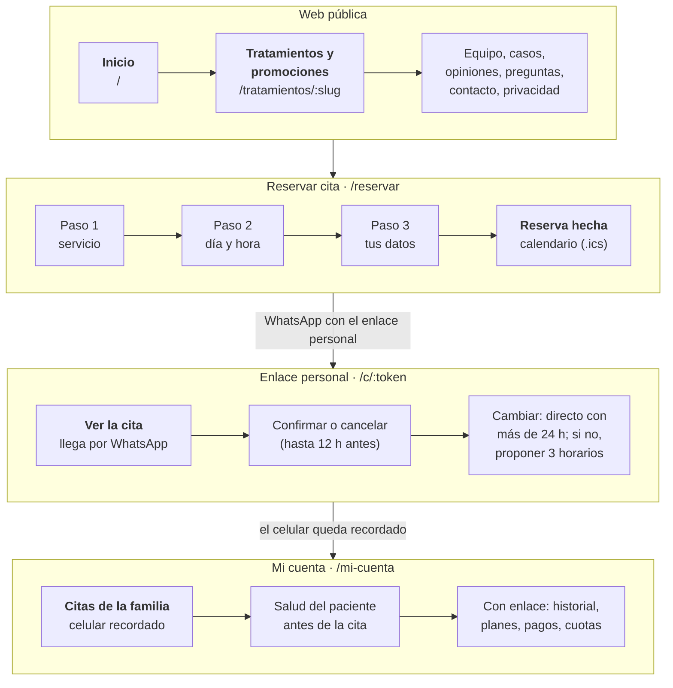

*Figura 1. Flujo de navegación del paciente en la web (rutas reales de `frontend/src/app/router.tsx`).*

En el panel, cada rol ve un menú distinto (tabla 6). El trabajo del día pasa de recepción al doctor y vuelve a recepción para cobrar (figura 2).

*Tabla 6. Menú principal del panel por rol (comprobado con `PanelNavigationTest` y con el panel de demostración).*

| Entrada del menú | Recepción | Doctor | Administrador |
| --- | :-: | :-: | :-: |
| Hoy | Sí | Sí (su día) | Sí |
| Agenda (citas, cambios pedidos, lista de espera, bloqueos) | Sí | Solo la suya | Sí |
| Pacientes (atenciones, presupuestos, laboratorio) | Sí, sin lo clínico | Sus pacientes, con lo clínico | Sí; lo clínico si es odontólogo |
| Caja (saldos, cuotas, cierre del día, gastos) | Sí | No | Sí |
| Inventario | Sí | Ve el stock, sin costos | Sí, con costos |
| Avisos | Sí | Sí | Sí |
| Reportes | No | Solo si la clínica lo activa | Sí |
| Configuración | No | Solo lo suyo (perfil, tratamientos, opciones rápidas) | Sí |
| Página web | No | No | Sí |

<!-- figura: diagramas/flujo-personal.png -->
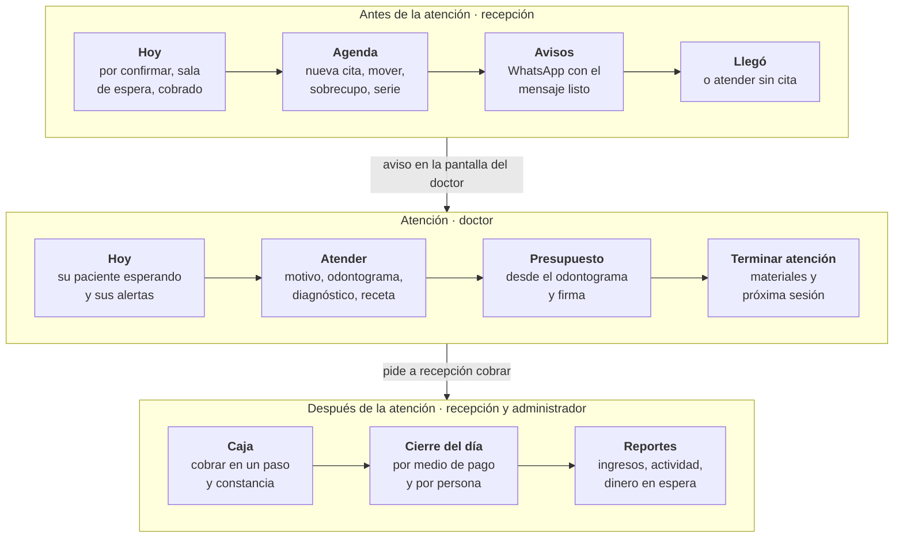

*Figura 2. Flujo de trabajo del personal en el panel, de la cita al cierre de caja.*

## Pantallas principales

<!-- figura: prototipo/web-reserva.png 13.5cm -->

*Figura 3. Web del paciente en el celular: inicio, paso 1 (servicio) y paso 2 (día y hora) de la reserva. Cumple RF-WEB-01, RF-RES-01 y RF-RES-02.*

<!-- figura: prototipo/web-mi-cuenta.png 13.5cm -->

*Figura 4. Enlace personal de la cita, Mi cuenta en un celular no recordado (pide el enlace por WhatsApp) y Mi cuenta en un celular recordado. Cumple RF-CTA-01, RF-CTA-03 y RF-CTA-04.*

<!-- figura: prototipo/panel-recepcion.png 15cm -->

*Figura 5. Recepción: "Hoy" con citas, por confirmar, sala de espera y cobrado; y la agenda del día con el buscador de huecos. Cumple RF-REP-01, RF-AGE-01 y RF-AGE-07.*

<!-- figura: prototipo/panel-atencion.png 13cm -->

*Figura 6. Doctor: pantalla de atención con la barra de secciones (motivo, odontograma, diagnóstico, tratamientos, evolución) y el aviso de antecedentes faltantes. Cumple RF-CLI-01 y RF-CLI-02.*

<!-- figura: prototipo/panel-ley-29733.png 15cm -->

*Figura 7. El mismo plan visto por el doctor (con la pieza dental) y por recepción (sin la pieza), según la Ley N.º 29733. Cumple RNF-LEY-01 y RF-PRE-06.*

<!-- figura: prototipo/panel-caja.png 15cm -->

*Figura 8. Caja con los pagos y su constancia, y el cierre del día por medio de pago. Cumple RF-CAJ-03 y RF-CAJ-05.*

<!-- figura: prototipo/panel-celular-y-reportes.png 13cm -->

*Figura 9. "Hoy" de recepción en el celular, con la barra inferior, y el reporte de ingresos del administrador. Cumple RNF-USA-01 y RF-REP-02.*

<!-- figura: prototipo/app-movil-wireframe.png 14cm -->

*Figura 10. Prototipo de baja fidelidad de la app móvil (planificada): ingresar, mis citas, reservar y mi saldo. Responde a RF-MOV-01 a RF-MOV-04 y usa los mismos datos de demostración.*

## Validación con usuarios y stakeholders

La validación se hace con el Dr. Vega (administrador y doctor) y con la recepcionista, en una sesión de 45 minutos por persona sobre el prototipo con datos de demostración. Cada tarea tiene un criterio de éxito observable; se mide el tiempo, los errores y, al final, el cuestionario SUS (System Usability Scale, 10 preguntas). La meta es completar sin ayuda al menos el 90 % de las tareas y un SUS de 70 o más.

*Tabla 7. Guion de validación por rol.*

| N.º | Rol | Tarea | Criterio de éxito | RF |
| :-: | --- | --- | --- | --- |
| 1 | Paciente (lo hace recepción con un celular) | Reservar una limpieza para mañana en la tarde | Llega a "Reserva hecha" en menos de 2 min | RES-01, 02 |
| 2 | Paciente | Abrir el enlace de la cita y confirmarla | La cita queda "Confirmada" | CTA-01 |
| 3 | Recepción | Agendar en la agenda a un paciente nuevo | La cita aparece confirmada y su aviso, en Avisos | AGE-02 |
| 4 | Recepción | Mover una cita arrastrándola a otra hora libre | Confirma el cambio y queda el aviso | AGE-03 |
| 5 | Recepción | Marcar que llegó y luego deshacerlo | La cita vuelve a su estado anterior | AGE-04 |
| 6 | Doctor | Atender al paciente en sala, marcar una caries en el odontograma y terminar | La cita queda "Atendida" y recepción ve "Cobrar" | CLI-01, 03, 07 |
| 7 | Doctor | Armar el presupuesto desde el odontograma | El presupuesto tiene la pieza y su vigencia | PRE-01 |
| 8 | Recepción | Cobrar la atención en efectivo y abrir la constancia | El saldo queda en cero y la constancia lo dice | CAJ-01, 03 |
| 9 | Recepción | Cerrar la caja del día | El cierre cuadra por medio de pago | CAJ-05 |
| 10 | Administrador | Ver los ingresos del mes por doctor y descargar el Excel | Descarga el archivo con una hoja por tabla | REP-02 |
| 11 | Administrador | Cambiar la anticipación mínima de reserva | La web deja de ofrecer los horarios más cercanos | CFG-03 |
| 12 | Paciente | Recorrer los bocetos de la app móvil (figura 10) y decir qué falta | Comentarios anotados | MOV-01 a 04 |

El registro de resultados por tarea y por participante, el cuestionario SUS y el acta van en el anexo B `[PENDIENTE – estudiante: llenarlos en la sesión]`. Los cambios que pidan los usuarios se registran como historias nuevas en el backlog de la FASE 4.

# Diseño arquitectónico

## Estilo de arquitectura y atributos de calidad

El sistema es un **monolito modular**: una sola aplicación Laravel con una base de datos, dos interfaces para personas distintas y un solo cron. La web del paciente (React) habla con la API `/api/v1`; el personal trabaja en el panel Filament; las tareas programadas corren con `schedule:run`. Las tres entradas no tienen reglas de negocio: llaman a los mismos servicios de `app/Services`, que a su vez usan los modelos, las políticas de permisos y las enumeraciones de estados. Así una regla (por ejemplo, que dos citas no se crucen) vive en un solo lugar y vale igual en la web, en el panel y en el cron. La tabla 8 muestra qué decisión atiende cada atributo de calidad del SRS.

*Tabla 8. Atributos de calidad y decisiones de arquitectura que los atienden.*

| Atributo (RNF) | Cómo lo atiende la arquitectura | ADR |
| --- | --- | --- |
| Seguridad y Ley N.º 29733 (RNF-SEG, RNF-LEY) | Política de permisos en cada acción; lo clínico solo para el doctor tratante; archivos clínicos fuera de `public/`; tokens guardados como hash; auditoría de cada cambio. | ADR-08, ADR-10, ADR-11 |
| Disponibilidad con un servidor (RNF-DIS) | Un cron con 10 tareas; los recordatorios se ponen al día al abrir el panel si el cron falla; copia diaria con restauración probada. | ADR-06 |
| Rendimiento (RNF-REN) | La primera carga trae los datos de la página en el HTML; una consulta por página; los archivos de la web tienen hash y se guardan en la caché del proxy. | ADR-01, ADR-04 |
| Usabilidad en celular y tablet (RNF-USA) | Web pensada primero para el celular; panel adaptable con barra inferior en el celular. | ADR-03, ADR-04 |
| Mantenibilidad (RNF-MAN) | Reglas solo en servicios; estados en enumeraciones; pruebas y formato en la CI. | ADR-01, ADR-02 |
| Compatibilidad (RNF-COM) | Sin Node en producción: el mismo paquete corre en Azure o en un hosting compartido. | ADR-06 |

## Vista de contexto (C4 nivel 1)

<!-- figura: diagramas/c1-contexto.png 12cm -->
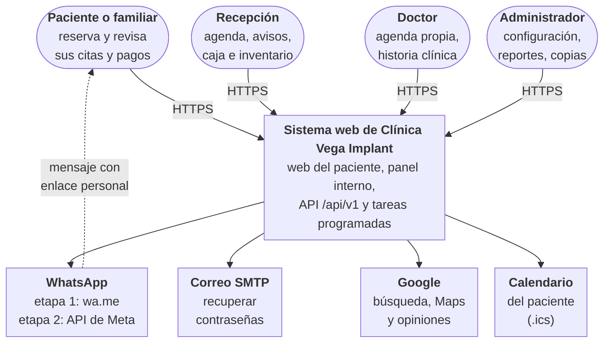

*Figura 11. Contexto: quién usa el sistema y con qué sistemas externos se comunica.*

Cuatro tipos de usuarios entran por HTTPS. WhatsApp es el canal con el paciente: en la etapa 1 el personal abre `wa.me` con el mensaje ya escrito y en la etapa 2 los avisos salen solos por la API oficial de Meta (ADR-07). El correo SMTP solo sirve para que el personal recupere su contraseña. Para Google, el sistema publica `sitemap.xml`, `robots.txt` y datos estructurados en cada página, y enlaza a Maps y a las opiniones. La cita reservada se entrega como archivo `.ics` para el calendario del celular.

## Vista de contenedores (C4 nivel 2)

<!-- figura: diagramas/c2-contenedores.png 13.5cm -->
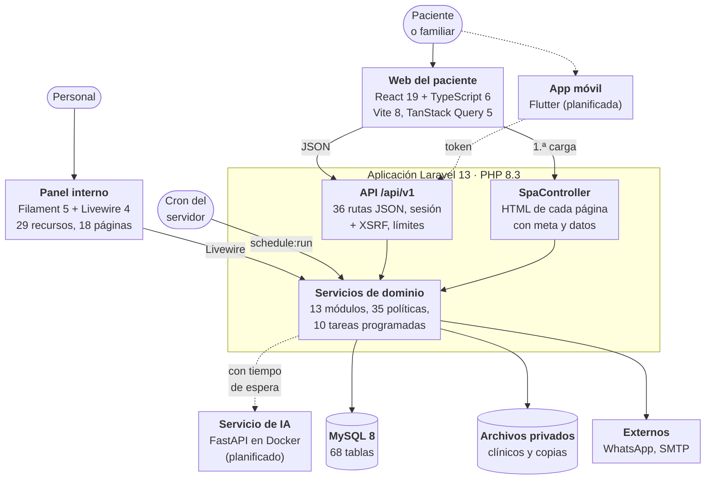

*Figura 12. Contenedores. Las líneas punteadas son lo planificado para la FASE 3 (app móvil y servicio de IA).*

*Tabla 9. Responsabilidad y tecnología de cada contenedor.*

| Contenedor | Tecnología | Responsabilidad |
| --- | --- | --- |
| Web del paciente | React 19, TypeScript 6, Vite 8, React Router 8, TanStack Query 5 | Inicio, tratamientos, reservar, enlace personal y Mi cuenta. Se compila dentro de `backend/public/app` y llama a la API con la cookie de sesión y el encabezado `X-XSRF-TOKEN`. |
| Documento de cada página | Laravel, `SpaController` y la vista `spa.blade.php` | Devuelve el HTML con título, meta, datos estructurados y los datos de la página ya cargados. |
| API `/api/v1` | Laravel 13: 13 controladores, 3 Form Requests, 10 API Resources | 36 rutas: contenido de la web, disponibilidad, reservar, enlace personal, Mi cuenta y salud. Límites por IP y por celular. |
| Panel interno | Filament 5 y Livewire 4 | Agenda, pacientes, atención clínica, caja, inventario, avisos, reportes y configuración, según el rol. |
| Tareas programadas | Programador de Laravel con un cron cada minuto | 10 tareas: recordatorios, citas sin confirmar, cuotas, apartados de la lista de espera, WhatsApp, cola, limpieza, duraciones aprendidas y copia diaria. |
| Base de datos | MySQL 8 (SQLite en memoria en las pruebas) | 68 tablas y 143 llaves foráneas; también guarda sesiones, caché y cola. |
| Archivos privados | Disco `storage/app/private` | Radiografías, fotos, firmas y copias de seguridad, fuera de `public/`; se entregan solo si la política lo permite. |
| App móvil (planificada) | Flutter | Ingresar, mis citas, reservar y saldo (RF-MOV), con la misma API y un token (ADR-12). |
| Servicio de IA (planificado) | Python, FastAPI y Docker | `POST /predict`: probabilidad de "No asistió" (RF-IA); Laravel lo llama con tiempo de espera (ADR-13). |

## Vista de despliegue en Microsoft Azure

El C2 cumple el rol de vista de despliegue y la figura 13 lo ubica en la infraestructura de Azure que diseña la línea CE03 del mismo equipo. Desde Internet solo entra el puerto 443. OPNsense filtra el tráfico (con Suricata como IDS/IPS) y lo pasa al proxy de la DMZ, que termina el TLS con Let's Encrypt, aplica el WAF de ModSecurity y guarda en caché los archivos de `/app/assets`. La aplicación corre en `vm-app` con Nginx y PHP-FPM 8.3, a partir del paquete `consultorio-para-hosting` que arma la CI, y con el cron `schedule:run` cada minuto. MySQL Flexible Server 8.0 no tiene acceso público y exige TLS. Los secretos del `.env` (clave de la aplicación, base de datos, token de Meta) van en Key Vault y los registros, en Azure Monitor.

Este despliegue trae un cambio para el código. Detrás del proxy, `$request->ip()` devuelve la IP de `vm-proxy`, así que los límites por IP (8 reservas por hora en `BookingController`, 60 páginas y 240 llamadas a la API por minuto en `AppServiceProvider`) se compartirían entre todos los pacientes, y Laravel no sabría que la conexión es HTTPS. Hay que declarar el proxy como confiable (`trustProxies` en `bootstrap/app.php`) junto con la línea CE03 `[PENDIENTE: FASE 3, cambio de una línea coordinado con CE03]`.

<!-- figura: diagramas/despliegue-azure.png 14cm -->
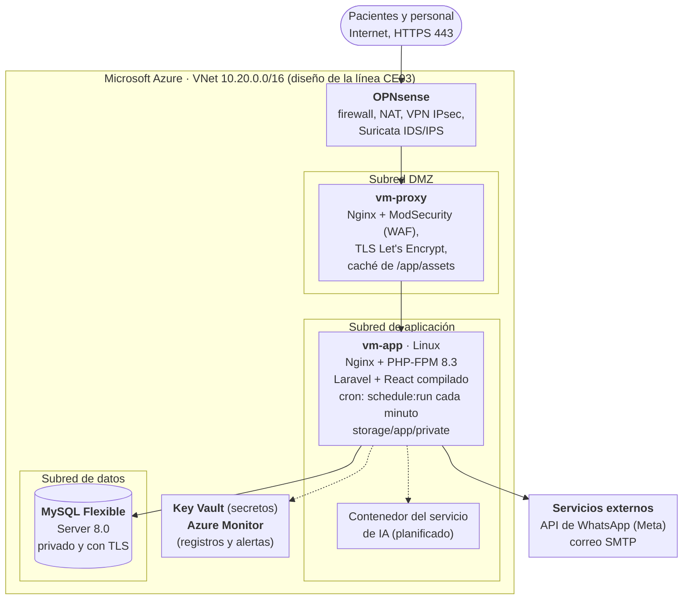

*Figura 13. Despliegue en Microsoft Azure (VNet 10.20.0.0/16), alineado con el diseño de la línea CE03.*

## Vista de componentes (C4 nivel 3)

En el backend (figura 14), las entradas solo validan, autorizan y responden. Los controladores de la API usan Form Requests (`StoreBookingRequest`, `ChangeAppointmentRequest`, `StoreHealthRequest`) y devuelven API Resources; el panel usa acciones de Filament como `CheckoutAction`. Toda regla está en uno de los 13 módulos de servicios y toda decisión de acceso, en una de las 35 políticas. Los servicios abren transacciones y bloquean la agenda del doctor cuando reservan, para que dos personas no tomen el mismo horario a la vez.

En el frontend (figura 15), Laravel entrega el HTML de la página con sus datos y `main.tsx` los pone en la caché de TanStack Query, así la página se ve completa sin esperar a la API. Cada página pide sus datos con una sola consulta de `api/queries.ts`; las acciones (reservar, confirmar, cancelar, cambiar) están en `api/actions.ts` y todas pasan por `api/client.ts`, que agrega el token XSRF y traduce los errores de validación.

<!-- figura: diagramas/c3-backend.png 14cm -->
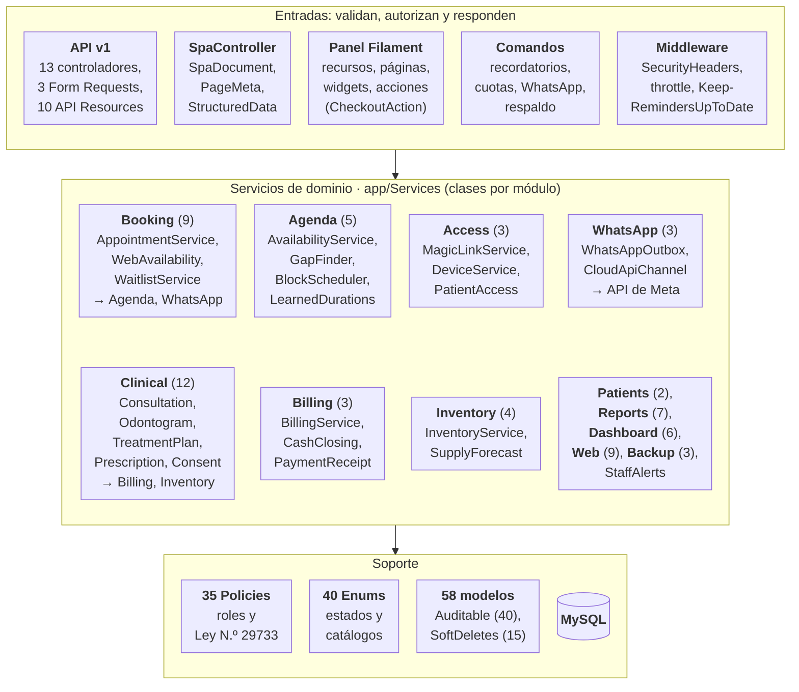

*Figura 14. Componentes del backend Laravel (`backend/app`). Entre paréntesis, la cantidad de clases de cada módulo de servicios.*

<!-- figura: diagramas/c3-frontend.png 8.5cm -->
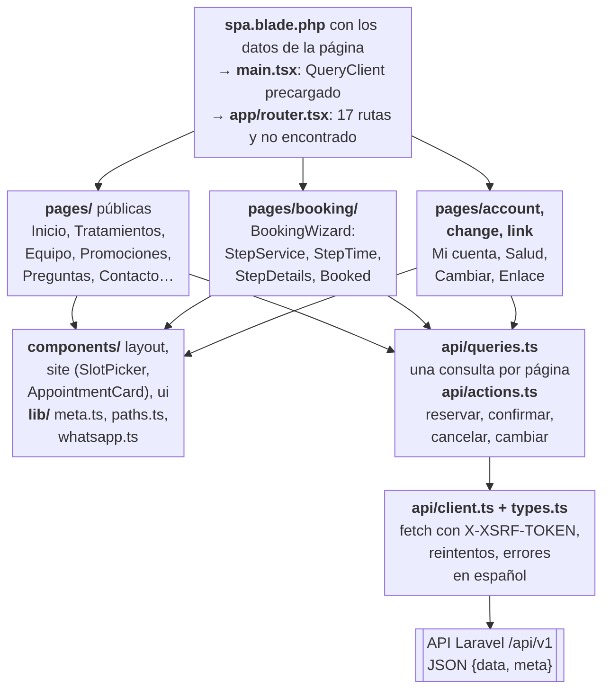

*Figura 15. Componentes del frontend React (`frontend/src`).*

## Decisiones de arquitectura (ADR)

Cada decisión sigue el formato de Michael Nygard: contexto, opciones, decisión y consecuencias. Las ADR-01 a ADR-11 están aceptadas y se ven en el código; las ADR-12 y ADR-13 son propuestas para la FASE 3.

### ADR-01. Un monolito modular con dos interfaces sobre los mismos servicios

- **Contexto:** pacientes con celular, personal en computadora y tablet, un equipo de tres personas y un servidor.
- **Opciones:** (a) aplicación PHP con vistas del servidor para todo; (b) frontend React y backend PHP separados en dos servidores; (c) un monolito Laravel que sirve la API y el panel, con la web React compilada dentro.
- **Decisión:** (c). La web del paciente es React y consume `/api/v1` en el mismo dominio (sesión y XSRF, sin CORS); el personal usa el panel Filament; ambos llaman a `app/Services`.
- **Consecuencias:** una sola base de código, un despliegue y una transacción para toda regla; la web se puede cambiar sin tocar las reglas. La app móvil necesitará otra forma de autenticarse (ADR-12).

### ADR-02. Laravel 13 con PHP 8.3 para el backend

- **Contexto:** hace falta autenticación, colas, programador de tareas, validación en español, migraciones y pruebas, en un lenguaje que corra en cualquier hosting.
- **Opciones:** (a) PHP sin framework; (b) Symfony; (c) Laravel.
- **Decisión:** (c) Laravel 13 (13.38 instalado) con PHP 8.3, Eloquent y PHPUnit.
- **Consecuencias:** el programador (`routes/console.php`) reemplaza a varios cron y 1 037 pruebas corren en SQLite en memoria; hay que seguir las versiones mayores de Laravel.

### ADR-03. Filament 5 y Livewire 4 para el panel del personal

- **Contexto:** el panel tiene 29 recursos, 18 páginas y 26 widgets (agenda, odontograma, caja); el personal no es técnico.
- **Opciones:** (a) hacer el panel en React; (b) vistas Blade a mano; (c) Filament sobre Livewire.
- **Decisión:** (c). Formularios, tablas, filtros y permisos salen de Filament; lo especial (agenda, odontograma) son componentes Livewire.
- **Consecuencias:** mucho menos código y los mismos permisos que la API; el panel depende de la versión de Filament.

### ADR-04. React 19, TypeScript, Vite y TanStack Query para la web del paciente

- **Contexto:** la web es lo que ve el paciente en su celular y debe aparecer en Google.
- **Opciones:** (a) páginas Blade; (b) React con renderizado en un servidor Node; (c) React compilado con Vite y datos precargados desde Laravel.
- **Decisión:** (c). Laravel arma el HTML con título, meta y datos (`SpaDocument`); React toma esos datos sin volver a pedirlos.
- **Consecuencias:** buena primera carga y SEO sin Node en producción; a cambio, dos lenguajes y dos suites de pruebas (126 en Vitest).

### ADR-05. MySQL 8 como motor de base de datos

- **Contexto:** datos relacionales con reglas fuertes (una cita, un doctor y un paciente; pagos y cargos) y un hosting que ofrezca el motor.
- **Opciones:** (a) MySQL o MariaDB; (b) PostgreSQL; (c) SQLite.
- **Decisión:** (a) MySQL 8 en producción (MySQL Flexible Server en Azure) y SQLite en memoria para las pruebas.
- **Consecuencias:** de las 11 llaves foráneas hacia el paciente, 10 usan `restrictOnDelete`: un paciente con historia no se puede borrar. Las vistas y procedimientos de la FASE 2 serán solo para MySQL, para no romper las pruebas en SQLite.

### ADR-06. Un solo servidor con un cron cada minuto

- **Contexto:** recordatorios, cuotas y copias necesitan tareas programadas, pero un hosting económico no tiene procesos permanentes ni Node.
- **Opciones:** (a) hosting compartido con cPanel; (b) Azure App Service y base de datos administrada; (c) máquinas virtuales en Azure detrás de OPNsense, como diseña la línea CE03.
- **Decisión:** (c) para la producción del curso. El sistema sigue necesitando solo PHP y un cron: `schedule:run` ejecuta las 10 tareas y procesa la cola con `queue:work --stop-when-empty`.
- **Consecuencias:** el mismo paquete de la CI sirve en Azure y en un hosting compartido (RNF-COM-01). Si el cron falla, `KeepRemindersUpToDate` prepara los recordatorios al abrir el panel. Hay que configurar el proxy confiable (sección 3.4).

### ADR-07. WhatsApp oficial en dos etapas: enlace `wa.me` y luego la API de Meta

- **Contexto:** los pacientes confirman por WhatsApp; los servicios no oficiales arriesgan el bloqueo del número de la clínica.
- **Opciones:** (a) bibliotecas no oficiales; (b) solo `wa.me`; (c) `wa.me` ahora y la API oficial de Meta después.
- **Decisión:** (c). Los avisos se guardan en una bandeja (`WhatsAppOutbox`); con `WHATSAPP_DRIVER=click_to_chat` el personal los abre con el mensaje escrito y con `cloud_api` el comando `whatsapp:enviar` los manda cada 5 minutos.
- **Consecuencias:** se pasa de etapa sin cambiar las reglas. La etapa 2 necesita una cuenta de WhatsApp Business verificada y plantillas aprobadas por Meta `[PENDIENTE – estudiante: trámite con el Dr. Vega]`. Evidencia: `WhatsAppOutboxTest`, `SendDueWhatsAppMessagesTest`.

### ADR-08. Nada se borra: se anula con motivo y queda auditado

- **Contexto:** cobros, citas e historia clínica tienen valor legal y contable; un borrado no deja rastro.
- **Opciones:** (a) borrar; (b) borrado lógico en todo; (c) anular con motivo lo que mueve dinero, impedir borrar lo clínico y auditar todo cambio.
- **Decisión:** (c). Las políticas niegan `delete` en citas y pagos; cargos y pagos tienen `voided_at`, quién y motivo; 40 modelos usan `Auditable` (valores anteriores y nuevos, usuario, IP) y 15 usan `SoftDeletes`.
- **Consecuencias:** los reportes y el cierre de caja excluyen lo anulado (`PatientsAndSetupPanelTest`); la auditoría crece y solo los enlaces y dispositivos vencidos se limpian con `model:prune`.

### ADR-09. Los pagos son solo informativos

- **Contexto:** el paciente paga en el consultorio en efectivo, tarjeta, Yape, Plin o transferencia.
- **Opciones:** (a) pasarela de pago en la web; (b) registrar en el sistema lo que se cobró en el consultorio.
- **Decisión:** (b). El sistema registra monto, medio y número de operación; no mueve dinero ni guarda datos de tarjetas.
- **Consecuencias:** sin datos de tarjetas que proteger; el cierre del día cuadra lo registrado con la caja real (`DailyClosingTest`).

### ADR-10. El paciente entra sin contraseña

- **Contexto:** pacientes de todas las edades olvidan contraseñas; una familia comparte un celular.
- **Opciones:** (a) usuario y contraseña; (b) código OTP por SMS o WhatsApp; (c) enlace personal por WhatsApp y celular recordado.
- **Decisión:** (c), según la decisión del cliente del 23/10/2026 ("sin códigos OTP"). El enlace de la cita vale hasta 2 días después de ella y el de acceso, 72 horas; el token se guarda como hash SHA-256; el celular queda recordado 120 días y lo personal pide una verificación reforzada de 15 minutos.
- **Consecuencias:** abrir el enlace verifica el celular; quien lo pierde pide otro enlace a recepción. Evidencia: `LinkControllerTest`, `AccountControllerTest`.

### ADR-11. Permisos por políticas y lo clínico solo para quien atiende (Ley N.º 29733)

- **Contexto:** la historia clínica es un dato sensible; recepción necesita cobrar sin verla.
- **Opciones:** (a) permisos por pantalla; (b) una política por modelo con reglas por rol y por relación con el paciente.
- **Decisión:** (b). 35 políticas; `PatientPolicy::viewClinical` deja ver lo clínico al doctor que atiende al paciente y al administrador odontólogo; los archivos clínicos se sirven desde el disco privado solo tras pasar la política.
- **Consecuencias:** la misma regla vale en la API, el panel y las impresiones. Evidencia: `PanelAccessTest`, `TreatmentPlanPageTest`.

### ADR-12. API REST para la app móvil y servicios externos (propuesta)

- **Contexto:** la app móvil no es un navegador: no puede usar la cookie de sesión de la web.
- **Opciones:** (a) una API nueva; (b) la misma `/api/v1` con tokens de Laravel Sanctum; (c) la misma API con el token del celular recordado como `Bearer`.
- **Decisión propuesta:** (b). Una sola API documentada en OpenAPI. La app entra con el enlace personal que llega por WhatsApp (enlace profundo) y recibe un token con permisos limitados.
- **Consecuencias:** las reglas no cambian. Sanctum es una dependencia nueva que necesita aprobación `[PENDIENTE – estudiante: aprobar en la FASE 3]`, y la guía pide un "código de WhatsApp" que choca con la decisión del 23/10/2026 `[PENDIENTE – estudiante: confirmar con el Dr. Vega]`.

### ADR-13. Servicio de IA aparte y con degradación elegante (propuesta)

- **Contexto:** la FASE 3 agrega un servicio distribuido que estima el riesgo de "No asistió", para que recepción confirme primero esas citas (HU-14); el modelo se entrena en Python.
- **Opciones:** (a) reglas fijas en PHP; (b) un servicio Python con FastAPI en Docker; (c) un servicio de aprendizaje automático en la nube.
- **Decisión propuesta:** (b). `POST /predict` recibe anticipación, día y hora, confirmación, faltas previas, tratamiento, primera cita y canal. Laravel lo llama con un tiempo de espera corto `[PENDIENTE: FASE 3, valor medido]`.
- **Consecuencias:** si el servicio no responde, la agenda carga igual sin el indicador (RF-IA-02). Se entrena solo con datos del seeder y se compara contra un modelo base (AUC y recall).

# Diseño detallado

## Casos de uso por actor

Los 22 casos de uso salen de las historias de usuario y de los menús reales de cada rol. El paciente usa la web (y más adelante la app); recepción, doctor y administrador usan el panel; el cron y el servicio de IA son actores del sistema. La matriz del anexo A une cada caso de uso con sus requerimientos, componentes y pruebas, y el anexo D especifica los dos centrales: CU-02 Reservar cita en línea y CU-14 Atender y cerrar la atención.

<!-- figura: diagramas/casos-de-uso-paciente.png 11cm -->
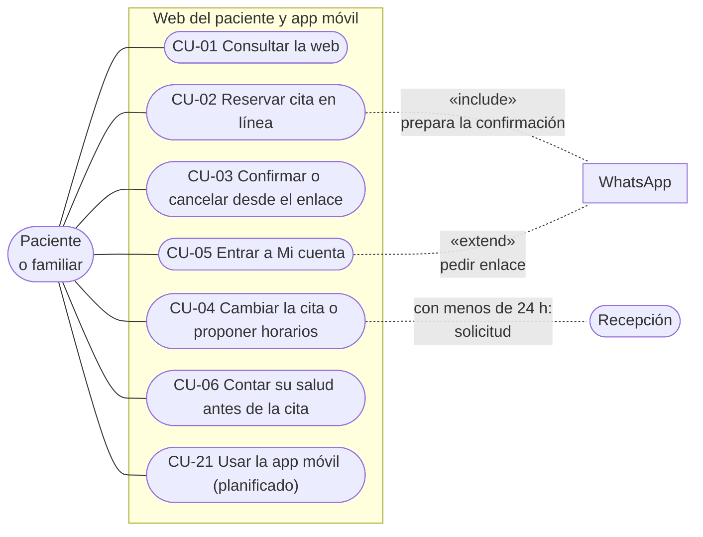

*Figura 16. Casos de uso del paciente o familiar.*

<!-- figura: diagramas/casos-de-uso-personal.png 11cm -->
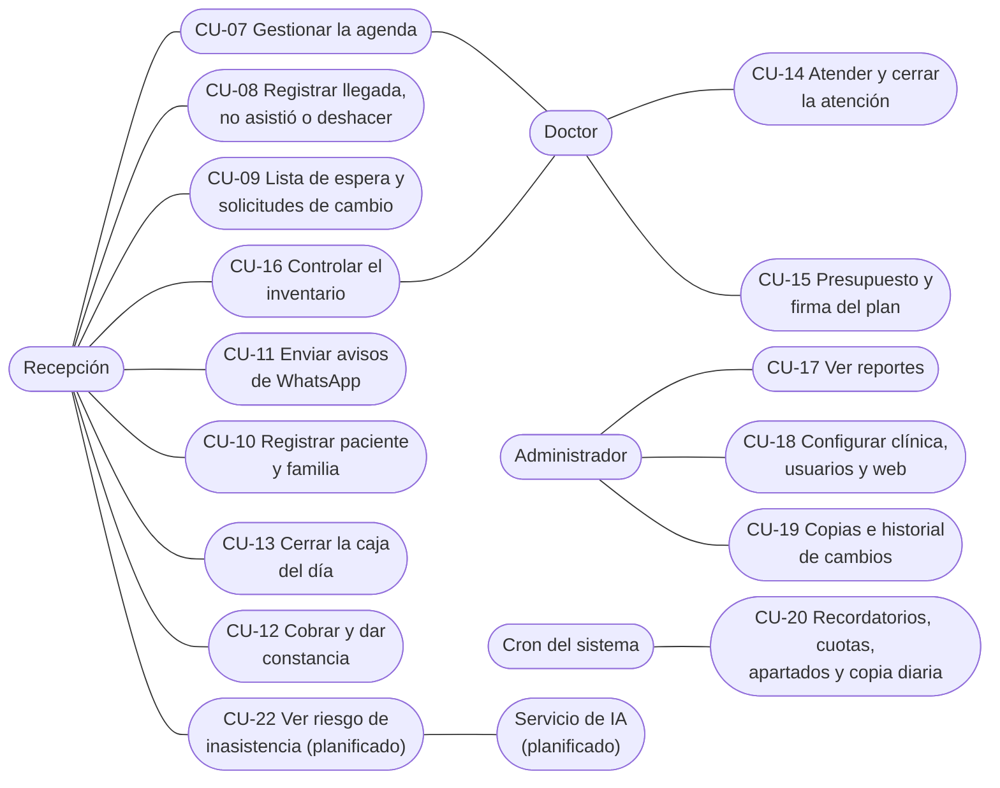

*Figura 17. Casos de uso del personal, del cron y del servicio de IA.*

## Diagrama de clases del dominio

La figura 18 resume 24 de los 58 modelos Eloquent con sus relaciones reales. La cuenta (`Account`) es el celular de la familia y agrupa a sus pacientes; la cita une paciente, doctor y tratamiento y puede tener una atención con odontograma y recetas; el plan tiene procedimientos, cuotas y sesiones; el dinero se registra como cargos y pagos. El anexo C trae los diagramas detallados con atributos: agenda, acceso, clínica, y plan y caja.

<!-- figura: diagramas/clases-dominio.png 15cm -->
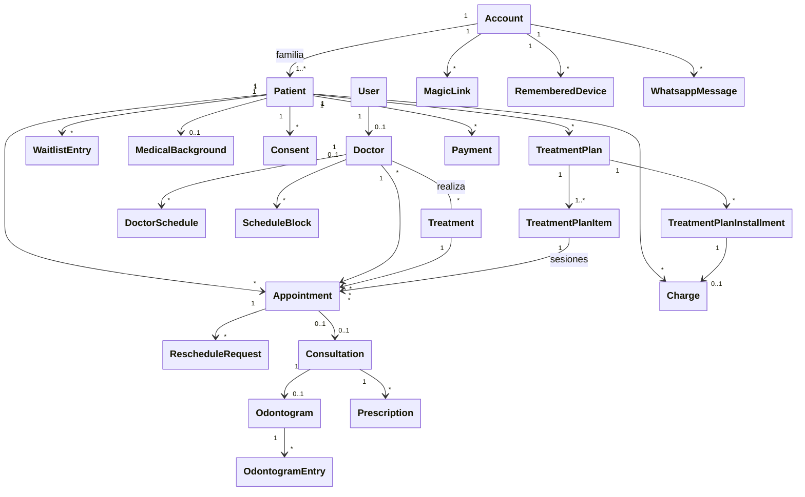

*Figura 18. Clases del dominio y sus relaciones (`backend/app/Models`).*

## Diagramas de secuencia

**Reservar cita** (figura 19). `BookingController` valida con `StoreBookingRequest` y llama a `AppointmentService::bookFromWeb()`, que comprueba las reglas RN-02 a RN-05, abre una transacción, bloquea la fila del doctor (`lockForUpdate`) y vuelve a preguntar a `AvailabilityService::isFree()`. Si otra persona tomó el horario, responde 409 y la web pide elegir otro.

<!-- figura: diagramas/seq-reservar.png -->
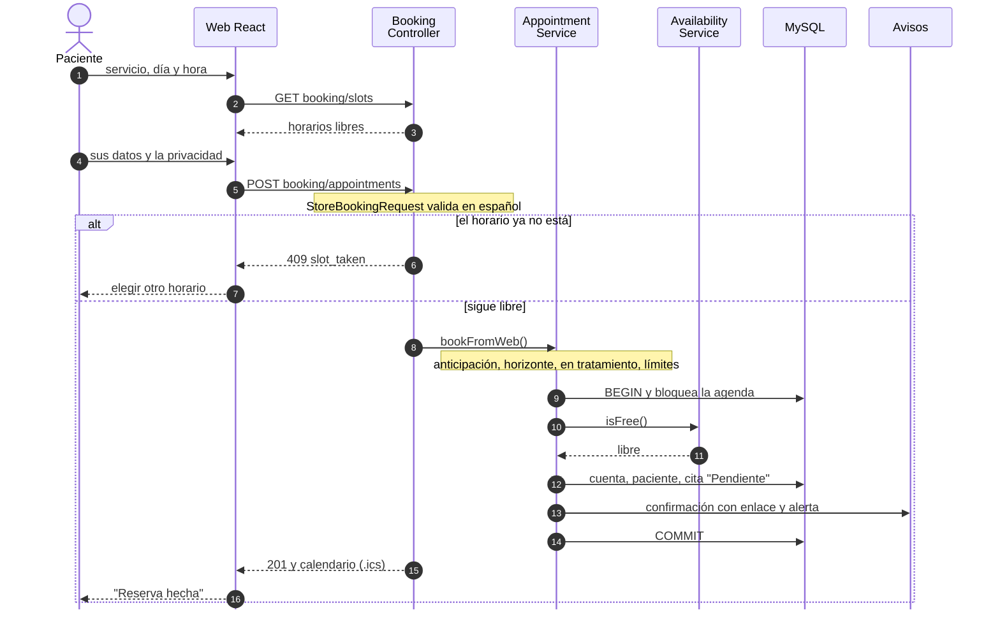

*Figura 19. Secuencia "Reservar cita" (web del paciente → API → servicios).*

**Atender y cerrar la atención** (figura 20). `ConsultationService` abre la atención solo para el doctor de la cita y la cierra en una transacción que coordina cuatro servicios: el plan (`TreatmentPlanService::syncConsultation`), la cita (`markCompleted`), la caja (`BillingService::chargeConsultation`) y el inventario (`InventoryService::useForConsultation`).

<!-- figura: diagramas/seq-atender.png -->
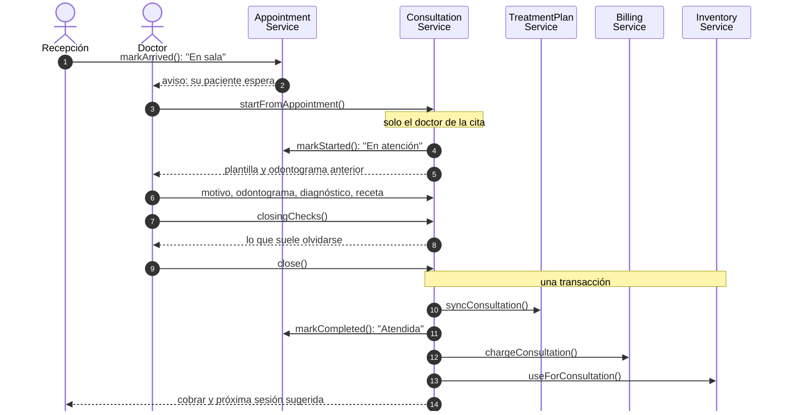

*Figura 20. Secuencia "Atender y cerrar la atención" (panel → servicios clínicos, caja e inventario).*

**Cobrar** (figura 21). `CheckoutAction` pregunta a `ChargePolicy` (el doctor no cobra), carga las cuotas vencidas y muestra lo de la cita con el saldo anterior. Recepción corrige, aplica un descuento y registra el pago en una transacción; la constancia se abre como página y como borrador de WhatsApp.

<!-- figura: diagramas/seq-cobrar.png -->
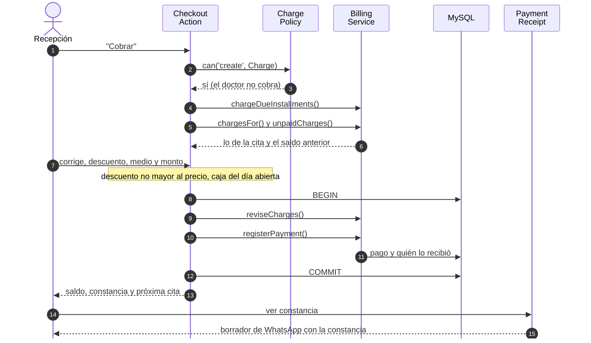

*Figura 21. Secuencia "Cobrar" (acción del panel → política → servicio de caja).*

## Diagramas de estados

**Cita** (figura 22). Los estados y sus transiciones son los de `AppointmentStatus` y los métodos de `AppointmentService`. La web crea la cita "Pendiente" y el personal, "Confirmada". El último paso se deshace dentro de 24 h y vuelve a "Confirmada" si alguien la había confirmado, o a "Pendiente" si no (`UndoLastStepTest`).

<!-- figura: diagramas/estados-cita.png 13.5cm -->
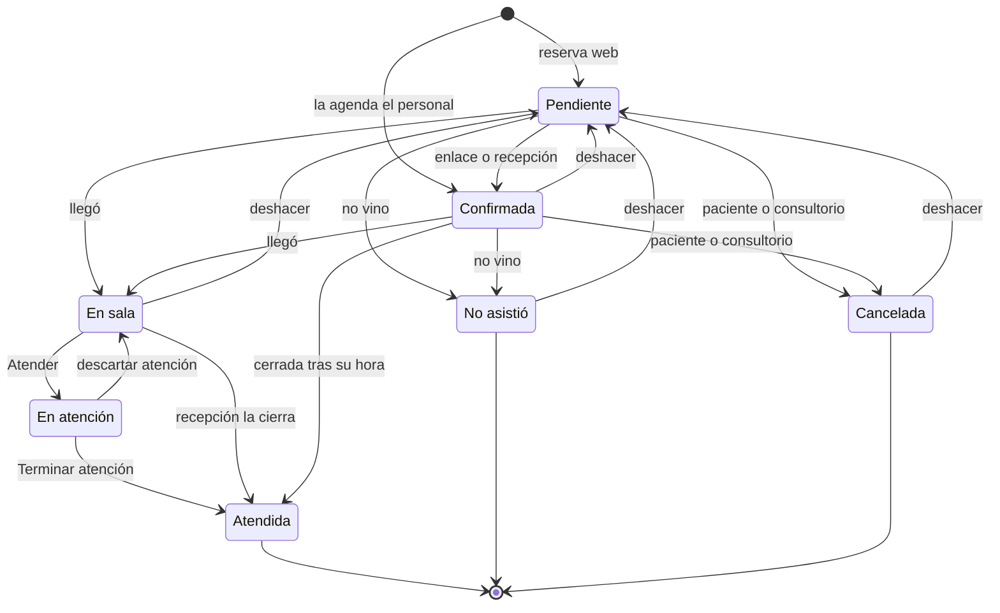

*Figura 22. Estados de la cita (`app/Enums/AppointmentStatus.php`).*

**Presupuesto y plan de tratamiento** (figura 23). Los estados son los de `TreatmentPlanStatus`. Al firmar, o al empezar a trabajarlo, el plan queda aceptado con los precios fijos (RN-09); cancelarlo cobra lo hecho y detiene las cuotas, como comprueba `TreatmentPlanPaymentsTest`.

<!-- figura: diagramas/estados-presupuesto.png 10.5cm -->
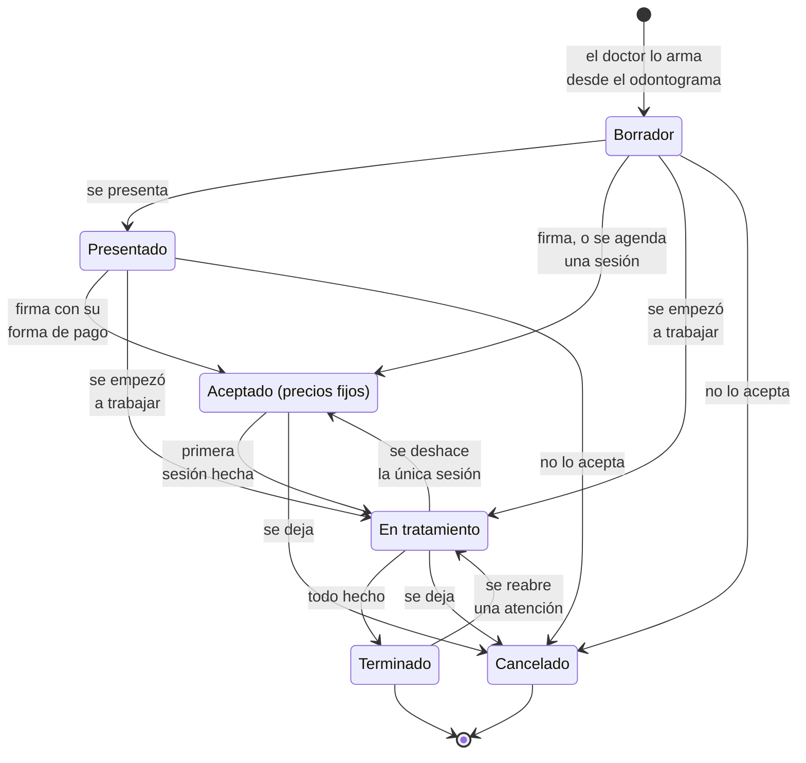

*Figura 23. Estados del presupuesto y del plan (`app/Enums/TreatmentPlanStatus.php`).*

# Anexos

Los anexos van en un Word aparte, `CE021-S1-E1-Requerimientos-y-Diseno-del-Sistema-Anexos.docx`: **A**, la matriz de trazabilidad RF → historia → caso de uso → componente o servicio → archivo → prueba automatizada; **B**, el registro de la validación y el acta con el Dr. Vega y recepción `[PENDIENTE – firma]`; **C**, los diagramas de clases detallados; y **D**, los criterios de aceptación en Gherkin de las 14 historias y la especificación de CU-02 y CU-14. La matriz se comprueba contra el código con `python3 docs/entregables/verificar-trazabilidad.py`: cada archivo y cada prueba que cita existen en el repositorio.
