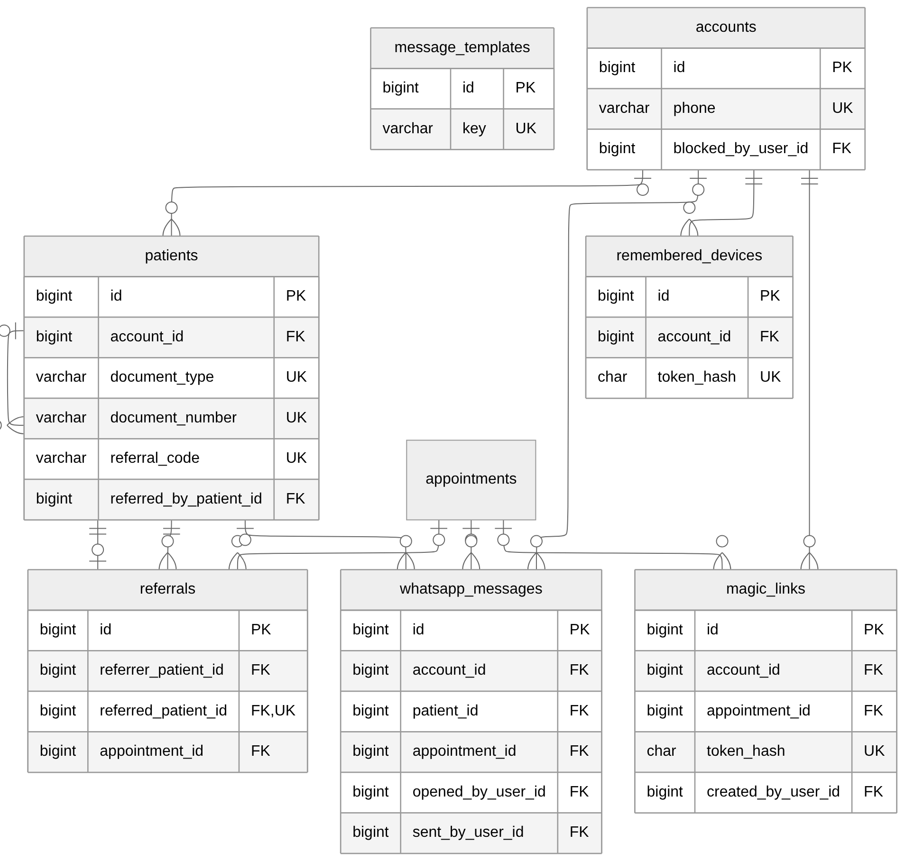
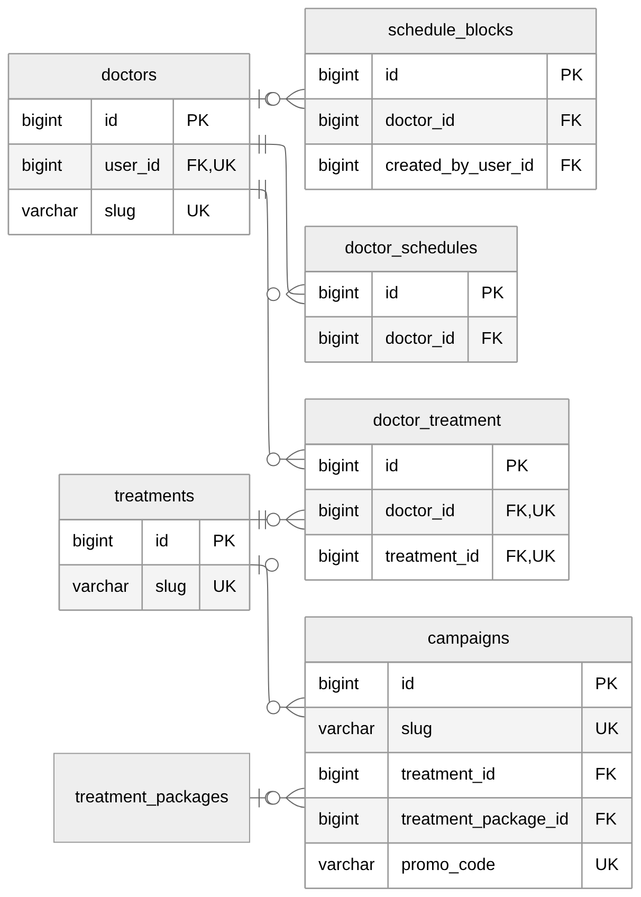
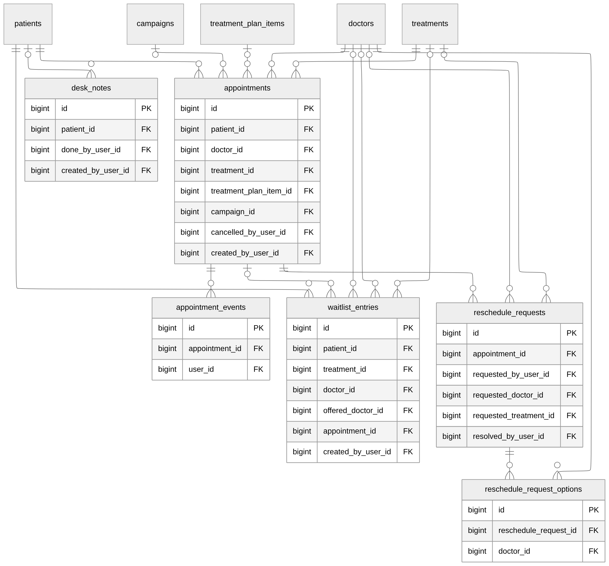
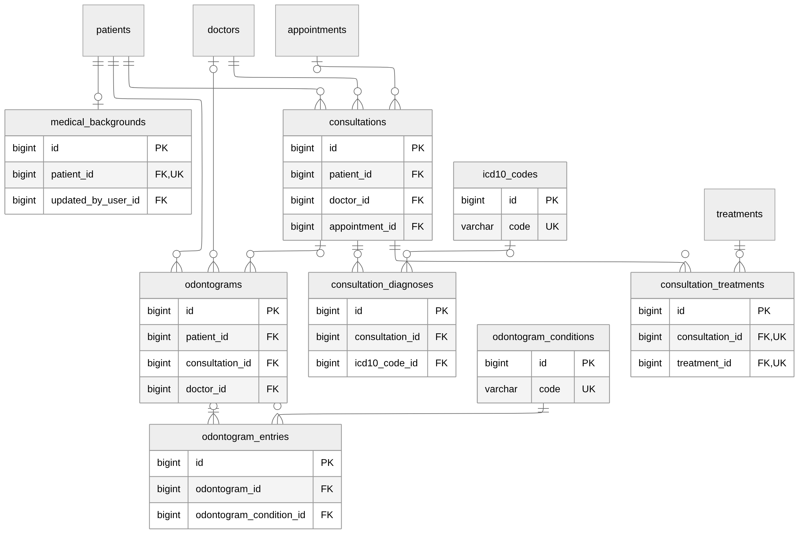
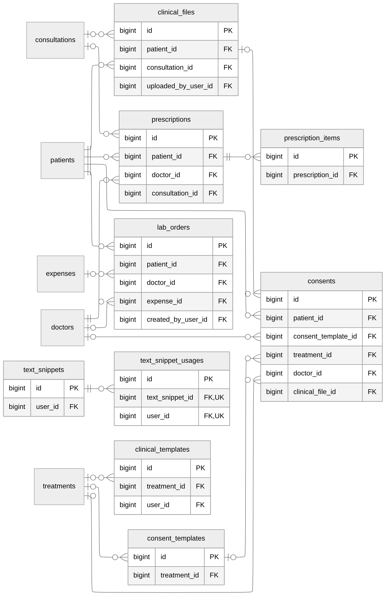
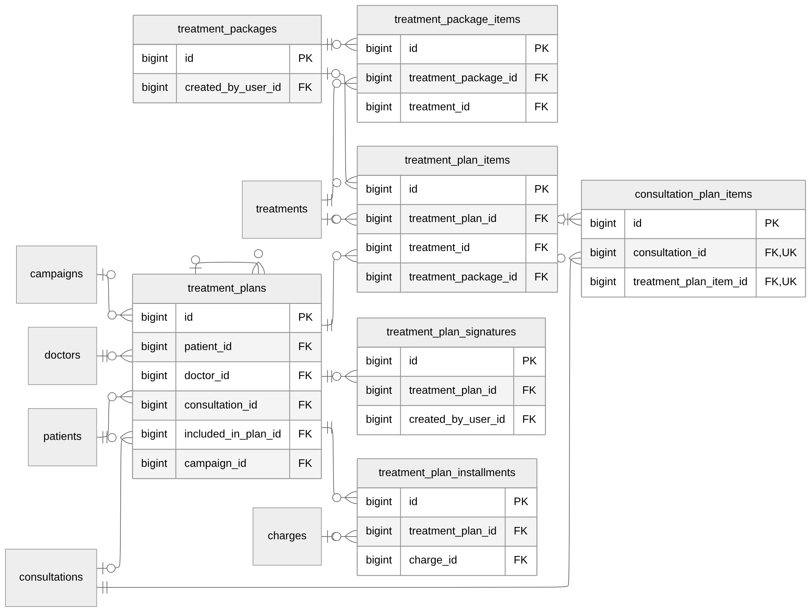
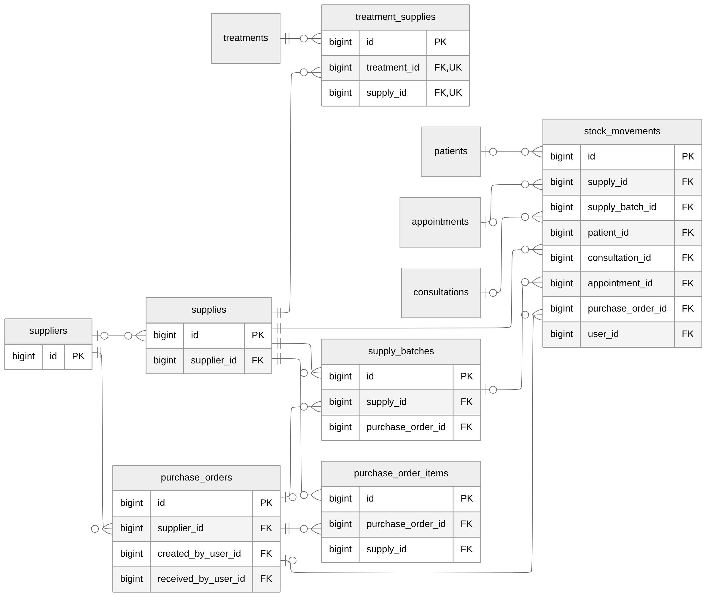
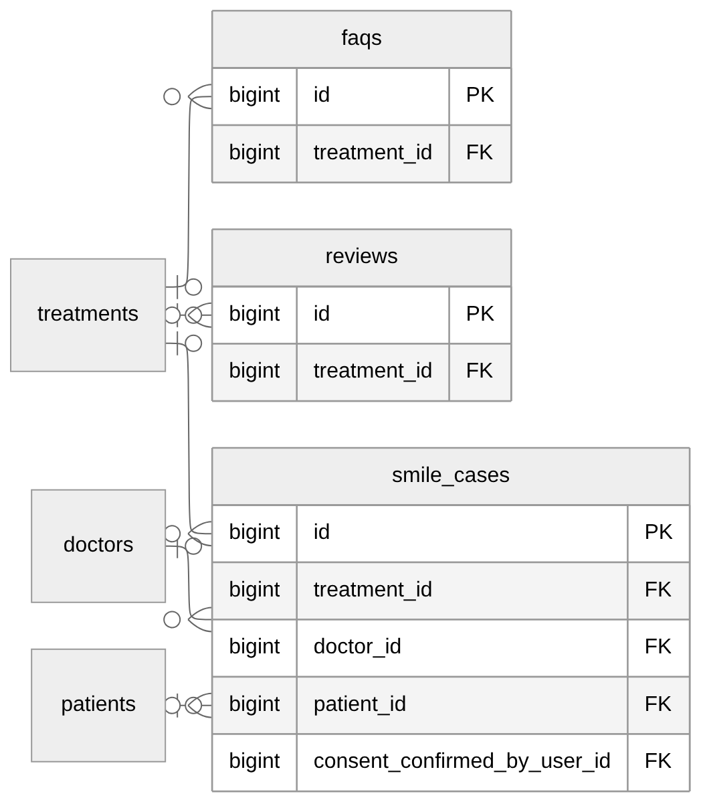

# Anexo B. Modelo lógico por dominio

Las figuras salen de los archivos `diagramas/er-*.mmd`, que escribe `generar-modelo.py` a partir de `sql/ddl.sql` (sección 1.3 del documento). Cada caja es una tabla con su llave primaria (PK), sus llaves foráneas (FK) y sus valores únicos (UK); las demás columnas están en el anexo A. Una caja sin columnas es una tabla de otro dominio. Las relaciones con `users` (quién creó, cobró o anuló algo) no se dibujan para que la figura se lea. En la notación pata de gallo, el círculo es "cero", la raya es "uno" y el tridente es "muchos". El dominio Caja está en la figura 2 del documento, y Acceso, auditoría y sistema no tiene figura (sección 1.3).

<!-- figura: ../diagramas/er-pacientes.png 15cm -->



*Figura B1. Pacientes, cuentas y avisos (7 tablas): la cuenta es un celular y agrupa a los pacientes de una familia.*

<!-- figura: ../diagramas/er-catalogo.png 11cm -->



*Figura B2. Catálogo y doctores (6 tablas): tratamientos, doctores, la duración de cada doctor por tratamiento, horarios, bloqueos y campañas.*

<!-- figura: ../diagramas/er-citas.png 16cm -->



*Figura B3. Agenda (6 tablas): citas, su línea de tiempo, pedidos de cambio de horario, lista de espera y pendientes de recepción.*

[[HORIZONTAL]]

<!-- figura: ../diagramas/er-atencion.png 21.5cm -->



*Figura B4. Atención clínica (8 tablas): antecedentes, atenciones con sus diagnósticos CIE-10 y tratamientos, y odontogramas.*

[[VERTICAL]]

<!-- figura: ../diagramas/er-documentos.png 14cm -->



*Figura B5. Documentos clínicos (9 tablas): recetas, consentimientos, archivos clínicos, trabajos de laboratorio, plantillas y opciones rápidas.*

[[HORIZONTAL]]

<!-- figura: ../diagramas/er-planes.png 19cm -->



*Figura B6. Presupuestos y planes de tratamiento (7 tablas): paquetes, planes con sus ítems, lo trabajado en cada atención, firmas y cuotas.*

[[VERTICAL]]

<!-- figura: ../diagramas/er-inventario.png 16cm -->



*Figura B7. Inventario (7 tablas): proveedores, materiales y sus lotes, órdenes de compra, lo que usa cada tratamiento y los movimientos.*

<!-- figura: ../diagramas/er-web.png 9cm -->



*Figura B8. Web pública (3 tablas): preguntas frecuentes, opiniones de pacientes y casos de antes y después.*

[[HORIZONTAL]]

# Anexo C. Scripts de la base de datos

Este anexo copia el texto completo de cada script al generar el Word, desde el archivo del repositorio, así que no puede quedar desactualizado. `sql/ddl.sql` (2 728 líneas), `sql/dml.sql` (622 líneas, con sentencias `INSERT` muy largas) y `sql/consultas.sql` van como archivos aparte en `docs/entregables/E2-plataforma-de-datos/sql`; las 15 consultas y su resultado se resumen en la tabla 7 del documento y su resultado completo está en el anexo D.

## Funciones {-}

Archivo: [`backend/database/sql/mysql/funciones.sql`](../../../../backend/database/sql/mysql/funciones.sql)

<!-- archivo: ../../../../backend/database/sql/mysql/funciones.sql sql -->

## Vistas {-}

Archivo: [`backend/database/sql/mysql/vistas.sql`](../../../../backend/database/sql/mysql/vistas.sql)

<!-- archivo: ../../../../backend/database/sql/mysql/vistas.sql sql -->

## Procedimientos almacenados {-}

Archivo: [`backend/database/sql/mysql/procedimientos.sql`](../../../../backend/database/sql/mysql/procedimientos.sql)

<!-- archivo: ../../../../backend/database/sql/mysql/procedimientos.sql sql -->

## Triggers de auditoría {-}

Archivo: [`backend/database/sql/mysql/triggers.sql`](../../../../backend/database/sql/mysql/triggers.sql)

<!-- archivo: ../../../../backend/database/sql/mysql/triggers.sql sql -->

## Usuarios y privilegios {-}

Archivo: [`backend/database/sql/seguridad.sql`](../../../../backend/database/sql/seguridad.sql)

<!-- archivo: ../../../../backend/database/sql/seguridad.sql sql -->

## Consultas de monitoreo {-}

Archivo: [`docs/entregables/E2-plataforma-de-datos/sql/monitoreo.sql`](../sql/monitoreo.sql)

<!-- archivo: ../sql/monitoreo.sql sql -->

## Consultas del negocio {-}

Archivo: [`docs/entregables/E2-plataforma-de-datos/sql/consultas.sql`](../sql/consultas.sql)

<!-- archivo: ../sql/consultas.sql sql -->

# Anexo D. Evidencias

## Archivos de evidencia {-}

Cada evidencia es la salida de un comando corrido el 18 o el 19/11/2026 en el MySQL 8.0.46 local (Docker), con los datos de demostración, y está en `docs/entregables/E2-plataforma-de-datos/evidencias` (tabla D1). Las que se copian abajo salen de esos mismos archivos al generar el Word.

*Tabla D1. Evidencias del E2 y de dónde sale cada una.*

| Archivo | Qué muestra | Cómo se obtuvo | Sección |
| --- | --- | --- | --- |
| `resumen-del-modelo.txt` | Tablas, columnas, llaves y dominios | `generar-modelo.py` | 1.2 a 1.5 |
| `carga-ddl-dml.txt` | `ddl.sql` y `dml.sql` cargados en una base vacía | Consola `mysql` | 2.2 |
| `suite-completa-en-mysql.txt` | Las 1 044 pruebas del backend sobre MySQL, antes y después de corregir el error 3065 | `php artisan test` con `DB_CONNECTION=mysql` | 2.4 |
| `consultas-resultado.txt` | Las 15 consultas del negocio con su resultado | `correr-consultas.sh` | 3.1 |
| `explain-antes.txt`, `explain-despues.txt` | Planes de ejecución y tiempos de 5 corridas de las 6 consultas medidas | `EXPLAIN` y `EXPLAIN ANALYZE` de `consultas-medidas.sql` | 3.6 |
| `objetos-y-su-dueno.txt` | Quién puede crear los objetos y quién queda como su dueño | `php artisan bd:objetos` como `consultorio_despliegue` | 4.1 |
| `seguridad-sql-salida.txt` | Los permisos que deja `seguridad.sql` (`SHOW GRANTS`) | `seguridad.sql` como root | 4.1 |
| `probar-seguridad.txt` | Los 22 permisos que deben darse o negarse | `probar-seguridad.sh` | 4.1 |
| `bloqueo-de-reportes.txt` | El bloqueo de reportes tras 5 claves erradas y cómo se quita | Consola `mysql` | 4.1 |
| `respaldo-y-restauracion.txt` | Copia, daño simulado y tres restauraciones cronometradas | `respaldo:crear` y `respaldo:restaurar` | 4.3 |
| `monitoreo-resultado.txt` | Las 8 consultas de monitoreo | `monitoreo.sql` como root | 4.4 |

## Resumen del modelo {-}

<!-- archivo: ../evidencias/resumen-del-modelo.txt -->

## Carga de ddl.sql y dml.sql en una base vacía {-}

<!-- archivo: ../evidencias/carga-ddl-dml.txt -->

## La suite del backend sobre MySQL 8 {-}

<!-- archivo: ../evidencias/suite-completa-en-mysql.txt -->

## Plan de ejecución de la agenda de hoy (Q1) {-}

Extracto de `explain-antes.txt` y `explain-despues.txt`: el árbol de `EXPLAIN ANALYZE` de la consulta Q1, antes y después del índice `appointments_starts_on_index`.

```text
-- Antes: MySQL lee las 861 citas y filtra por la fecha.
-> Filter: ((cast(appointments.starts_at as date) = '2026-11-18') and (appointments.`status` <> 'cancelled') and (appointments.deleted_at is null))  (cost=88.1 rows=83.6) (actual time=0.0327..1.51 rows=5 loops=1)
    -> Table scan on appointments  (cost=88.1 rows=861) (actual time=0.0286..1.36 rows=861 loops=1)

-- Después: MySQL va directo a las 5 citas del día por el índice sobre date(starts_at).
-> Filter: ((appointments.`status` <> 'cancelled') and (appointments.deleted_at is null))  (cost=1.3 rows=0.485) (actual time=0.0339..0.0489 rows=5 loops=1)
    -> Index lookup on appointments using appointments_starts_on_index (cast(starts_at as date)='2026-11-18')  (cost=1.3 rows=5) (actual time=0.032..0.0461 rows=5 loops=1)
```

## Resultado de las consultas del negocio {-}

<!-- archivo: ../evidencias/consultas-resultado.txt -->

## Quién crea los objetos de la base {-}

<!-- archivo: ../evidencias/objetos-y-su-dueno.txt -->

## Prueba de los usuarios de la base {-}

<!-- archivo: ../evidencias/probar-seguridad.txt -->

## Bloqueo del usuario de reportes {-}

<!-- archivo: ../evidencias/bloqueo-de-reportes.txt -->

## Copia y restauración cronometradas {-}

<!-- archivo: ../evidencias/respaldo-y-restauracion.txt -->

[[VERTICAL]]

## Capturas que faltan {-}

Lo que solo puede mostrarse desde el servidor de Azure o desde una herramienta con sesión del equipo queda pendiente (tabla D2). Cada captura va en la sección del documento que indica la tabla.

*Tabla D2. Capturas y validaciones pendientes del E2.*

| N.º | Qué capturar o hacer | Dónde | Sección |
| --: | --- | --- | --- |
| 1 | `[PENDIENTE – estudiante: versión y "Información general" del servidor MySQL]` | Portal de Azure, servidor flexible | 2.1 |
| 2 | `[PENDIENTE – estudiante: tablas de la base y diagrama del dominio Caja]` | MySQL Workbench o phpMyAdmin conectado a Azure | 2.3 |
| 3 | `[PENDIENTE – estudiante: job "Base de datos (MySQL 8)" en verde, con la línea "Restauración: N ms"]` | GitHub, pestaña Actions | 3.7 y 4.3 |
| 4 | `[PENDIENTE – estudiante: log_bin_trust_function_creators en ON]` | Azure, Parámetros del servidor | 4.1 |
| 5 | `[PENDIENTE – estudiante: salida de seguridad.sql en Azure, incluido el permiso SHOW_ROUTINE]` | Consola de MySQL contra Azure | 4.1 |
| 6 | `[PENDIENTE – estudiante: retención de copias y restauración a un momento dado]` | Azure, Copia de seguridad y restauración | 4.3 |
| 7 | `[PENDIENTE – estudiante: slow_query_log activo y métrica de almacenamiento]` | Azure, Parámetros del servidor y Supervisión | 4.4 |
| 8 | `[PENDIENTE – estudiante: TLS obligatorio y acceso privado]` | Azure, Redes y Seguridad del servidor | 4.5 |
| 9 | `[PENDIENTE – estudiante: observaciones del Dr. Vega y de recepción sobre el diccionario de Caja y Pacientes]` | Reunión con la clínica | 1.1 |
| 10 | `[PENDIENTE – estudiante: constancia de inscripción del banco de datos de pacientes]` | Autoridad Nacional de Protección de Datos Personales | 4.5 |

# Anexo E. Documentación técnica de administración

Este anexo es el manual de la base para quien administre el sistema. Todo comando se corre desde la carpeta `backend` del repositorio, salvo que diga otra cosa. Las claves nunca se escriben en un archivo del repositorio: se guardan en Key Vault (ADR-06 del E1) y se pasan al comando cuando se necesitan. `<servidor>`, `<administrador>` y las claves `…` se reemplazan por los valores reales.

## Requisitos {-}

- MySQL 8.0.20 o más nuevo (lo pide `seguridad.sql`), con la base en `utf8mb4` y `utf8mb4_unicode_ci`. En Azure, Azure Database for MySQL Flexible Server 8.0.
- El parámetro `log_bin_trust_function_creators = ON`. Sin él, `consultorio_despliegue` no puede crear funciones ni triggers (error 1419).
- PHP 8.3 con `pdo_mysql`, y la consola de MySQL (`mysql` y `mysqldump`) en el equipo del administrador.

## Instalar la base desde cero {-}

1. Crear la base, como administrador del servidor:

    ```sql
    CREATE DATABASE consultorio CHARACTER SET utf8mb4 COLLATE utf8mb4_unicode_ci;
    ```

2. Crear los usuarios con `seguridad.sql`. Esta primera vez avisa que faltan las vistas, porque todavía no hay tablas:

    ```bash
    ( echo "SET @clave_app='…', @clave_despliegue='…', @clave_reportes='…', @clave_respaldo='…';"
      cat database/sql/seguridad.sql ) | mysql -h <servidor> -u <administrador> -p consultorio
    ```

3. Migrar como `consultorio_despliegue`. Las migraciones crean las 70 tablas, los índices, las vistas, las funciones, los procedimientos y los triggers:

    ```bash
    DB_USERNAME=consultorio_despliegue DB_PASSWORD='…' php artisan migrate --force
    ```

4. Correr `seguridad.sql` otra vez, igual que en el paso 2. Ahora debe decir "Permisos de reportes dados sobre las 5 vistas."
5. Comprobar los permisos. Debe terminar con "Todo como se esperaba.":

    ```bash
    MYSQL_HOST=<servidor> MYSQL_PORT=3306 CLAVE_APP=… CLAVE_DESPLIEGUE=… CLAVE_REPORTES=… CLAVE_RESPALDO=… \
      bash database/sql/probar-seguridad.sh
    ```

6. Dejar la aplicación con `DB_USERNAME=consultorio_app` y su clave en el `.env` de `vm-app`. `[PENDIENTE: FASE 4, el despliegue en Azure: cómo llegan los secretos de Key Vault al .env]`

## Publicar una versión nueva {-}

Las migraciones nuevas se corren con `consultorio_despliegue`, como en el paso 3; la aplicación sigue con `consultorio_app`. Si una versión cambia algo de `database/sql/mysql`, la migración que lo trae lo vuelve a crear; `php artisan bd:objetos` lo hace a mano cuando hace falta y avisa si falta algún objeto.

## Copias de seguridad {-}

- **Copia diaria.** `respaldo:crear` corre a las 03:00 desde el cron `schedule:run` de `vm-app` y deja un `.sql.gz` en `storage/app/private/respaldos`. Se guardan las últimas 14; el administrador lo cambia entre 3 y 90 en el panel, página "Copias de seguridad".
- **Copia a mano.** `php artisan respaldo:crear`, o el botón de la misma página.
- **Fuera del servidor.** Desde "Copias de seguridad" se descarga la copia de la base y, por tandas, las radiografías, fotos, documentos y firmas. El panel lo recuerda si pasan 7 días sin descargar. Esas descargas se guardan fuera del servidor y fuera de Azure, para que una falla de la nube no se lleve también las copias.
- **Con `mysqldump`.** Desde fuera de la aplicación, con el usuario de solo lectura:

    ```bash
    mysqldump -h <servidor> -u consultorio_respaldo -p --single-transaction --no-tablespaces \
      --routines --triggers --set-gtid-purged=OFF consultorio | gzip > consultorio_$(date +%F).sql.gz
    ```

## Restaurar una copia {-}

1. Elegir la copia en `storage/app/private/respaldos` (o subirla ahí). Lo registrado después de esa copia se pierde.
2. Restaurar como `consultorio_despliegue`. Sin nombre, usa la más reciente; sin `--force`, pide confirmación:

    ```bash
    DB_USERNAME=consultorio_despliegue DB_PASSWORD='…' php artisan respaldo:restaurar respaldo_AAAA-MM-DD_HHMMSS.sql.gz
    ```

3. Leer lo que responde: cuántas sentencias se restauraron, que se volvieron a crear las vistas, funciones, procedimientos y triggers, y cuántas anotaciones de la bitácora de pagos se conservaron.
4. Comprobar con `probar-seguridad.sh` y con la consulta M8 de `monitoreo.sql`, que muestra lo que anotó el trigger.
5. Si también se perdieron los archivos, descomprimir las descargas en orden: la carpeta `clinica` va dentro de `storage/app/private/` y la carpeta `web` es `public/media/`.

Con los datos de demostración, la restauración tardó 3,2 s (sección 4.3 del documento).

## Monitoreo {-}

Una vez por semana, el administrador corre `monitoreo.sql` y revisa la tabla E1:

```bash
mysql -h <servidor> -u <administrador> -p consultorio --table < ../docs/entregables/E2-plataforma-de-datos/sql/monitoreo.sql
```

*Tabla E1. Qué mirar en cada consulta de monitoreo.*

| Consulta | Qué es normal | Qué hacer si no |
| --- | --- | --- |
| M1, M2 | Crecimiento parejo; `audit_logs` es la tabla más grande | Revisar el almacenamiento contratado en Azure |
| M3 | Registro de consultas lentas activo, con 1 s | Activarlo en Parámetros del servidor |
| M4 | Las consultas que más tiempo suman son las de las pantallas de todos los días | Medir con `EXPLAIN` la que aparezca nueva |
| M5 | Pocas filas leídas sin índice en tablas grandes | Evaluar un índice, como en la sección 3.6 del documento |
| M6 | Pocos índices sin usar, de pantallas que se abren poco | No borrar uno sin revisar qué consulta lo usa |
| M7 | Solo `consultorio_app`, con pocas conexiones | Averiguar quién más está conectado |
| M8 | Vacía | Explicar cada cambio a pagos hecho por fuera de la aplicación |

## Cambiar las claves {-}

Se corre `seguridad.sql` con las claves nuevas, como en el paso 2 de la instalación: cambia las cuatro y vuelve a dar los mismos permisos. Después se actualizan Key Vault y el `.env` de `vm-app`. Si `consultorio_reportes` se bloqueó por 5 claves erradas, se desbloquea solo al día siguiente o al correr `seguridad.sql`, que vuelve a fijar el límite (comprobado en `evidencias/bloqueo-de-reportes.txt`).

## Errores conocidos {-}

*Tabla E2. Errores de MySQL que aparecieron al probar y cómo se resuelven.*

| Error | Cuándo pasa | Solución |
| --- | --- | --- |
| 1419 (falta `SUPER`) | `consultorio_despliegue` crea una función o un trigger con el registro binario activo | `log_bin_trust_function_creators = ON` |
| 1227 (falta `SYSTEM_USER`) | `consultorio_despliegue` quiere rehacer un objeto que creó root | Borrar el objeto como root y crearlo con `consultorio_despliegue` (`bd:objetos`) |
| 1370 (`execute command denied`) | Se carga `ddl.sql` en otra base y `consultorio_despliegue` no tiene permisos en ella | Dar a `consultorio_despliegue` `SELECT` y `EXECUTE` en esa base antes de cargar |
| 3065 (`DISTINCT` con `ORDER BY`) | Una consulta con `DISTINCT` ordena por una columna que no pide | Quitar ese orden (`reorder()`); el job `mysql` de la CI lo detecta |
| `PREPARE … FROM NULL` | Falta una clave al correr `seguridad.sql` | Pasar las cuatro claves en el `SET` |

## Regenerar los documentos del E2 {-}

Desde la raíz del repositorio, sobre una base migrada y cargada con los datos de demostración:

```bash
python3 docs/entregables/E2-plataforma-de-datos/generar-modelo.py      # diccionario, diagramas .mmd y resumen
MYSQL_HOST=… MYSQL_PORT=… CLAVE_RESPALDO=… bash docs/entregables/E2-plataforma-de-datos/sql/generar-ddl-dml.sh
MYSQL_HOST=… MYSQL_PORT=… CLAVE_APP=… CLAVE_REPORTES=… bash docs/entregables/E2-plataforma-de-datos/sql/correr-consultas.sh
bash docs/entregables/generar-word.sh                                   # Word y PDF de todos los entregables
```

Las imágenes `.png` de los diagramas se exportan de cada `.mmd` con Mermaid 11.12 y su layout ELK (`@mermaid-js/layout-elk` 0.2); en GitHub, los `.mmd` se ven directamente.

[[PAGINA]]

# Anexo F. Evidencia de la sustentación

Este anexo guarda la evidencia de que el entregable se sustentó ante el docente, como pide la rúbrica del área (CE022). Se llena el día de la sustentación `[PENDIENTE – estudiante: llenar el día de la sustentación]`.

*Tabla F1. Registro de la sustentación del E2.*

| Campo | Registro |
| --- | --- |
| Fecha y hora | `[PENDIENTE – estudiante]` |
| Docente evaluador | `[PENDIENTE – estudiante]` |
| Modalidad (presencial o virtual) | `[PENDIENTE – estudiante]` |
| Integrantes que sustentaron y parte que expuso cada uno | `[PENDIENTE – estudiante]` |
| Demostración en vivo (consultas, procedimiento, respaldo y restauración) | `[PENDIENTE – estudiante]` |
| Enlace a la grabación o a las diapositivas | `[PENDIENTE – estudiante]` |
| Preguntas del docente y respuesta resumida | `[PENDIENTE – estudiante]` |
| Observaciones y compromisos de corrección | `[PENDIENTE – estudiante]` |

**Capturas de la sesión.** `[PENDIENTE – estudiante: una captura de la sustentación con los integrantes visibles y otra de la demostración de la base de datos]`

**Firma del docente.** `[PENDIENTE – firma]`
