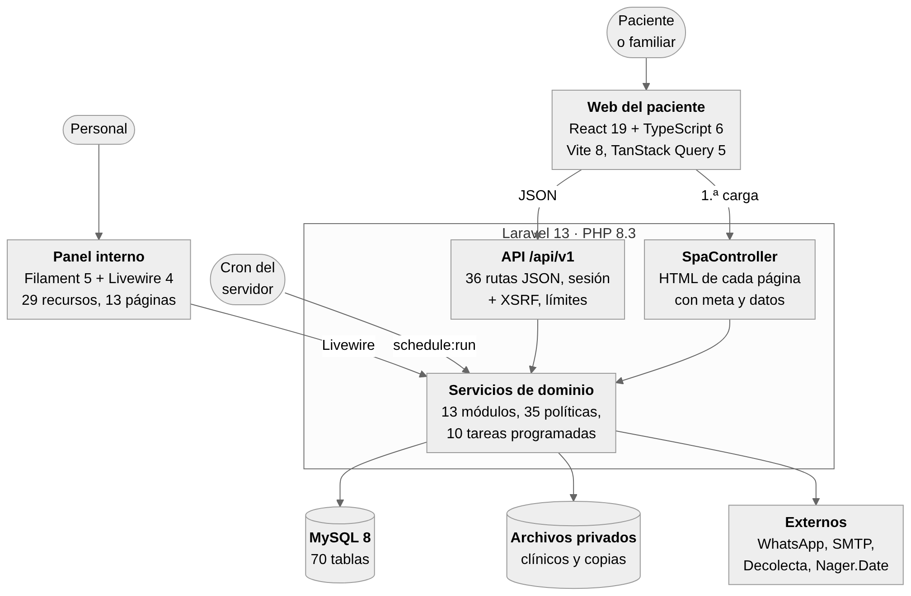
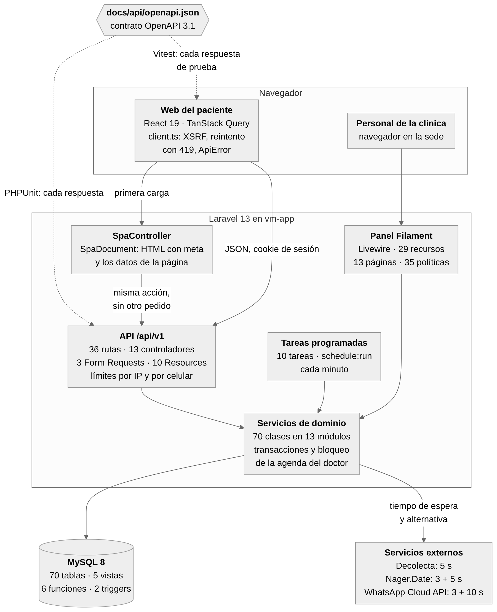
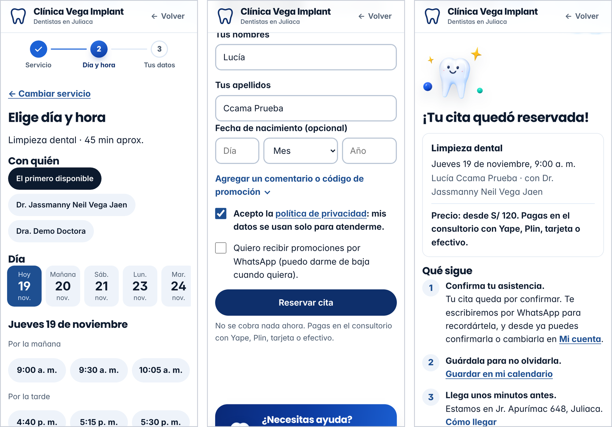
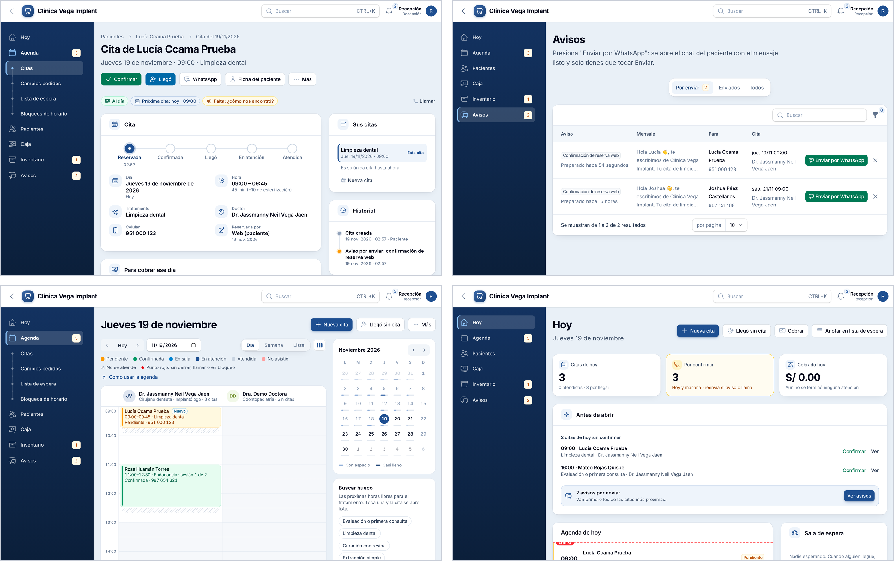
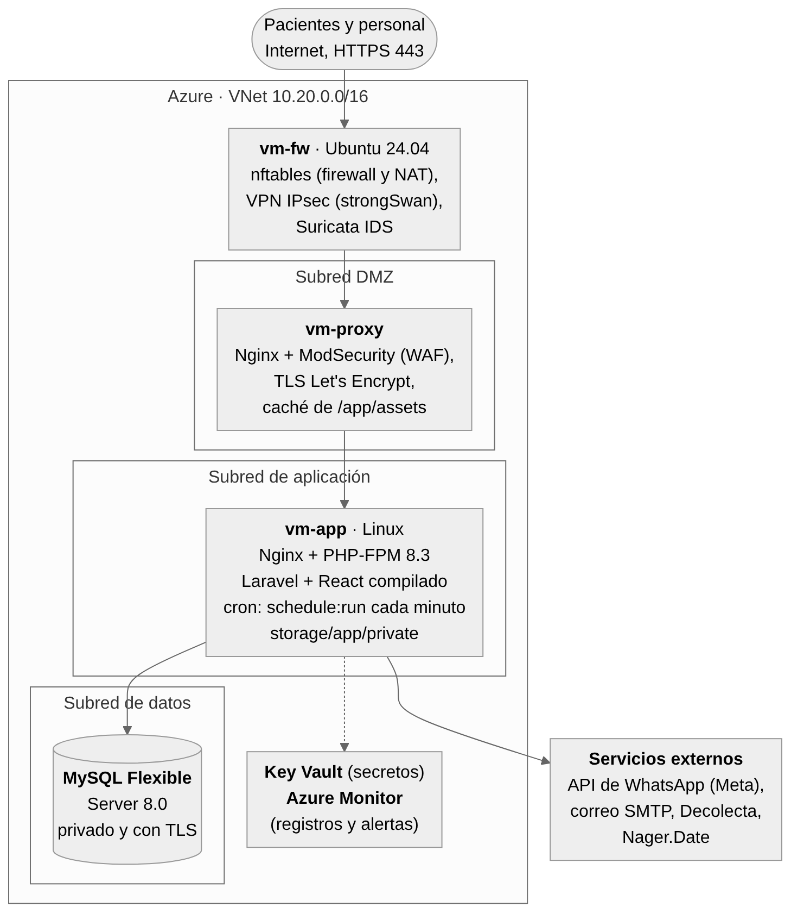

# Resumen ejecutivo

**Qué resuelve.** Clínica Vega Implant (Jr. Apurímac 648, Juliaca) necesita que sus pacientes reserven en línea y confirmen por WhatsApp sin llamar, que la agenda de cada doctor no tenga cruces, que la historia clínica, los presupuestos y los cobros estén en un solo lugar, y que los datos de salud se protejan según la Ley N.º 29733 (resumen ejecutivo del E1). Este entregable presenta el sistema que lo resuelve, funcionando y probado de punta a punta.

**Cómo se usa.** El paciente entra a la web desde su celular, sin contraseña: elige el tratamiento, el día y la hora, deja su nombre y su celular, y la cita queda reservada. Le llega un enlace personal por WhatsApp para confirmarla, cambiarla o cancelarla, y su celular queda recordado para "Mi cuenta". En la clínica, la misma cita aparece al instante en el panel: recepción la ve en "Hoy" y en la agenda, envía el aviso con un toque y, el día de la cita, marca la llegada y cobra; el doctor atiende y llena la historia clínica; el administrador configura el sistema y ve los reportes. La figura 3 y la figura 4 muestran una reserva real hecha así con los datos de demostración.

**Qué se entrega.** Todo dato de este documento sale del repositorio `venga-implantes` (rama de la FASE 3, sobre el commit `8c20db0`) o de un comando corrido el 19/11/2026 con los datos de demostración del seeder; nada viene de pacientes reales.

1. **Arquitectura e integración.** Un monolito modular en Laravel 13 con dos interfaces, la web del paciente (React 19) y el panel del personal (Filament 5), sobre los mismos 70 servicios de dominio y MySQL 8. La API `/api/v1` (36 rutas) quedó documentada en OpenAPI 3.1, y cada respuesta que piden las pruebas del backend y de la web se compara con ese contrato: así se encontraron y corrigieron siete diferencias entre la web y la API (sección 1.5).
2. **Funcionalidad.** Los flujos principales del E1 funcionan y tienen pruebas automáticas: reservar, confirmar o cambiar desde el enlace, Mi cuenta, agendar, avisar, atender, cobrar y cerrar caja, presupuestos y cuotas, reportes y copias de seguridad. Tres roles del personal con 35 políticas de permisos.
3. **Código.** 57 283 líneas de PHP en `backend/app` y 6 320 de TypeScript en `frontend/src`, con 1 092 pruebas en el backend y 141 en la web, todas en verde; Pint, ESLint, Prettier y TypeScript sin observaciones; la CI corre todo en cada cambio, también sobre MySQL 8.
4. **Desempeño y escalabilidad.** Las 16 rutas de lectura de la API responden con una mediana de 27 a 118 ms. A través del Nginx de producción, la web en un celular con 4G lenta muestra su contenido principal en 1,65 a 1,92 s (el límite de Google para una buena experiencia es 2,5 s), gracias a la compresión que se agregó en esta fase.
5. **Despliegue.** La instalación local se hace con los comandos de la sección 4.1, y el despliegue en Azure está escrito como código (Bicep, cloud-init y un workflow con OIDC, sin claves en GitHub).

Lo que solo puede hacer una persona (la URL de producción, las capturas del portal de Azure y la sustentación) va marcado `[PENDIENTE – estudiante]`.

# Arquitectura e integración

## Arquitectura general

El sistema es un **monolito modular** (ADR-01 del E1): una sola aplicación Laravel que se despliega junta, pero con cada regla del negocio en un único servicio de `app/Services`, y tres entradas que usan esos servicios por igual: la web del paciente, el panel del personal y las tareas programadas. Se eligió así porque la clínica tiene un solo local, dos doctores y una recepcionista: un sistema distribuido le habría sumado costo y puntos de falla sin beneficio (sección 3.1 del E1). La figura 1 muestra los contenedores, igual que en el diseño del E1, y la figura 2, cómo se comunican y cómo se comprueba esa comunicación.

<!-- figura: ../E1-requerimientos-y-diseno/diagramas/c2-contenedores.png 15cm -->



*Figura 1. Contenedores del sistema (C4 nivel 2), tal como se diseñaron en el E1 (figura 12) y como están implementados.*

Del diseño del E1 a la implementación solo cambió lo que el equipo decidió el 19/11/2026: no hay app móvil ni servicio de IA (ADR-12 y ADR-13, descartadas). La web del paciente es una aplicación React que se compila dentro de `backend/public/app` y se sirve desde el mismo dominio que la API, de modo que usa la sesión y la cookie de Laravel sin tokens aparte.

## Capas, módulos y componentes

El backend se ordena en capas: las **entradas** (controladores de la API, páginas y recursos de Filament, comandos de consola) solo validan, autorizan y responden; los **servicios** tienen las reglas; los **modelos** y la base guardan los datos. La tabla 1 mide cada capa.

*Tabla 1. Capas del backend (`backend/app`), contadas el 19/11/2026.*

| Capa | Carpeta | Archivos | Líneas | Qué hace |
| --- | --- | --: | --: | --- |
| Entrada web y API | `Http` | 42 | 3 232 | 13 controladores de la API, 3 Form Requests, 10 API Resources, 3 middleware y el documento de la web (`SpaController`). |
| Panel del personal | `Filament`, `Livewire` | 200 | 29 689 | 29 recursos, 13 páginas y sus widgets: agenda, pacientes, atención, caja, inventario, avisos, reportes y configuración. |
| Consola | `Console` | 11 | 400 | Los comandos que corre el cron: recordatorios, cuotas, lista de espera, WhatsApp, copias. |
| Servicios de dominio | `Services` | 70 | 13 723 | Las reglas, en 13 módulos (tabla 2). |
| Permisos | `Policies` | 35 | 1 487 | Qué puede ver y hacer cada rol, por modelo. |
| Dominio y datos | `Models`, `Enums` | 98 | 6 518 | 58 modelos Eloquent y 40 enums con los estados y tipos. |
| Apoyo | `Support`, `Exceptions`, `Providers` | 25 | 2 234 | Fechas, teléfonos, mensajes de error, excepciones del dominio, límites de peticiones y proxies de confianza. |
| **Total** | | **481** | **57 283** | |

*Tabla 2. Módulos de servicios (`app/Services`).*

| Módulo | Clases principales | Responsabilidad |
| --- | --- | --- |
| Booking | `AppointmentService`, `WebAvailability`, `AppointmentChange`, `WaitlistService` | Crear, mover y cancelar citas sin cruces; horarios libres para la web; lista de espera. |
| Agenda | `AvailabilityService`, `GapFinder`, `HolidayCalendar`, `LearnedDurations` | Horario de cada doctor, huecos, feriados y duración aprendida de cada tratamiento. |
| Access | `DeviceService`, `MagicLinkService`, `PatientAccess` | El celular recordado y los enlaces personales: el paciente entra sin contraseña. |
| Clinical | `ConsultationService`, `OdontogramService`, `PrescriptionService`, `TreatmentPlanService` | Atención, odontograma, recetas con alertas de alergias y presupuestos. |
| Billing | `BillingService`, `CashClosing`, `PaymentReceipt` | Cargos, pagos, constancias y cierre de caja. |
| WhatsApp | `WhatsAppOutbox`, `CloudApiChannel`, `CampaignBroadcast` | Los avisos: etapa 1 con `wa.me` y etapa 2 con la API de Meta. |
| Patients | `PatientRegistrar`, `DniLookup`, `PatientInsights` | Registro con los nombres de RENIEC y datos del paciente para el panel. |
| Web | `SpaDocument`, `PageMeta`, `StructuredData`, `ClinicInfo` | El HTML de cada página con su título, sus datos para Google y sus datos precargados. |
| Inventory, Reports, Dashboard, Backup, Database | `InventoryService`, `EarningsReport`, `TodayPulse`, `DatabaseBackup`, `DatabaseObjects` | Stock, reportes, tarjetas de "Hoy", copias de seguridad y objetos de MySQL. |

El frontend (`frontend/src`, 69 archivos y 6 320 líneas sin contar las pruebas) separa igual sus capas: `api/` habla con el servidor (`client.ts`, `queries.ts`, `actions.ts` y los tipos de cada respuesta), `pages/` tiene las páginas de las 16 rutas de la web, `components/` las piezas compartidas y `lib/` las funciones puras (fechas, textos, enlaces de WhatsApp). Ninguna página llama a `fetch` por su cuenta: todo pasa por `api/`. La vista de componentes del E1 (figuras 14 y 15) los detalla.

## Integración con la base de datos

La aplicación usa MySQL 8 a través de Eloquent; el modelo de datos, su implementación y su seguridad son el E2. Lo que importa aquí es cómo la usan las capas:

- **Esquema versionado.** Las 53 migraciones crean las 70 tablas y sus 143 llaves foráneas; `php artisan migrate` lleva cualquier base a la última versión, y la CI comprueba en cada cambio que `migrate` y la suite completa funcionan sobre MySQL 8.
- **Transacciones donde hay dinero o agenda.** Hay 48 bloques `DB::transaction` en 16 archivos. Al reservar, `AppointmentService::lockAgenda` bloquea la fila del doctor (`lockForUpdate`) dentro de la transacción: dos pacientes que eligen la misma hora al mismo tiempo no la pueden tomar los dos; el segundo recibe un 409 con `slot_taken` y la web le pide elegir otra (RNF-REN-01). Lo prueba `BookingControllerTest`.
- **Nada se borra (ADR-08).** 15 modelos usan borrado lógico y 40 registran cada alta, cambio y baja en `audit_logs` con el trait `Auditable` (fecha, usuario y valores anteriores y nuevos).
- **Objetos de MySQL.** Las 5 vistas, 6 funciones, 2 procedimientos y 2 triggers del E2 los instala `DatabaseObjects`; la aplicación no depende de ellos, así que la suite corre también con SQLite en memoria.
- **Sesión, caché y cola en la misma base** (`SESSION_DRIVER`, `CACHE_STORE` y `QUEUE_CONNECTION` en `database`): no hace falta otro servidor, y cualquier copia de la aplicación detrás de un balanceador ve las mismas sesiones (sección 3.6).

## Integración con servicios externos

El sistema se integra con cuatro servicios de terceros. Los tres que se llaman desde el servidor tienen un tiempo de espera y una alternativa propia (ADR-14 del E1), y sus pruebas no salen a internet: `Http::preventStrayRequests()` y `Http::fake()` simulan cada respuesta, también las caídas.

*Tabla 3. Servicios externos: qué sale, cuánto se espera (para conectar + para responder) y qué pasa si fallan.*

| Servicio | Qué sale | Espera | Si falla | Pruebas |
| --- | --- | --- | --- | --- |
| RENIEC por Decolecta (`DniLookup`): los nombres al registrar un paciente | Solo el DNI | 5 s | Los nombres se escriben a mano; sin consultas en el plan (429), se avisa; sin clave, la lupa no aparece | `DniLookupTest` |
| Nager.Date (`HolidayCalendar`): los feriados nacionales de la agenda | Solo el año | 3 + 5 s | Queda la lista propia (`PeruvianHolidays`) y se reintenta a los 10 minutos; con respuesta, se guarda un día | `HolidayCalendarTest` |
| API de WhatsApp de Meta (`CloudApiChannel`, etapa 2): los avisos salen solos | Celular y texto | 3 + 10 s | El aviso queda "fallido" con su motivo y el siguiente igual sale | `SendDueWhatsAppMessagesTest` |
| WhatsApp con `wa.me` (etapa 1, la de hoy): recepción abre el chat con el mensaje escrito | Nada desde el servidor | — | No depende de un servidor | `WhatsAppOutboxTest` |

En esta fase se corrigió una diferencia con el ADR-14: el envío por la API de Meta usaba la espera por defecto de Laravel (30 s), y con Meta caída una tanda de 50 avisos podía tardar más que los 5 minutos entre ejecuciones de `whatsapp:enviar`. Ahora espera a lo más 13 s por aviso, y una prueba nueva de `SendDueWhatsAppMessagesTest` confirma que un aviso sin respuesta queda fallido y el siguiente se envía. El correo (SMTP de Brevo en producción) solo se usa para recuperar contraseñas del panel.

## Integración entre capas: un contrato comprobado

La web y la API son dos programas escritos en dos lenguajes; si uno cambia la forma de una respuesta y el otro no, la página se rompe en producción aunque las pruebas de cada lado pasen. Para que eso no ocurra, la API tiene un contrato y las dos suites lo hacen cumplir (figura 2).

<!-- figura: diagramas/integracion-capas.png 13cm -->



*Figura 2. Cómo se comunican las capas y dónde se comprueba esa comunicación.*

- **El contrato** es `docs/api/openapi.json` (OpenAPI 3.1): las 36 operaciones de `/api/v1`, con sus parámetros, cuerpos, estados y 53 esquemas cerrados (un campo de más también es un error). Lo completa el requerimiento RF-API-01 del E1, que estaba planificado.
- **En el backend**, `TestCase` compara con el contrato cada respuesta JSON de `/api/v1` que pide cualquier prueba (`tests/Concerns/ChecksApiContract.php`): la ruta, el estado y la forma del cuerpo. Así, las pruebas que ya existían también prueban el contrato. `OpenApiTest` comprueba que cada ruta tenga su operación con el mismo nombre y que nada sobre, que las listas de valores sean las del código y que una respuesta fuera del contrato haga fallar la prueba que la pidió.
- **En la web**, `src/test/contract.ts` compara con el mismo archivo cada respuesta de mentira que usan las pruebas de React. Al activarlo encontró siete diferencias reales entre lo que las pruebas suponían y lo que la API responde (por ejemplo, la reserva responde 201 y no 200, y un horario que se ocupó al cambiar una cita responde 422 y no 409); se corrigieron en las pruebas.
- **La primera carga no espera a la API.** `SpaDocument` ejecuta dentro del mismo pedido la acción de la API que la página necesita y la deja en el HTML junto con el título y los datos para Google; la web la usa sin otro pedido y de ahí en adelante navega pidiéndole a la API (`SpaControllerTest`).

# Funcionalidad del sistema

## Flujos principales

Los flujos son los del E1 (figuras 1 y 2 y casos de uso de la sección 4.1); la tabla 4 dice dónde está cada uno en el código y qué lo prueba. La matriz de trazabilidad del anexo A del E1 baja el mismo detalle a cada uno de los 87 requerimientos.

*Tabla 4. Flujos principales implementados y sus pruebas.*

| Flujo | Quién | Dónde | Pruebas |
| --- | --- | --- | --- |
| Reservar una cita en tres pasos | Paciente | `/reservar`; `BookingController`, `AppointmentService`, `WebAvailability` | `BookingControllerTest`, `AppointmentServiceTest`, `WebAvailabilityTest`, `BookingPage.test.tsx` |
| Confirmar, cambiar o cancelar desde el enlace de WhatsApp | Paciente | `/c/{token}`; `LinkController`, `MagicLinkService` | `LinkControllerTest`, `LinkPage.test.tsx`, `ChangePage.test.tsx` |
| Mi cuenta con el celular recordado, y la salud antes de la cita | Paciente | `/mi-cuenta`; `AccountController`, `HealthController`, `DeviceService` | `AccountControllerTest`, `HealthControllerTest`, `AccountPage.test.tsx`, `HealthPage.test.tsx` |
| Agendar, mover, sobrecupo, lista de espera | Recepción | Agenda, "Nueva cita"; `AppointmentService`, `GapFinder`, `WaitlistService` | `AgendaPanelTest`, `NewAppointmentWindowTest`, `EasierSchedulingTest`, `WaitlistServiceTest` |
| Avisos por WhatsApp: confirmación, recordatorio, sin confirmar | Recepción y cron | Avisos; `WhatsAppOutbox`, `citas:preparar-recordatorios`, `whatsapp:enviar` | `WhatsAppOutboxTest`, `PrepareRemindersTest`, `FlagUnconfirmedAppointmentsTest` |
| Llegada, atención clínica, odontograma y receta | Recepción y doctor | "Llegó", "Atender"; `ConsultationService`, `OdontogramService`, `PrescriptionService` | `ArrivalChecklistTest`, `AttendScreenTest`, `ClinicalPanelTest`, `PatientSafetyChecksTest` |
| Cobrar, constancia y cierre de caja | Recepción | Caja; `BillingService`, `CashClosing` | `CollectingAndReceiptsTest`, `DailyClosingTest`, `CashClosingPanelTest` |
| Presupuesto firmado y cuotas | Doctor y recepción | Presupuestos, Cuotas; `TreatmentPlanService` | `TreatmentPlanPanelTest`, `TreatmentPlanPaymentsTest`, `ChargeDueInstallmentsTest` |
| Reportes de ingresos y saldos | Administrador | Reportes; `EarningsReport`, `MoneyWaiting` | `EarningsReportTest`, `ReportsPanelTest`, `MoneyWaitingReportTest` |
| Copias de seguridad diarias | Cron y administrador | `respaldo:crear`, Copias de seguridad; `DatabaseBackup` | `DatabaseBackupTest`, `FilesBackupTest`, `BackupsPanelTest` |

## Usuarios, roles y permisos

Hay dos tipos de usuario. El **paciente** no tiene contraseña (ADR-10): entra con su celular recordado, que se asocia la primera vez que reserva o abre su enlace personal, y con enlaces personales que llegan por WhatsApp, con un código al azar de 32 caracteres que vence; cada pedido de Mi cuenta comprueba que el paciente sea de ese celular. El **personal** entra al panel con correo y contraseña propia, que debe cambiar en su primer ingreso (`OwnPasswordAtFirstLoginTest`), y tiene uno de tres roles (`UserRole`).

*Tabla 5. Roles del personal.*

| Rol | Qué hace | Qué no puede |
| --- | --- | --- |
| Recepción | Agenda de todos los doctores, avisos, cobros, caja, cuotas e inventario | Ver lo clínico (historia, odontograma, recetas), reportes y configuración |
| Doctor | Su agenda, la historia clínica de sus pacientes, presupuestos y recetas | Caja, la agenda de otro doctor y la configuración del consultorio |
| Administrador | Todo lo anterior, configuración, página web, reportes, copias y auditoría; lo clínico solo si es odontólogo | — |

Los permisos no están repartidos por las pantallas: viven en 35 políticas, una por modelo, y Filament y los controladores las consultan antes de mostrar o guardar algo. `PanelAccessTest` abre cada pantalla con cada rol y comprueba lo que ve, y `PanelNavigationTest` el menú de cada uno (tabla 6 del E1). Lo clínico solo lo ve quien atiende, como pide la Ley N.º 29733 (ADR-11).

## Evidencias de funcionamiento

Las figuras 3 y 4 siguen una sola reserva de punta a punta, hecha el 19/11/2026 sobre el sistema corriendo con los datos de demostración (`evidencias/capturas-e3.cjs`, con Playwright). Una paciente nueva, inventada para la prueba, reserva una limpieza dental desde un celular; sin que nadie toque nada, la misma cita aparece en el panel de recepción con su aviso de WhatsApp listo para enviar.

<!-- figura: evidencias/capturas/e3-figura-reserva-web.png 15cm -->



*Figura 3. La paciente reserva desde el celular: elige día y hora entre los horarios libres de los dos doctores, deja sus datos y acepta la política de privacidad, y ve su cita reservada con lo que sigue.*

<!-- figura: evidencias/capturas/e3-figura-reserva-panel.png 16cm -->



*Figura 4. La misma cita en el panel de recepción: la ficha de la cita, reservada por la web; el aviso de confirmación listo en Avisos; la cita marcada "Nuevo" en la agenda del día; y "Hoy", que la cuenta entre las citas por confirmar.*

Las demás pantallas del sistema (atención clínica, presupuesto, caja, cierre, reportes, Mi cuenta y el enlace personal) están en la sección 2.3 del E1, capturadas del mismo sistema, y en el anexo C de este entregable. La demostración en vivo es parte de la sustentación `[PENDIENTE – estudiante: grabar un video corto de este mismo recorrido en producción y anotar su enlace en el anexo C]`.

# Código y diseño técnico

## Estructura del repositorio

*Tabla 6. Estructura del repositorio `venga-implantes`.*

| Carpeta | Qué tiene |
| --- | --- |
| `backend/` | La aplicación Laravel: `app/` (tabla 1), `routes/` (`web.php`, `api.php` con las 36 rutas y `console.php` con las tareas programadas), `database/` (53 migraciones, factories, seeders y los scripts SQL del E2), `resources/views` (el documento de la web, impresiones y vistas del panel) y `tests/` (151 archivos de prueba). |
| `frontend/` | La web del paciente: `src/api`, `src/pages`, `src/components`, `src/lib`, `src/styles` y `src/test` (fixtures, la API de mentira y el contrato). |
| `docs/api/` | `openapi.json`, el contrato de la API. |
| `docs/entregables/` | Los entregables de la EPE en Markdown, sus diagramas y evidencias, y el guion que genera los Word. |
| `infra/` | El despliegue en Azure: plantillas Bicep, cloud-init de cada VM, configuración de Nginx, scripts de publicación y copias, y las reglas del firewall (`vm-fw`). |
| `.github/workflows/` | `tests.yml` (pruebas en cada cambio) y `desplegar-azure.yml` (publicación manual en producción). |

## Patrones y buenas prácticas aplicadas

*Tabla 7. Patrones del diseño y dónde se aplican.*

| Patrón o práctica | Dónde | Para qué |
| --- | --- | --- |
| Capa de servicios | `app/Services` | Una regla, un lugar: la web, el panel y el cron reservan con el mismo `AppointmentService`. |
| Políticas (autorización por modelo) | `app/Policies` | Los permisos se prueban una vez y valen en todas las pantallas. |
| Form Request y API Resource | `app/Http/Requests`, `app/Http/Resources` | La validación y la forma de cada respuesta quedan fuera del controlador. |
| Enums con comportamiento | `app/Enums` (40) | Los estados de una cita o un pago y sus textos en un solo lugar, sin cadenas sueltas. |
| Inyección de dependencias | Constructores de servicios y comandos | Cada pieza se prueba sola y se cambia sin tocar a quien la usa (`CloudApiChannel` por `wa.me`). |
| Bandeja de salida (outbox) | `WhatsAppOutbox`, `whatsapp_messages` | El aviso se guarda en la misma transacción que la cita y sale después: si WhatsApp falla, la cita no se pierde. |
| Trait de auditoría | `Models/Concerns/Auditable` | 40 modelos dejan rastro sin repetir código. |
| Contrato primero en la API | `docs/api/openapi.json` | Backend y frontend se prueban contra el mismo documento (sección 1.5). |
| Consultas de servidor en el cliente | TanStack Query en `api/queries.ts` | Caché, reintentos y estados de carga iguales en todas las páginas. |
| Pruebas como documentación | 986 métodos de prueba con nombres en inglés que se leen como reglas | `test_a_time_taken_meanwhile_sends_the_patient_back_to_choose_another` dice qué garantiza el sistema. |

Las convenciones se hacen cumplir con herramientas, no con revisiones a mano: Pint para el formato de PHP, ESLint y Prettier para el de TypeScript, y `tsc` en modo estricto; los cuatro corren en la CI y el 19/11/2026 no dieron ninguna observación.

## Modularidad y desacoplamiento

- **Las entradas no tienen reglas.** Un controlador de la API valida con su Form Request, llama a un servicio y devuelve un Resource; una acción de Filament hace lo mismo. Por eso la reserva de la web y la del panel no pueden comportarse distinto.
- **El dominio no conoce la interfaz.** Los servicios no devuelven HTML ni JSON y no leen la sesión; lanzan excepciones del dominio (`BookingException`, `ClinicalException`, `InventoryException`, `DniLookupException`) que cada entrada traduce a su manera.
- **Los servicios externos están detrás de una clase propia.** Cambiar Decolecta por otro proveedor, o pasar WhatsApp de la etapa 1 a la 2, es cambiar `DniLookup` o la variable `WHATSAPP_DRIVER`, sin tocar quien los usa.
- **La web y el servidor se separan por el contrato.** El frontend solo conoce `docs/api/openapi.json`; podría servirse desde otro lugar sin cambiar el backend, y la API está versionada (`/api/v1`) para poder cambiarla sin romper a quien ya la usa.
- **La configuración vive fuera del código.** Todo lo que cambia entre local y producción sale de variables de entorno (sección 4.2), y lo que cambia la clínica (horarios, anticipación, textos) sale de la tabla `settings` y se edita en el panel.

## Manejo de errores y validaciones

*Tabla 8. Errores y validaciones por capa.*

| Capa | Cómo valida o maneja el error | Qué ve el usuario | Evidencia |
| --- | --- | --- | --- |
| Base de datos | Llaves foráneas, valores únicos y tipos (E2); transacción y bloqueo en la agenda | Nada: lo que no cumple no se guarda | `MysqlDatabaseObjectsTest`, suite sobre MySQL 8 en la CI |
| Servicios | Reglas del negocio con excepciones del dominio y mensajes en español | "Ese horario se acaba de ocupar. Por favor elige otro." | `AppointmentServiceTest`, `TreatmentRulesTest` |
| API | Form Requests: 422 con el error de cada campo; datos de otro tipo también dan 422 y no 500; 409 con un código cuando algo cambió; 429 con límites por IP y por celular | El mensaje junto al campo que hay que corregir | `BookingControllerTest`, `ApiErrorsTest` |
| Laravel (errores no previstos) | `bootstrap/app.php` cambia el mensaje de los 403, 404, 405, 419, 429 y 5xx por uno en español (`ApiErrorMessage`), sin nombres de clases ni detalles internos; el detalle va al registro de errores | "No encontramos lo que buscas…" | `ApiErrorsTest` |
| Web | `client.ts` convierte toda respuesta fallida en un `ApiError` con su estado y sus errores por campo; con 419 renueva la sesión y reintenta una vez; lo que el paciente escribió no se pierde | La página de error o el mensaje en el formulario | `client.test.ts`, `BookingPage.test.tsx` |
| Panel | Validación de Filament en cada formulario y notificaciones con el motivo; nada se borra sin motivo | El campo marcado y un aviso | `ModalSubmitButtonsTest`, `UndoLastStepTest` |

En esta fase la revisión de la API encontró y corrigió los casos en que un dato de otro tipo daba un error 500 en vez de un 422 (por ejemplo, un filtro enviado como lista, `?codigo[]=x`), validó el motivo de cancelación antes de usar el enlace y unificó los mensajes de error en español; las cinco pruebas de `ApiErrorsTest` fallan sin ese cambio.

## Desempeño

El E1 fijó como meta (RNF-REN-02) que las rutas principales de la API respondan bajo 500 ms y que la web cargue rápido en un celular. Se midió el 19/11/2026 con los datos de demostración (260 cuentas, 262 pacientes y 861 citas) en un contenedor de 4 vCPU, con el servidor de desarrollo de PHP, que es más lento que producción (sin OPcache ni PHP-FPM): las cifras son un techo. Los scripts quedan en `evidencias/` para repetir la medición en producción.

*Tabla 9. Desempeño medido (detalle en `evidencias/medicion-api.md` y `evidencias/medicion-web.md`).*

| Qué | Cómo | Resultado | Meta |
| --- | --- | --- | --- |
| API: 16 rutas de lectura | 30 pedidos por ruta (`medir-api.sh`) | Mediana de 27 a 43 ms; la más pesada, `booking/days` (12 días de horarios), 118 ms con un percentil 95 de 142 ms | Bajo 500 ms: se cumple |
| Web en celular, 5 páginas, a través del Nginx de producción | Chromium con red 4G lenta y procesador 4 veces más lento (`medir-web.cjs`) | Contenido principal (LCP) en 1 652 a 1 924 ms; sin saltos de diseño (CLS 0) ni bloqueos (TBT 0) | LCP hasta 2 500 ms, CLS hasta 0,1, TBT hasta 200 ms: se cumple |
| Accesibilidad automática de las mismas 5 páginas | Idioma, títulos, textos alternativos, nombres de controles y contraste WCAG AA | Sin observaciones, después de corregir el contraste del botón de WhatsApp (de 4,30:1 a 4,87:1) | RNF-USA-03 |

La medición encontró un problema real en la configuración de producción: el Nginx de Ubuntu solo comprime el HTML, así que el JavaScript de la web viajaba con sus 459 KB y la página tardaba unos 3,5 s en mostrarse en el celular. Se agregó la compresión de JavaScript, CSS y SVG a `infra/nginx/proxy.conf` (el JavaScript baja a 139 KB) y se volvió a medir con esa misma configuración: de ahí salen las cifras de la tabla 9. El JSON de la API no se comprime porque lleva datos del paciente y comprimirlo sobre HTTPS facilita el ataque BREACH. El puntaje de Lighthouse sobre la URL de producción queda `[PENDIENTE – estudiante: correr Lighthouse en modo celular sobre la URL de Azure y anotar el puntaje en evidencias/medicion-web.md]`.

Otras decisiones que cuidan el desempeño: los índices de la agenda del E2 (de leer 861 filas a 5); la caché de un minuto de los próximos horarios libres de la web (`WebAvailability`) y de cinco minutos de las cifras del mes en "Hoy"; `Model::shouldBeStrict()`, que en desarrollo y en las pruebas hace fallar toda carga perezosa de relaciones, así que un listado con consultas N+1 no llega a producción; y la caché de una semana de los archivos de la web en el proxy.

## Escalabilidad

El sistema se diseñó para un solo servidor (ADR-06), que es lo que la clínica necesita hoy, pero sin decisiones que impidan crecer. La tabla 10 dice qué ya está listo y qué habría que cambiar si la clínica abre otra sede o la web recibe mucho más tráfico.

*Tabla 10. Qué está listo para escalar y qué cambiaría.*

| Dimensión | Hoy | Para crecer |
| --- | --- | --- |
| Más servidores de aplicación | La aplicación no guarda estado en el servidor: sesión, caché y cola están en MySQL, y los proxies de confianza se configuran (`TRUSTED_PROXIES`, `TrustedProxiesTest`) | Poner varias `vm-app` detrás del proxy; los archivos clínicos (`storage/app/private`) pasarían a Azure Blob, que ya se usa para las copias |
| Más carga en la base | Índices medidos (E2), consultas sin N+1 (`Model::shouldBeStrict()`), caché de lo que más se pide | Pasar sesión y caché a Redis con solo cambiar `SESSION_DRIVER` y `CACHE_STORE`; réplica de lectura para los reportes |
| Más avisos y tareas | Cola en la base y `queue:work` cada minuto; tareas con `withoutOverlapping` | Un proceso de cola permanente con Supervisor, sin cambiar el código |
| Más tráfico en la web | Archivos con nombre por versión y caché de 7 días en el proxy; compresión; la primera carga trae los datos de la página en el HTML, sin pedirlos a la API | Una CDN delante del proxy; dividir el JavaScript por página (hoy es un solo archivo de 139 KB comprimido) |
| Otra sede u otro doctor | Doctores, horarios, tratamientos y textos se configuran en el panel, sin código | Agregar la sede como dato de la agenda (nueva migración) |
| Nuevos clientes de la API | API versionada (`/api/v1`) y documentada en OpenAPI | Una `/api/v2` convive con la actual; un cliente móvil necesitaría tokens (ADR-12, descartada por ahora) |

# Despliegue o instalación

## Instrucciones de instalación

Para correr el sistema en una computadora (el manual técnico del anexo B tiene el detalle y los problemas conocidos) hace falta PHP 8.3 o superior, Composer, MySQL 8 y Node 22. Desde la raíz del repositorio:

```bash
cd backend
composer install
cp .env.example .env && php artisan key:generate   # completar DB_* en .env
php artisan migrate --seed                          # crea las tablas y los datos de demostración
npm --prefix ../frontend install
composer dev                                        # Laravel en http://localhost:8000 y Vite
```

El panel queda en `/panel` con los usuarios de demostración `admin@consultorio.test` y `recepcion@consultorio.test` (la clave está en el `DemoSeeder` y en el `README.md`). Para un servidor, la web se compila con `npm --prefix frontend run build` y se sirve solo con Laravel.

## Configuración requerida

Toda la configuración sale del archivo `.env` (plantilla en `backend/.env.example`; la de producción, sin secretos, en `infra/env/produccion.env`). Los secretos nunca están en el repositorio: en Azure van en Key Vault y `deploy-app.sh` los junta con el resto al publicar.

*Tabla 11. Variables de entorno por grupo (sin valores).*

| Grupo | Variables | Secreto |
| --- | --- | --- |
| Aplicación | `APP_KEY`, `APP_URL`, `APP_ENV`, `APP_DEBUG`, `APP_TIMEZONE`, `TRUSTED_PROXIES` | `APP_KEY` |
| Base de datos | `DB_HOST`, `DB_DATABASE`, `DB_USERNAME`, `DB_PASSWORD`, `MYSQL_ATTR_SSL_CA` | `DB_PASSWORD` |
| Sesión, caché y cola | `SESSION_DRIVER`, `SESSION_SECURE_COOKIE`, `CACHE_STORE`, `QUEUE_CONNECTION` | No |
| Correo | `MAIL_MAILER`, `MAIL_HOST`, `MAIL_PORT`, `MAIL_USERNAME`, `MAIL_PASSWORD`, `MAIL_FROM_ADDRESS` | `MAIL_PASSWORD` |
| WhatsApp | `CLINIC_WHATSAPP`, `WHATSAPP_DRIVER`, `WHATSAPP_CLOUD_TOKEN`, `WHATSAPP_PHONE_NUMBER_ID`, `REMINDERS_AT`, `FLAG_UNCONFIRMED_AT` | `WHATSAPP_CLOUD_TOKEN` |
| RENIEC (Decolecta) | `DNI_LOOKUP_TOKEN`, `DNI_LOOKUP_URL` | `DNI_LOOKUP_TOKEN` |
| Copias | `BACKUPS_KEEP` | No |

Además, el servidor necesita un único cron, `* * * * * php artisan schedule:run`, que corre las 10 tareas programadas: recordatorios, citas sin confirmar y avisos de cuotas cada 15 minutos; lista de espera y envío por WhatsApp cada 5; la cola cada minuto; los cargos de cuotas a las 6:00; la limpieza de registros vencidos una vez al día; la duración aprendida de cada tratamiento a las 2:30 y la copia de seguridad a las 3:00.

## Despliegue en Microsoft Azure

El despliegue sigue la vista de despliegue del E1 (figura 5) y está escrito como código en `infra/` (PR #13, unido a `main` el 19/11/2026): dos plantillas Bicep crean la red de producción y la de la sede de la clínica, cada VM se configura con cloud-init, y `infra/desplegar.sh` crea, enciende, apaga y muestra el estado de todo desde Cloud Shell.

<!-- figura: ../E1-requerimientos-y-diseno/diagramas/despliegue-azure.png 13cm -->



*Figura 5. Despliegue en Azure (figura 13 del E1): el firewall `vm-fw` como única entrada, el proxy con WAF en la DMZ, la aplicación sin IP pública y MySQL privado con TLS.*

Cada versión se publica así, sin claves guardadas en GitHub:

1. **Pruebas.** Cada cambio pasa por `tests.yml` (sección 4.4), que también arma el paquete `consultorio-para-hosting`.
2. **Publicación.** El workflow `desplegar-azure.yml`, que corre solo desde `main` (a mano o, con `DESPLIEGUE_AUTOMATICO=true`, después de cada CI en verde; E4, sección 2.1), compila la web, arma el paquete, entra a Azure con OIDC (GitHub firma un token que solo acepta la identidad de despliegue), lo sube a Blob y le pide a `vm-app` que corra `remoto-publicar.sh`.
3. **En `vm-app`**, `deploy-app.sh` deja la versión en su propia carpeta (`releases/<fecha>`), enlaza el `.env` y los archivos compartidos, corre `composer install --no-dev`, `migrate --force` y `optimize`, y recién al final cambia el enlace `current`. Quedan las últimas cinco versiones: volver a la anterior es cambiar ese enlace, con la acción `volver` del mismo workflow.
4. **Comprobación.** El workflow pide `/up` y falla si la web no responde.

## Evidencia de despliegue y ejecución

*Tabla 12. Ejecución comprobada el 19/11/2026.*

| Evidencia | Resultado |
| --- | --- |
| Suite del backend (`php artisan test`, SQLite en memoria) | 1 092 pruebas (986 métodos, algunos con varios casos) y 10 532 comprobaciones, todas en verde, en 209 s; Pint sin observaciones. Las 13 pruebas del grupo `mysql` corren en la CI sobre MySQL 8 |
| Suite de la web (`npm test`), tipos, ESLint y Prettier | 141 pruebas en 19 archivos, todas en verde; `tsc`, ESLint y Prettier sin observaciones |
| CI en GitHub Actions (`tests.yml`): backend, MySQL 8, web y paquete | Backend, MySQL 8 y web en verde sobre `8c20db0` (ejecución 44484849601); el paquete se arma solo en `main` |
| Sistema corriendo con los datos de demostración | La reserva de las figuras 3 y 4, las mediciones de la tabla 9 y la configuración de Nginx de producción probada con Nginx 1.24 (`nginx -t`) |
| Producción en Azure | `[PENDIENTE – estudiante: URL pública, captura del grupo de recursos en el portal, ejecución del workflow "Desplegar en Azure" y respuesta de /up]` |

# Anexos

Los anexos van en un Word aparte, `CE023-S2-E3-Sistema-de-Software-Funcional-Integrado-Anexos.docx`:

- **A.** El repositorio fuente: dirección, ramas, versión entregada y cómo se obtiene.
- **B.** El manual técnico breve: instalar, configurar, publicar, operar y resolver los errores conocidos.
- **C.** Las capturas de funcionamiento: la reserva de punta a punta en tamaño completo y el índice de las demás pantallas.
- **D.** La evidencia de despliegue y ejecución: las rutas de la API, los resultados de las pruebas y las mediciones.
- **E.** La evidencia de la sustentación ante el docente `[PENDIENTE – estudiante]`.

Todos los archivos de este entregable están en `docs/entregables/E3-sistema-funcional` y el contrato de la API en `docs/api/openapi.json`.
